# Contenido {#contenido .TOC-Heading}

[Laboratorio 0 [2](#laboratorio-0)](#laboratorio-0)

[Aprovisione un espacio de trabajo de Azure Databricks Premium
[2](#aprovisione-un-espacio-de-trabajo-de-azure-databricks-premium)](#aprovisione-un-espacio-de-trabajo-de-azure-databricks-premium)

[Tarea 1: Abrir Azure Cloud Shell
[2](#tarea-1-abrir-azure-cloud-shell)](#tarea-1-abrir-azure-cloud-shell)

[Tarea 2: Ejecutar el script de aprovisionamiento
[2](#tarea-2-ejecutar-el-script-de-aprovisionamiento)](#tarea-2-ejecutar-el-script-de-aprovisionamiento)

[Tarea 3: Abrir el espacio de trabajo de Azure Databricks
[2](#tarea-3-abrir-el-espacio-de-trabajo-de-azure-databricks)](#tarea-3-abrir-el-espacio-de-trabajo-de-azure-databricks)

[Laboratorio 1 [5](#laboratorio-1)](#laboratorio-1)

[Ejercicio 1: Navegar por la interfaz de usuario del espacio de trabajo
de Azure Databricks
[5](#ejercicio-1-navegar-por-la-interfaz-de-usuario-del-espacio-de-trabajo-de-azure-databricks)](#ejercicio-1-navegar-por-la-interfaz-de-usuario-del-espacio-de-trabajo-de-azure-databricks)

[Tarea 1: Explorar la barra lateral del espacio de trabajo
[5](#tarea-1-explorar-la-barra-lateral-del-espacio-de-trabajo)](#tarea-1-explorar-la-barra-lateral-del-espacio-de-trabajo)

[Tarea 2: Explorar el código Genie
[7](#tarea-2-explorar-el-código-genie)](#tarea-2-explorar-el-código-genie)

[Tarea 3: Cargar un conjunto de datos de transporte de ejemplo
[7](#tarea-3-cargar-un-conjunto-de-datos-de-transporte-de-ejemplo)](#tarea-3-cargar-un-conjunto-de-datos-de-transporte-de-ejemplo)

[Importar el cuaderno de laboratorio
[10](#importar-el-cuaderno-de-laboratorio)](#importar-el-cuaderno-de-laboratorio)

# 

# Laboratorio 0

## Aprovisione un espacio de trabajo de Azure Databricks Premium

### Tarea 1: Abrir Azure Cloud Shell

Iniciamos sesión en azre y iniciamos una powe Shell una vez iniciada
ejecutamos el siguiente comando par descargar el script de
aprovisionamiento

### Tarea 2: Ejecutar el script de aprovisionamiento

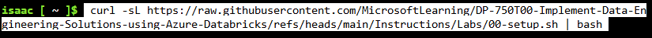{width="5.905555555555556in"
height="0.3506944444444444in"}

Esto tardara unos 5 minutos

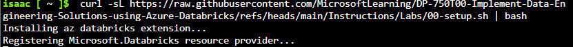{width="5.905555555555556in"
height="0.49027777777777776in"}

Una vez finalizada la descarga nos saldrá esto

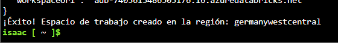{width="5.834146981627296in"
height="0.7501049868766404in"}

### Tarea 3: Abrir el espacio de trabajo de Azure Databricks

Cerramos la consola y en la barra de búsqueda buscamos azure databricks
y lo abrimos

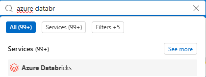{width="4.3756102362204725in"
height="1.6460629921259842in"}

Al entrar veremos unn espacio de trabajo llamado adp-dp750

{width="5.905555555555556in"
height="0.40208333333333335in"}

Pulsamos en ella y selecionamos en iniciar espacio

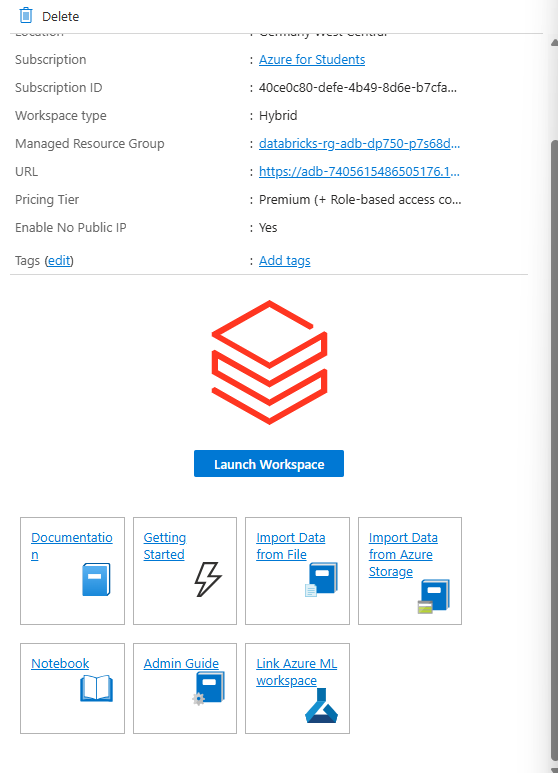{width="5.813311461067366in"
height="8.053207567804025in"}

Lo que nos lo abrirá en una pestaña nueva

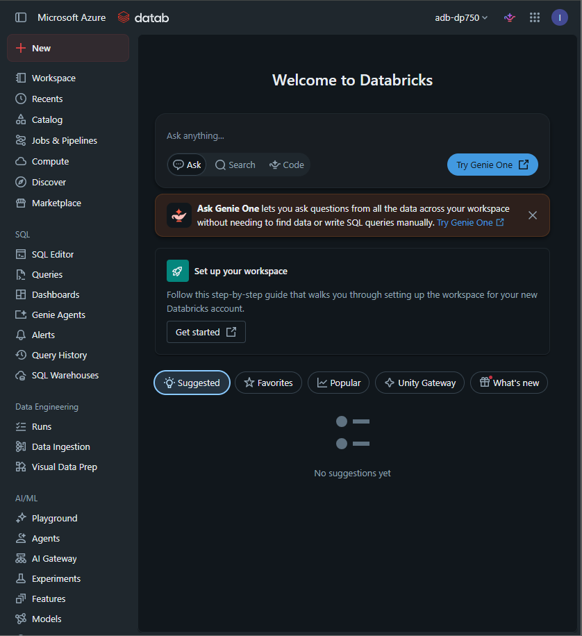{width="5.905555555555556in"
height="6.454861111111111in"}

# Laboratorio 1

## Ejercicio 1: Navegar por la interfaz de usuario del espacio de trabajo de Azure Databricks

### Tarea 1: Explorar la barra lateral del espacio de trabajo

Observamos la barra de opciones de la zona lateral

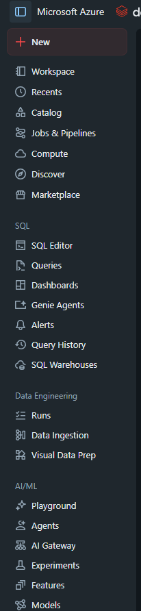{width="2.1461329833770777in"
height="9.292963692038494in"}

### Tarea 2: Explorar el código Genie

Buscamos el icono de genie code y lo pulsamos

{width="0.3125437445319335in"
height="0.2500349956255468in"}

En el cuadro de texto escribimos esto

{width="5.905555555555556in"
height="1.5930555555555554in"}

Esto en unos segundos nos dará unos resultados

### Tarea 3: Cargar un conjunto de datos de transporte de ejemplo

En la barra lateral de databricks hacemos click en catalogo y le damos a
crear volumen y lo llamamos lab_data

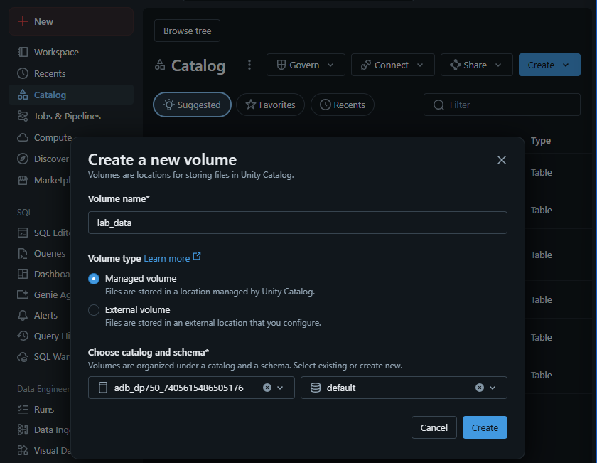{width="5.905555555555556in"
height="4.577083333333333in"}

Una vez creado en la barra lateral del espacio de trabajo hacemos click
en nuevo y agregar o cargar datos

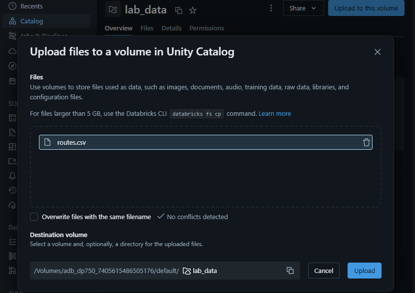{width="5.905555555555556in"
height="4.1715277777777775in"}

Comprobamos que el csv este presente

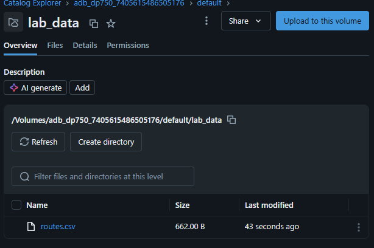{width="5.905555555555556in"
height="3.923611111111111in"}

## Importar el cuaderno de laboratorio

En la barra lateral seleccionamos workspace y navegamos hasta la carpeta
en la que se almacenara el lab

Y importamos el archivo

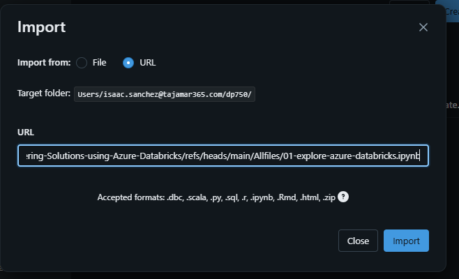{width="5.905555555555556in"
height="3.589583333333333in"}

Tras esto se nos abrirá el cuaderno

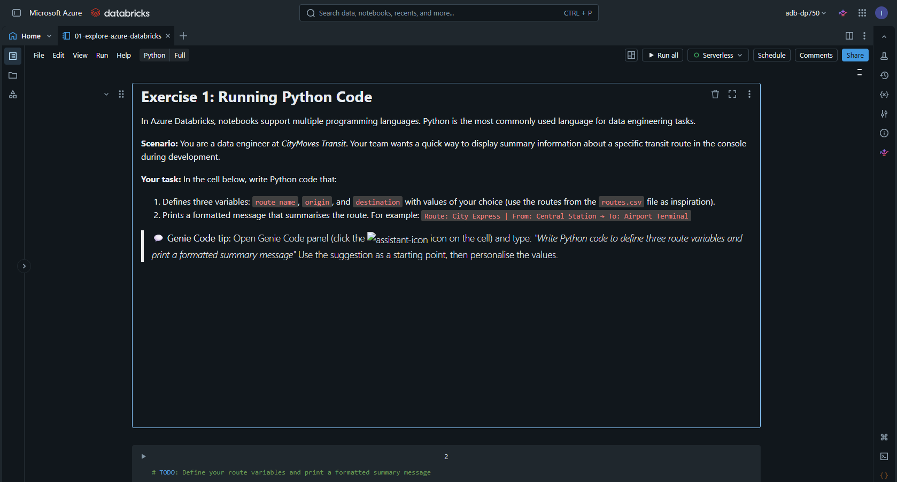{width="5.905555555555556in"
height="3.1743055555555557in"}
