# Provision an Azure SQL Database

Creación de la bbdd con los datos aportados por el laboratorio

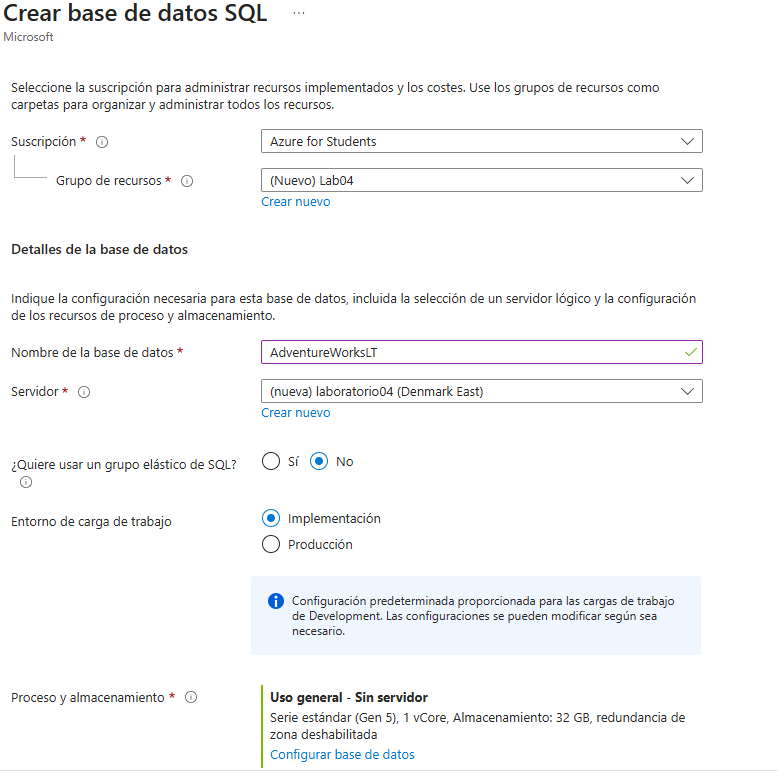{width="5.905555555555556in"
height="5.928472222222222in"}

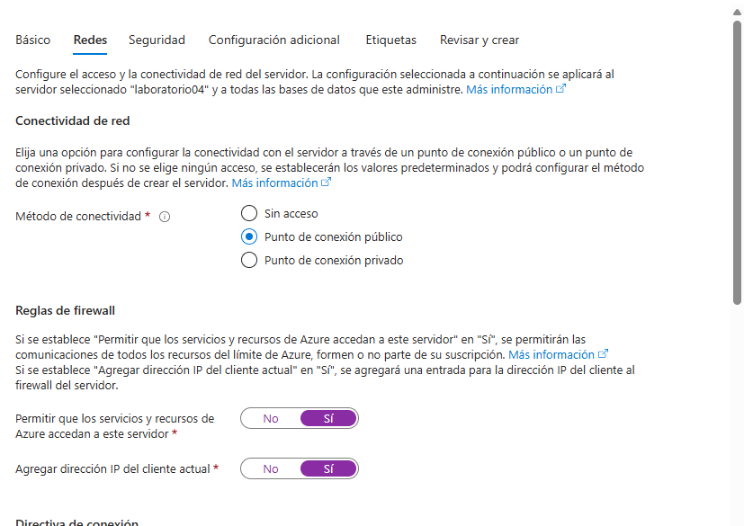{width="5.905555555555556in"
height="4.177777777777778in"}

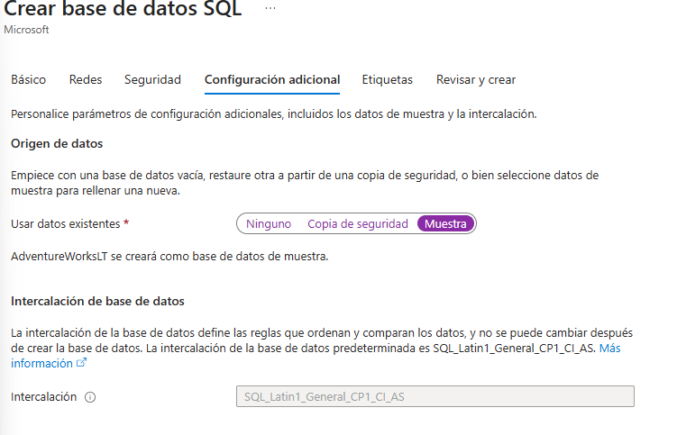{width="5.905555555555556in"
height="3.798611111111111in"}

# Set up Visual Studio Code with GitHub Copilot

Login en visual studio con github e instalación de las extensiones de
github copilot y de sql server

{width="5.905555555555556in"
height="2.704861111111111in"}

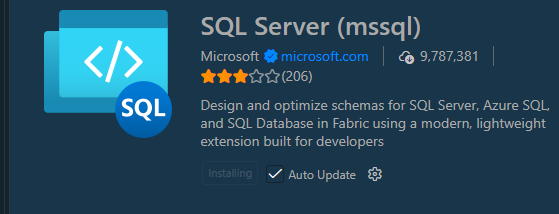{width="5.823729221347332in"
height="2.229478346456693in"}

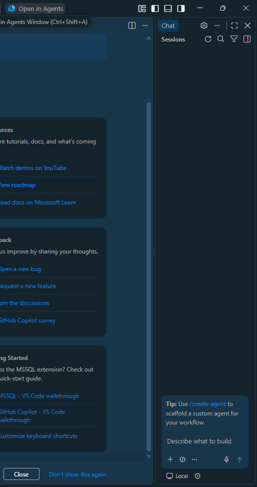{width="5.131944444444445in"
height="9.725in"}

# Connect to the Azure SQL Database

Conexión con la ddbb creada en azure

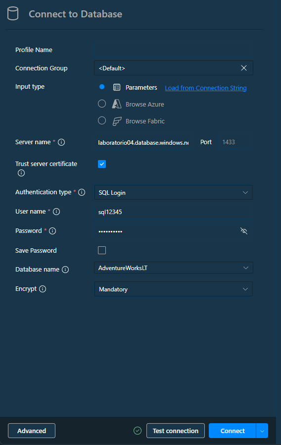{width="5.225124671916011in"
height="8.260416666666666in"}

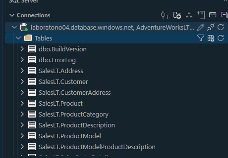{width="4.792335958005249in"
height="3.333798118985127in"}

Vista de las tablas

# Create a custom instruction file for Copilot

Fichero con instrucciones de funcionamiento para copilot

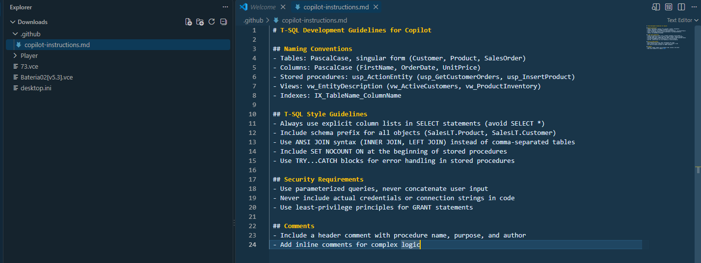{width="5.905555555555556in"
height="2.216666666666667in"}

# Use Copilot to generate a stored procedure

Creación de un procedure usando el chat de copilot

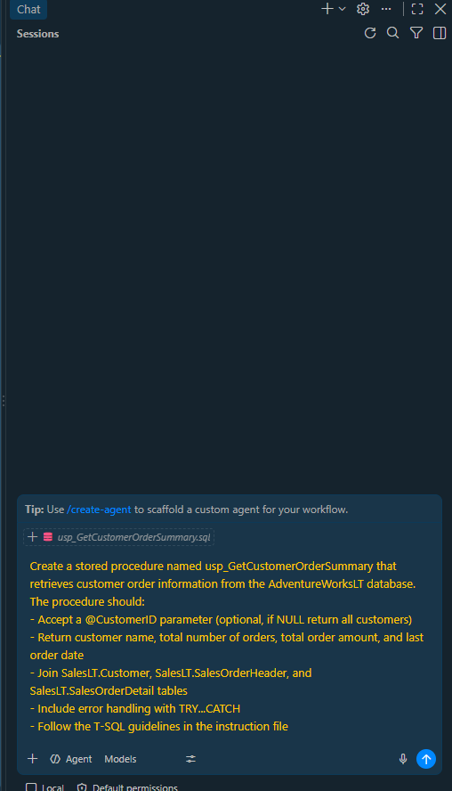{width="5.076388888888889in"
height="7.854001531058618in"}

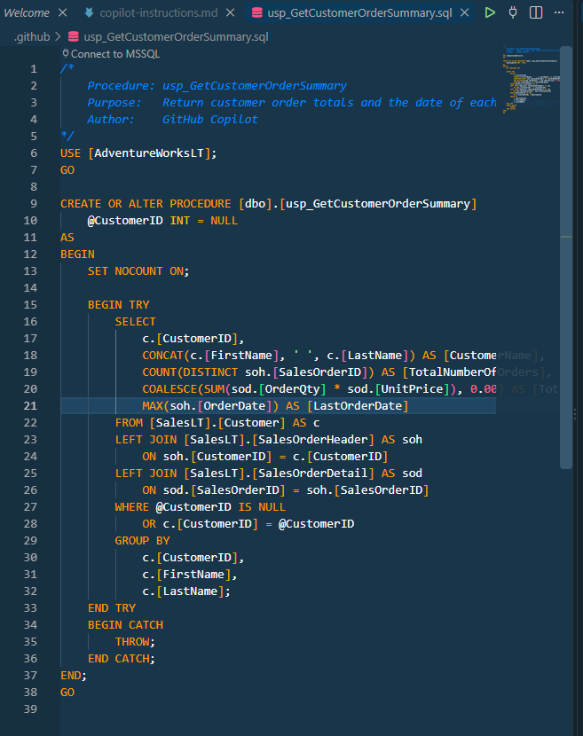{width="5.905555555555556in"
height="7.460416666666666in"}

# Use Copilot to generate a view

Usando copilot generar una vista

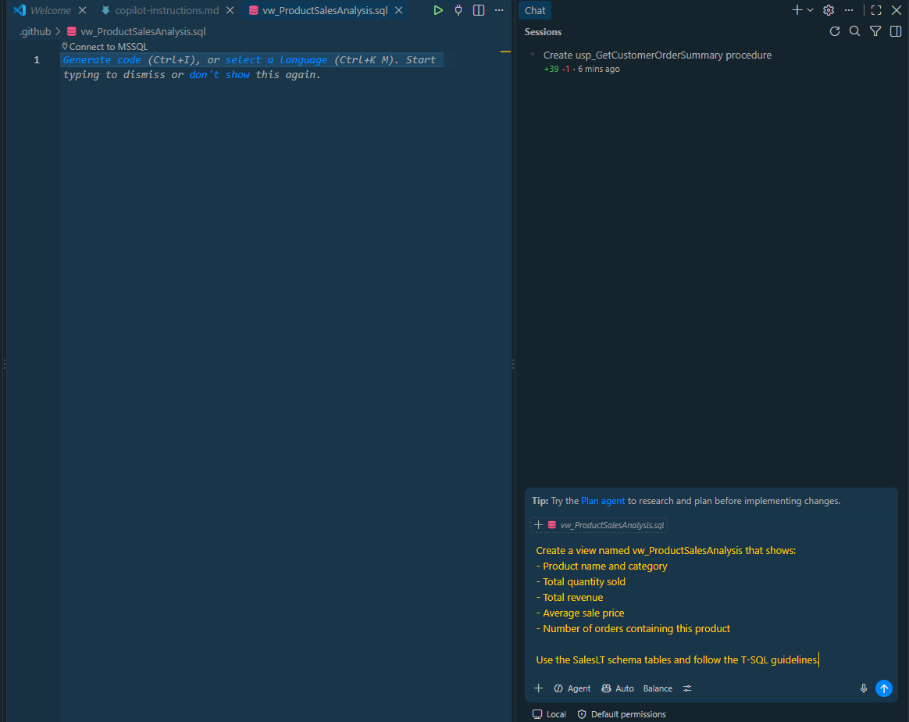{width="4.833333333333333in"
height="3.836431539807524in"}

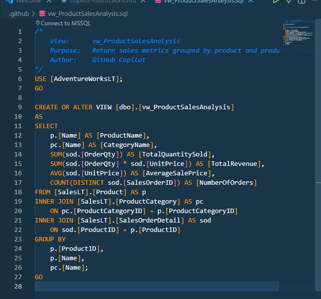{width="4.921917104111986in"
height="4.59375in"}

# Use Copilot to explain existing code

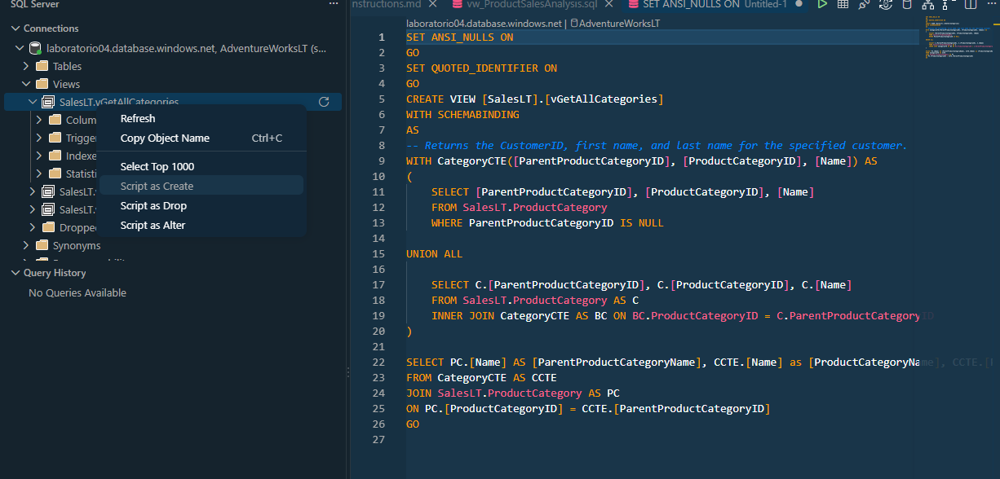{width="5.905555555555556in"
height="2.832638888888889in"}

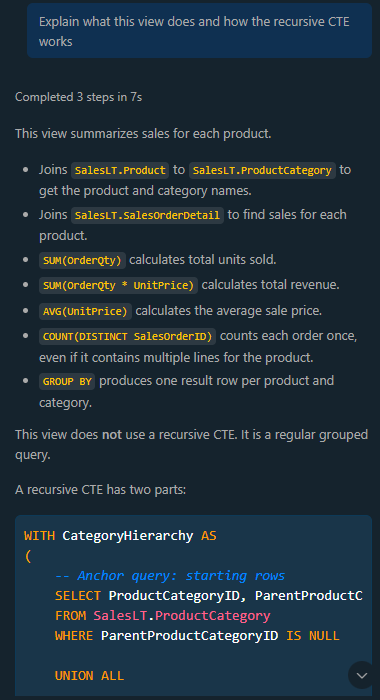{width="3.958885608048994in"
height="7.292684820647419in"}

# Use Copilot for query optimization suggestions

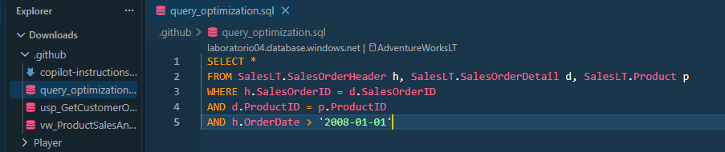{width="5.905555555555556in"
height="1.242361111111111in"}

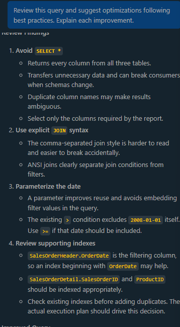{width="3.7296872265966754in"
height="6.771778215223097in"}

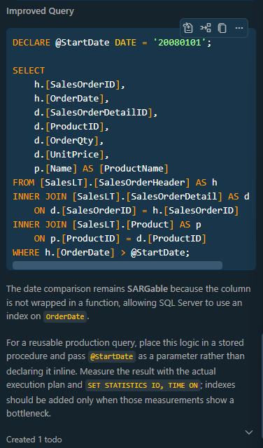{width="3.9172134733158357in"
height="6.667597331583552in"}

# Cleanup

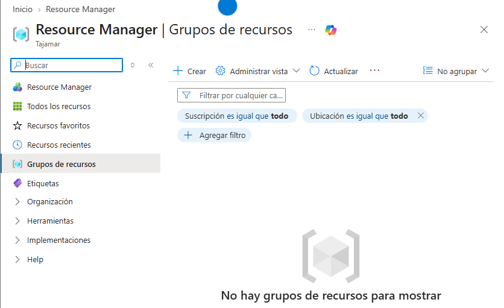{width="5.905555555555556in"
height="3.609722222222222in"}
