# Provision an Azure SQL Database

Creación de la bbdd

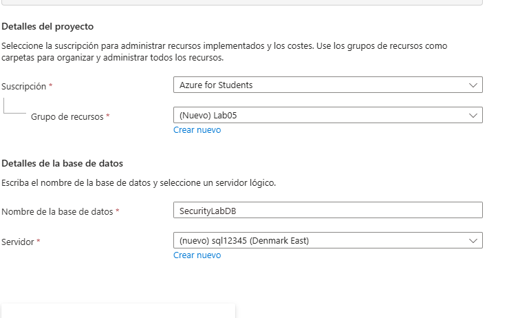{width="5.21875in"
height="3.18869094488189in"}

En el apartado de redes

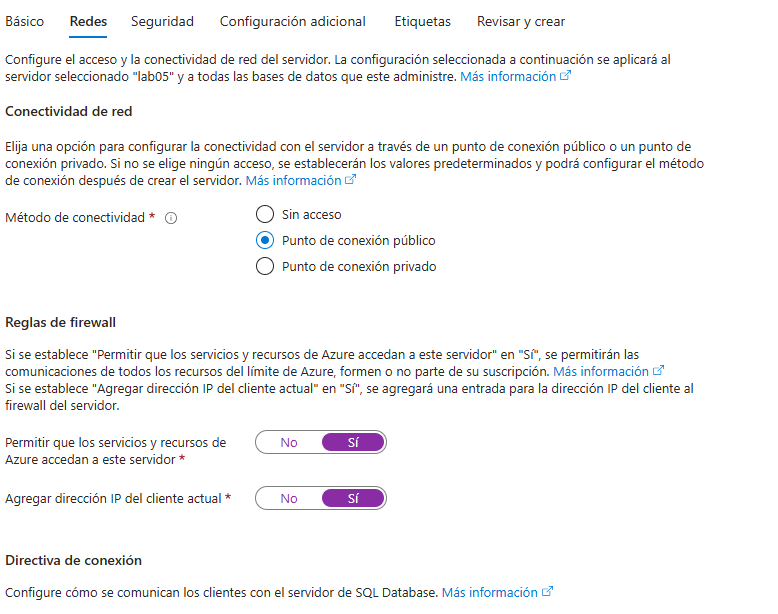{width="4.802083333333333in"
height="3.7901673228346455in"}

# Create sample tables

Conectar la bbdd con visual studio

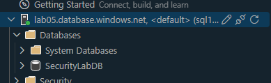{width="4.052648731408574in"
height="1.2397561242344708in"}

Crear una tabla

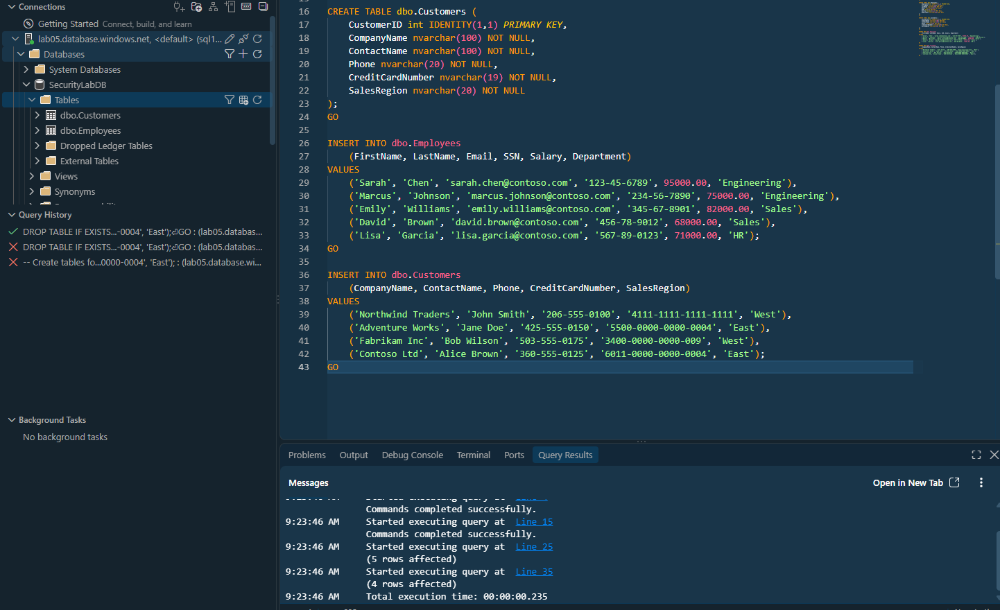{width="5.905555555555556in"
height="3.6034722222222224in"}

# Implement Dynamic Data Masking

Creación de una máscara para ocultar los datos a usuarios sin permiso

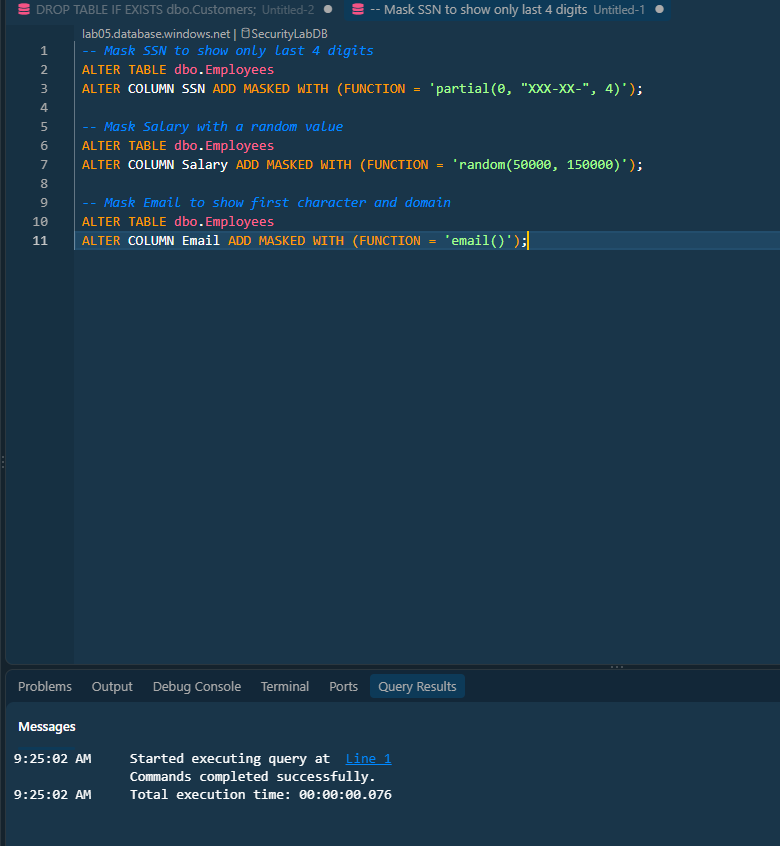{width="5.905555555555556in"
height="6.405555555555556in"}

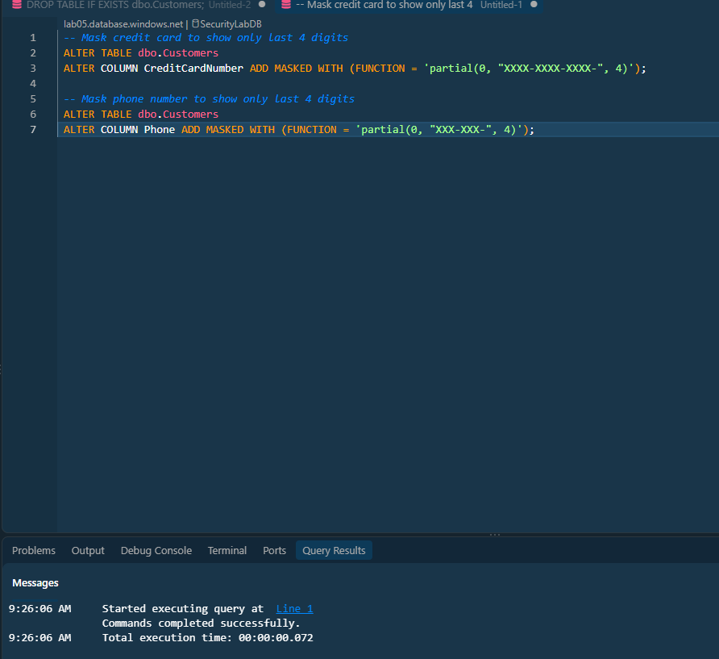{width="5.905555555555556in"
height="5.409027777777778in"}

Resultados de el enmascarado

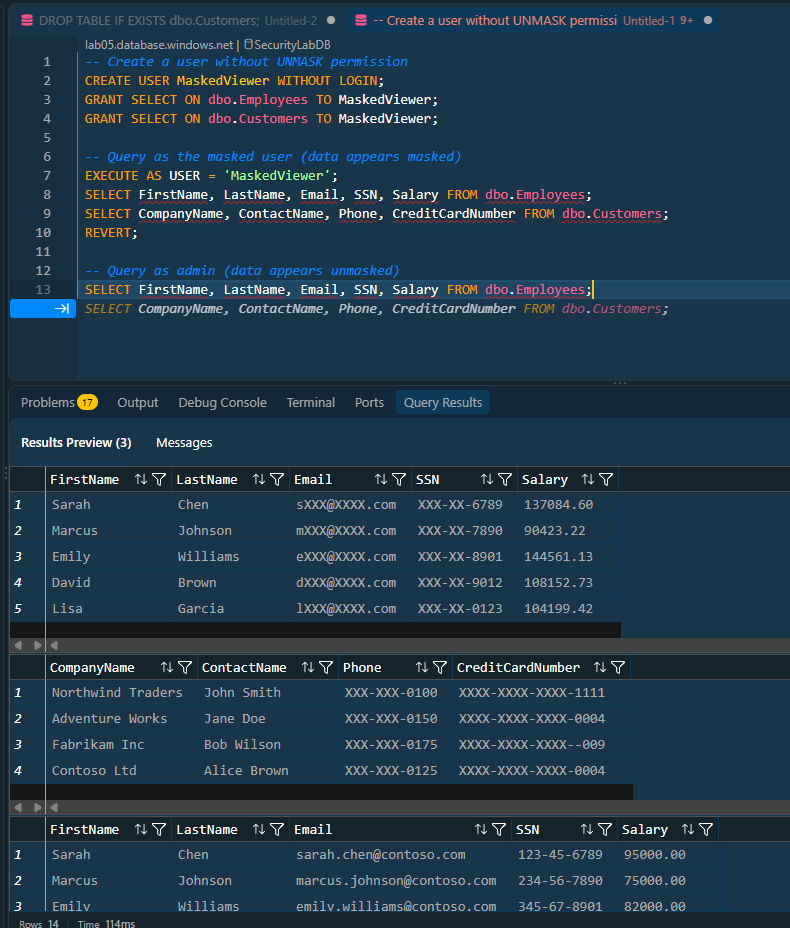{width="5.905555555555556in"
height="6.936805555555556in"}

# Implement Row-Level Security

Creación de un usuario con determinadas zonas

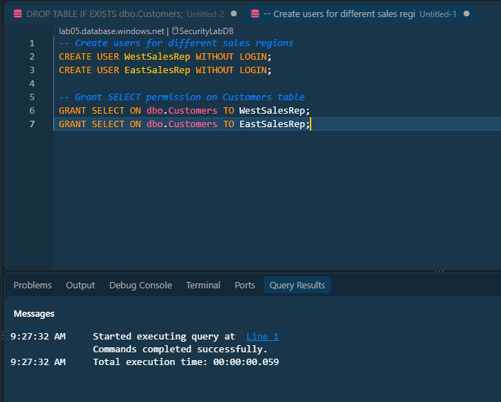{width="4.813888888888889in"
height="3.8645833333333335in"}

Creación del esquema de seguridad según la zona

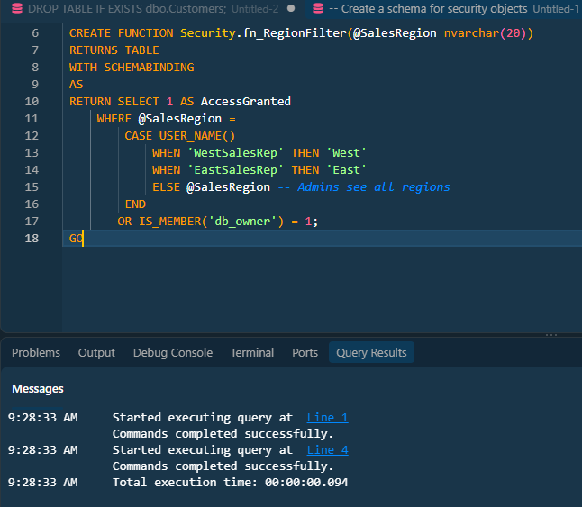{width="5.052083333333333in"
height="4.402749343832021in"}

Creación de la política de seguridad

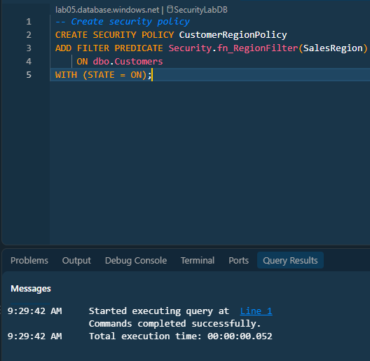{width="4.410679133858268in"
height="4.302083333333333in"}

Test

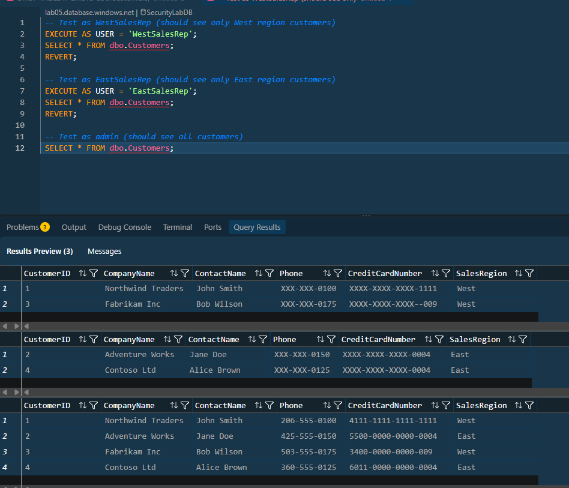{width="5.125in"
height="4.395181539807524in"}

# Limpieza

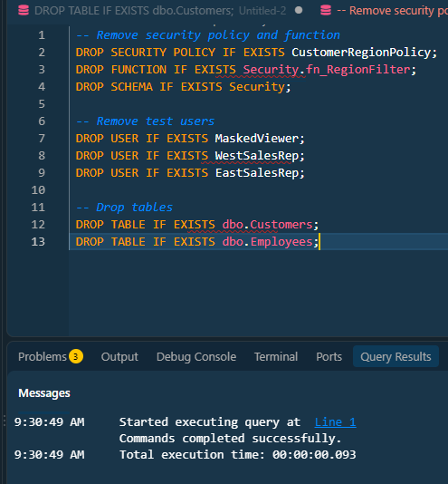{width="5.156969597550306in"
height="5.563276465441819in"}

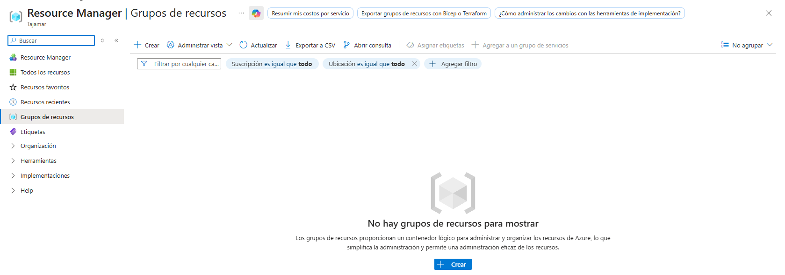{width="5.905555555555556in"
height="2.078472222222222in"}
