# Contenido {#contenido .TOC-Heading}

[Create a Foundry project and deploy Azure OpenAI models
[2](#create-a-foundry-project-and-deploy-azure-openai-models)](#create-a-foundry-project-and-deploy-azure-openai-models)

[Create a Foundry project
[2](#create-a-foundry-project)](#create-a-foundry-project)

[Deploy Azure OpenAI models
[3](#deploy-azure-openai-models)](#deploy-azure-openai-models)

[Retrieve the Azure OpenAI endpoint
[4](#retrieve-the-azure-openai-endpoint)](#retrieve-the-azure-openai-endpoint)

[Configure managed identity Access create the ProductReview table
[4](#configure-managed-identity-access-create-the-productreview-table)](#configure-managed-identity-access-create-the-productreview-table)

[Create a database scoped credential and an external model for
embeddings
[5](#create-a-database-scoped-credential-and-an-external-model-for-embeddings)](#create-a-database-scoped-credential-and-an-external-model-for-embeddings)

[Add a vector column and generate embeddings
[7](#add-a-vector-column-and-generate-embeddings)](#add-a-vector-column-and-generate-embeddings)

[Create a full-text index
[9](#create-a-full-text-index)](#create-a-full-text-index)

[Search with full-text predicates
[10](#search-with-full-text-predicates)](#search-with-full-text-predicates)

[Search with vector similarity
[12](#search-with-vector-similarity)](#search-with-vector-similarity)

[Combine full-text and vector search with hybrid search
[14](#combine-full-text-and-vector-search-with-hybrid-search)](#combine-full-text-and-vector-search-with-hybrid-search)

[Compare the three search approaches
[14](#compare-the-three-search-approaches)](#compare-the-three-search-approaches)

# Create a Foundry project and deploy Azure OpenAI models

## Create a Foundry project

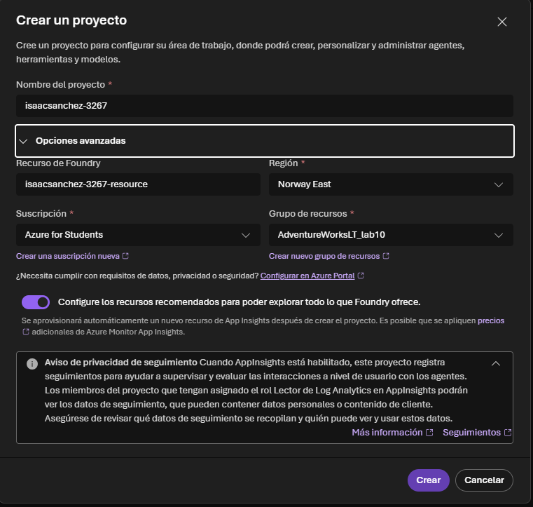{width="5.905555555555556in"
height="5.610416666666667in"}

## Deploy Azure OpenAI models

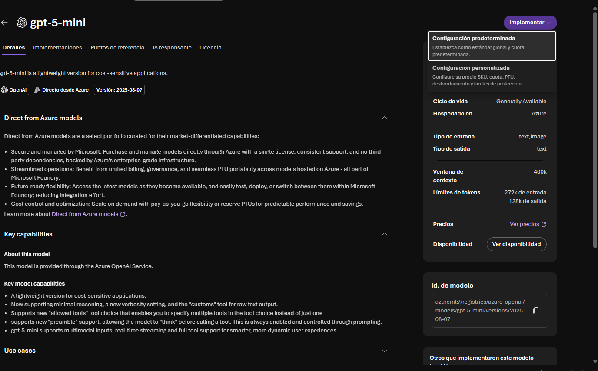{width="5.905555555555556in"
height="3.6694444444444443in"}

Utilizamos gpt5mini

Y creamos el modelo

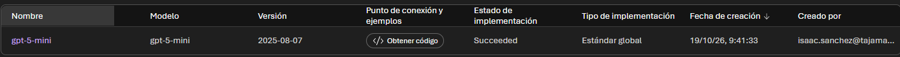{width="5.905555555555556in"
height="0.38055555555555554in"}

Repetimos con el
text-embedding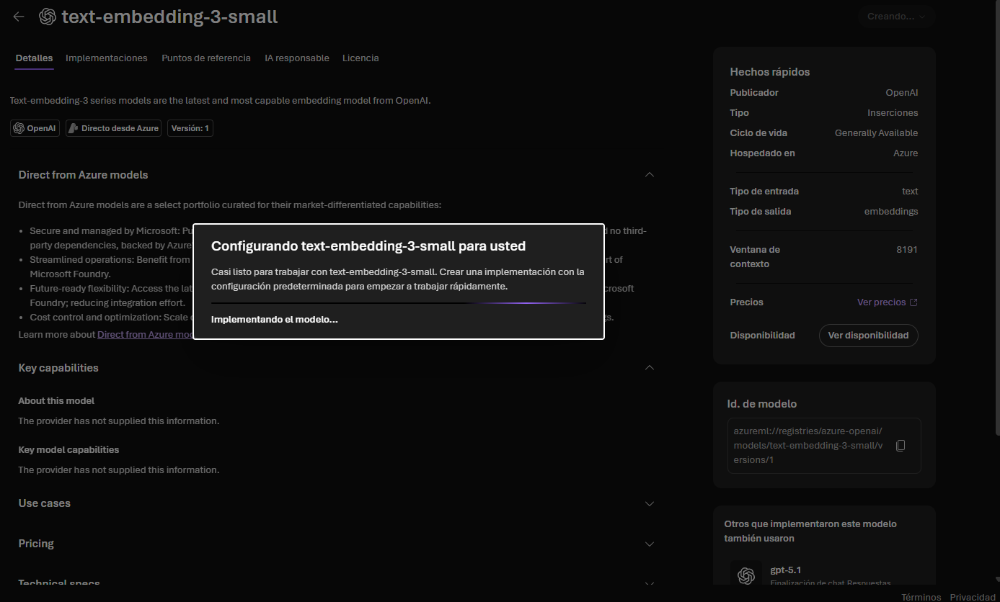{width="5.905555555555556in"
height="3.5597222222222222in"}

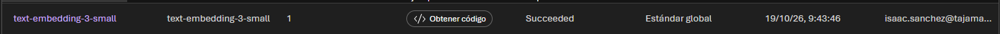{width="5.905555555555556in"
height="0.20416666666666666in"}

## Retrieve the Azure OpenAI endpoint

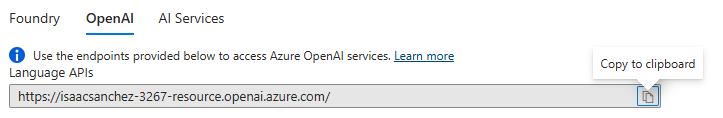{width="5.905555555555556in"
height="0.9638888888888889in"}

# Configure managed identity Access create the ProductReview table

Vamos al servidor de la bbdd

En la prte de seguridad activamos managed
identityen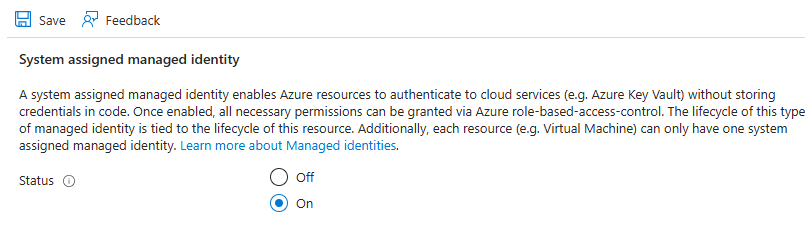{width="5.905555555555556in"
height="1.7020833333333334in"}

En el menú de acceso token agregamos un rol que sea Cognitive Services
OpenAI User

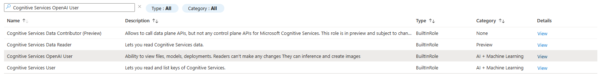{width="5.905555555555556in"
height="0.775in"}

Asignamos el sql server como miembro

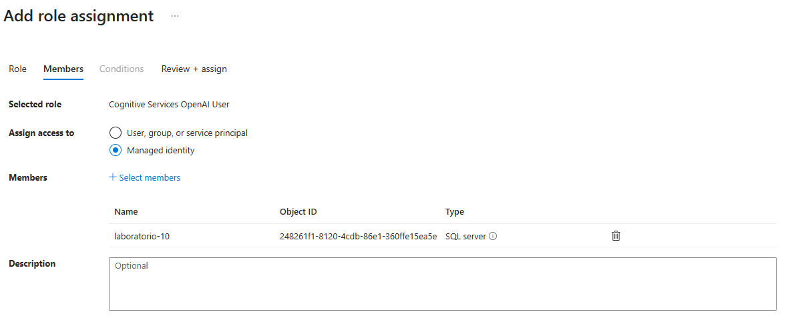{width="5.905555555555556in"
height="2.484722222222222in"}

# Create a database scoped credential and an external model for embeddings

Mediante visual estudio nos conctamos a la bbdd que hemos creado

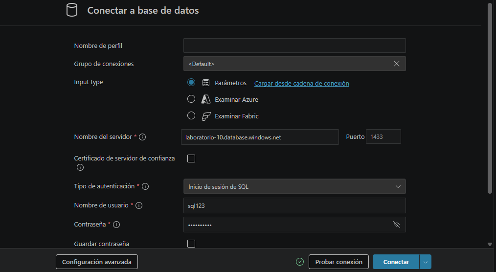{width="5.905555555555556in"
height="3.2381944444444444in"}

Una vez conectados ejecutamos el archivo para la creación de la bbdd

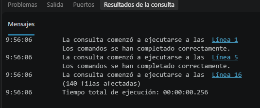{width="5.573694225721785in"
height="2.3128226159230096in"}

Comprobación de que la creación a sido exitosa

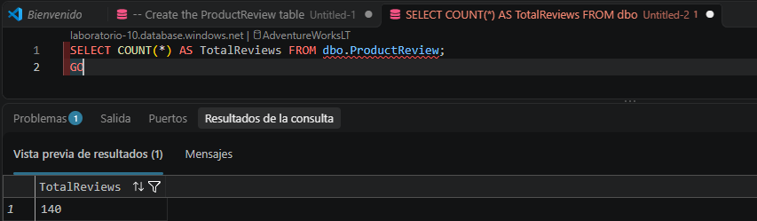{width="5.905555555555556in"
height="1.7236111111111112in"}

Ejecutamos este código

\-- Create a database master key if one doesn\'t exist

IF NOT EXISTS (SELECT \* FROM sys.symmetric_keys WHERE name =
\'##MS_DatabaseMasterKey##\')

CREATE MASTER KEY ENCRYPTION BY PASSWORD = \'\<your strong password
here\>\';

GO

\-- Create a credential using Managed Identity

CREATE DATABASE SCOPED CREDENTIAL
\[https://\<your-openai-endpoint\>.openai.azure.com\]

WITH IDENTITY = \'Managed Identity\', SECRET =
\'{\"resourceid\":\"https://cognitiveservices.azure.com\"}\';

GO

Creamos el modelo externo

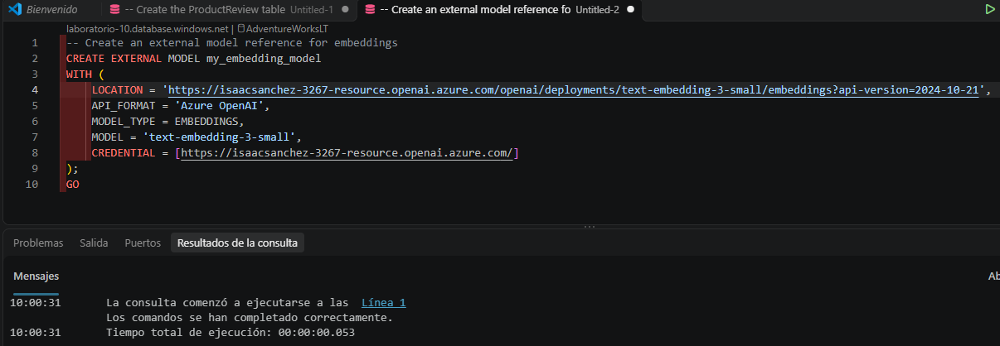{width="5.905555555555556in"
height="2.046527777777778in"}

# Add a vector column and generate embeddings

Añadimos la columna de embeddins

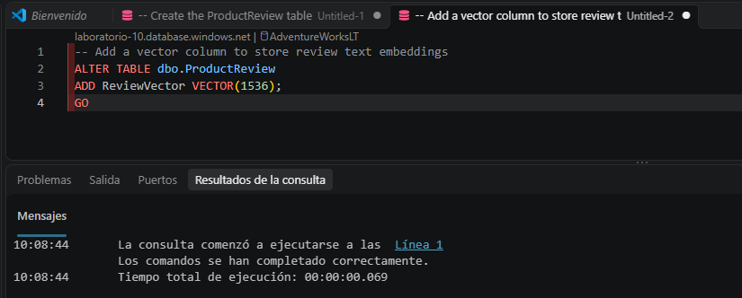{width="5.905555555555556in"
height="2.376388888888889in"}

Generamos los embeddings

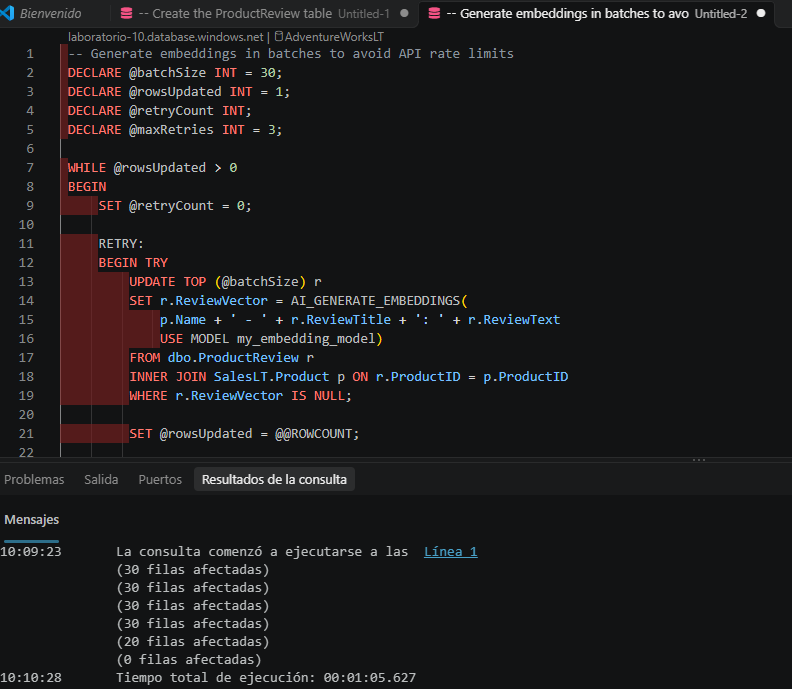{width="5.905555555555556in"
height="5.1375in"}

Comprobamos los embeddings creados

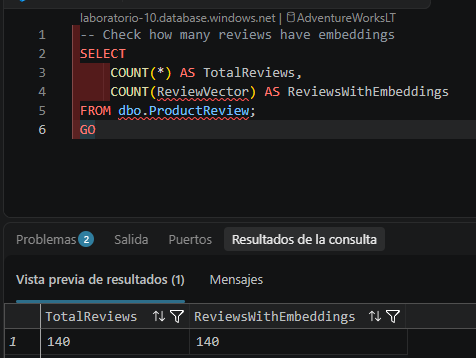{width="4.959025590551181in"
height="3.7296872265966754in"}

Creamos el índice de los vectores

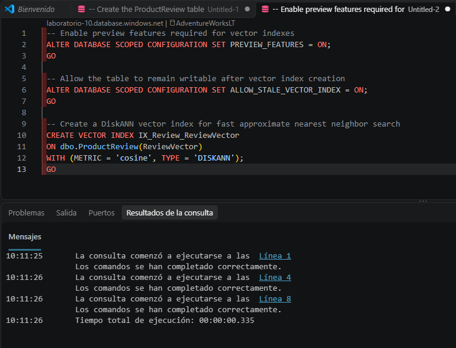{width="5.905555555555556in"
height="4.50625in"}

# Create a full-text index

Creamos el catálogo completo

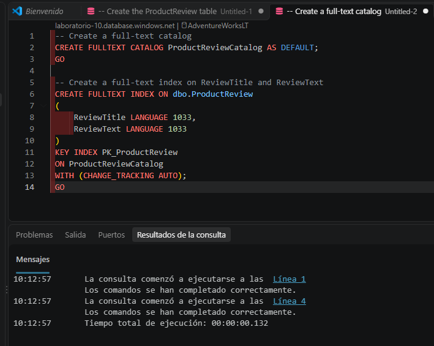{width="5.905555555555556in"
height="4.70625in"}

Verificamos la creación de los índices

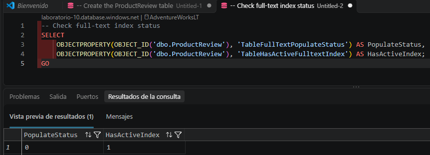{width="5.905555555555556in"
height="2.1375in"}

# Search with full-text predicates

Buscamos por una palabra concreta

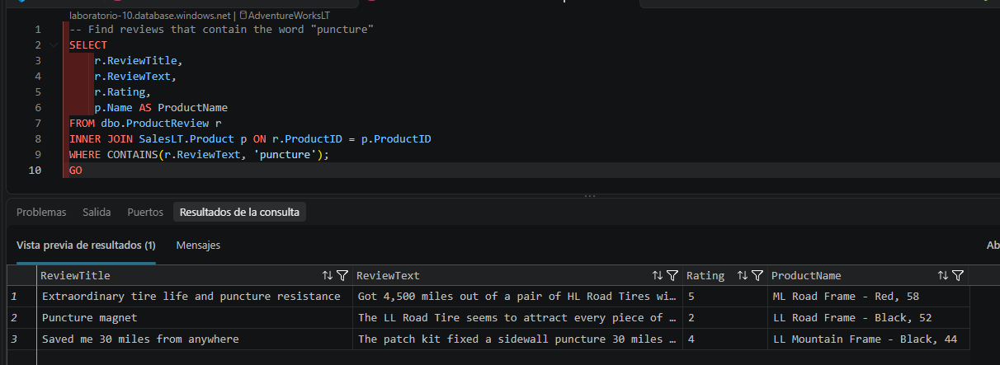{width="5.905555555555556in"
height="2.158333333333333in"}

Buscamos por una frase

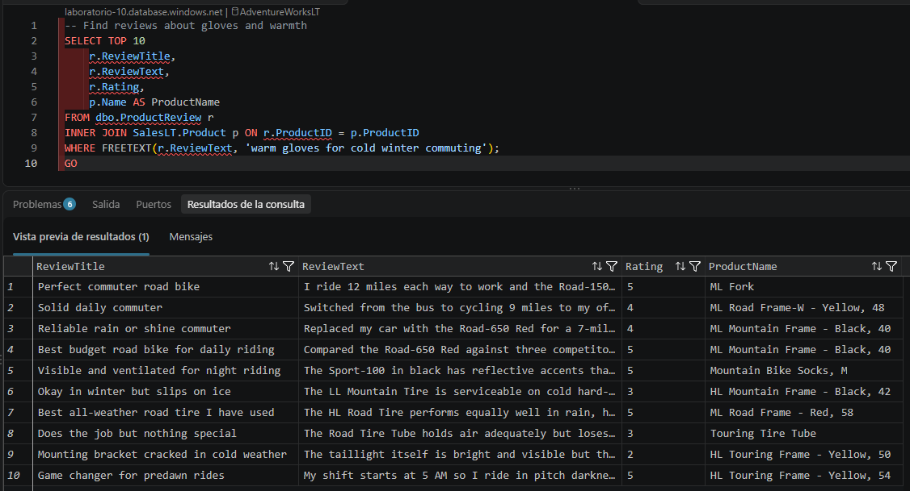{width="5.905555555555556in"
height="3.19375in"}

Ahora utilizamos constaintable para obtener las puntuaciones de
similitud

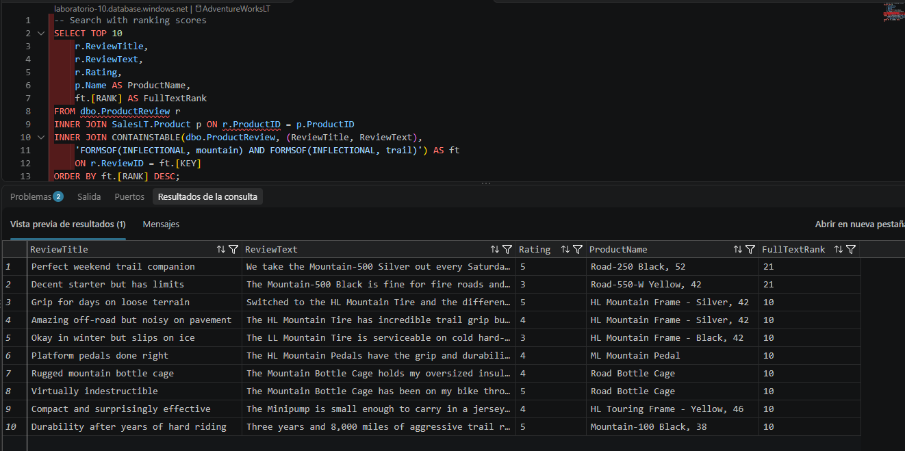{width="5.905555555555556in"
height="2.94375in"}

Ahora buscamos por el inicio de una palabra

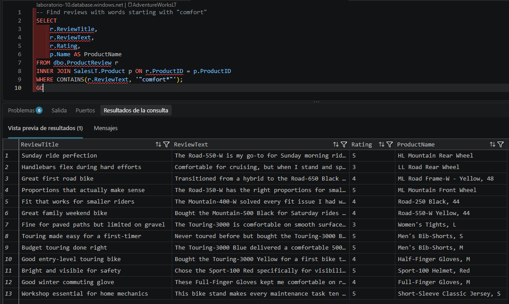{width="5.905555555555556in"
height="3.5368055555555555in"}

# Search with vector similarity

Usamos vector search para realizar la búsqueda

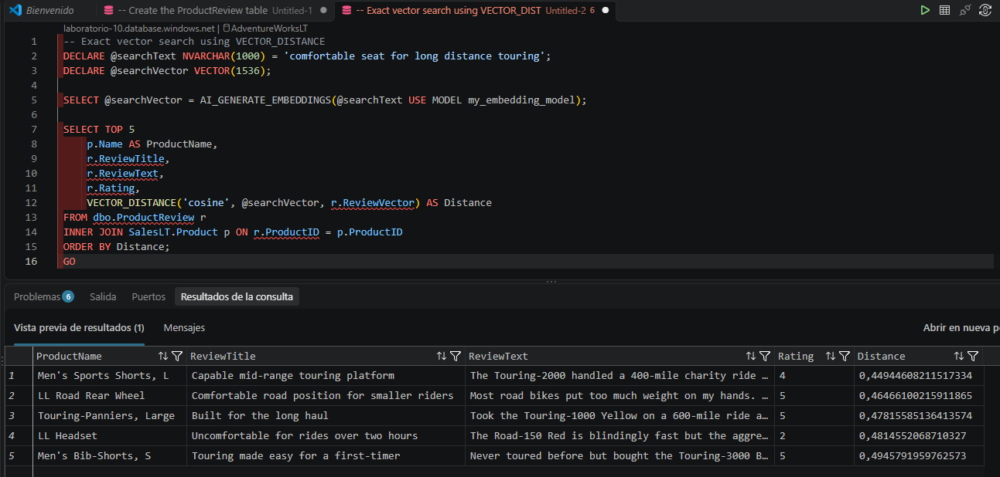{width="5.905555555555556in"
height="2.8229166666666665in"}

Buscamos con el vector y usando el índice para resultados mas rapidos

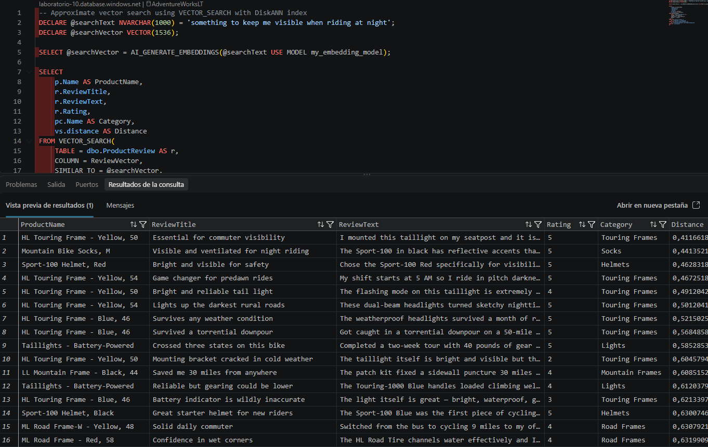{width="5.905555555555556in"
height="3.7333333333333334in"}

Comprobamos los vectores por los meta data

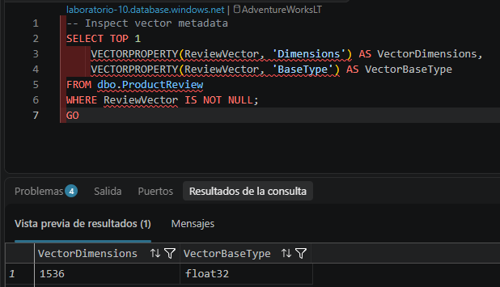{width="5.905555555555556in"
height="3.3916666666666666in"}

# Combine full-text and vector search with hybrid search

Combinamos ambas del scrip que nos aportan es necesario eliminar el
topN=50 porque da error

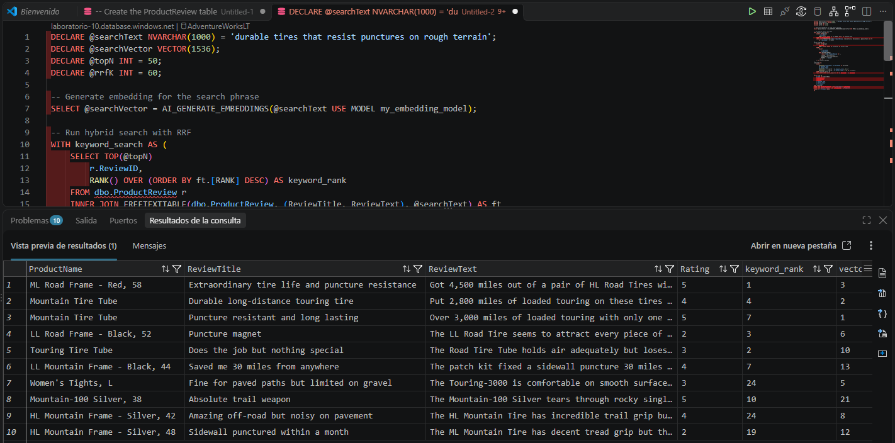{width="5.905555555555556in"
height="2.923611111111111in"}

# Compare the three search approaches

Realizamos una búsqueda de texto completa

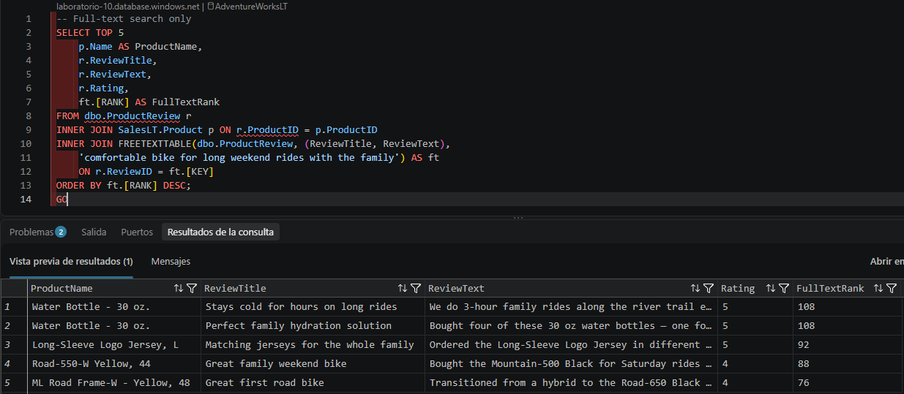{width="5.905555555555556in"
height="2.577777777777778in"}

Hacemos una búsqueda de vector con el mismo parámetro

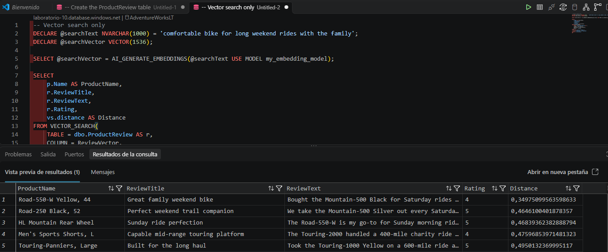{width="5.905555555555556in"
height="2.45625in"}

Usamos la búsqueda hidrida

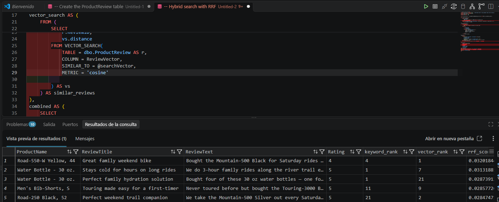{width="5.905555555555556in"
height="2.3986111111111112in"}
