# Create a Foundry project and deploy Azure OpenAI models

Creación del Proyecto y selección de los modelos

Seleccionamos gpt-5-mini y lo desplegamos con la configuración
predeterminada

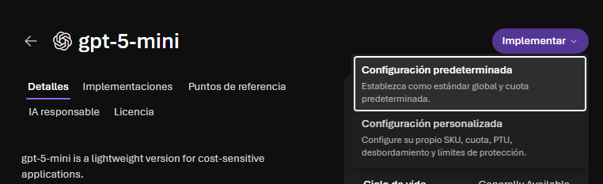{width="5.905555555555556in"
height="1.8055555555555556in"}

Resultado

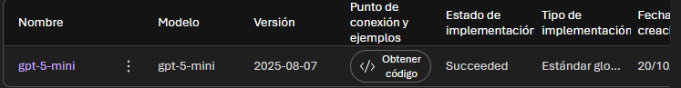{width="5.905555555555556in"
height="0.7666666666666667in"}

Repetimos con el motor de los embeddings

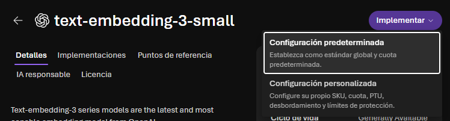{width="5.905555555555556in"
height="1.5868055555555556in"}

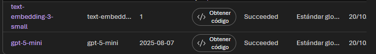{width="5.905555555555556in"
height="0.8513888888888889in"}

Dentro del recurso entramos en foundry y vamos al apartado de keys and
empoint para copiar la url de openAI

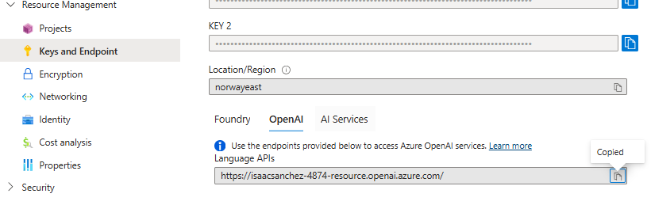{width="5.905555555555556in"
height="1.8652777777777778in"}

# Configure managed identity access

En el portal de azure accedemos al recurso y luego al servidor y
acedemos a seguridad identidad y en la sección de maneged identity
selecionamos el estado a on

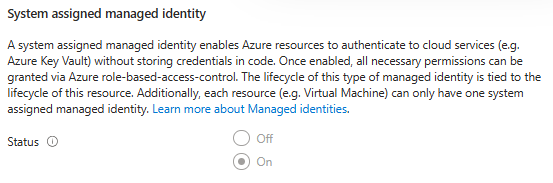{width="5.761220472440945in"
height="1.906515748031496in"}

Añadimos el rol de openai

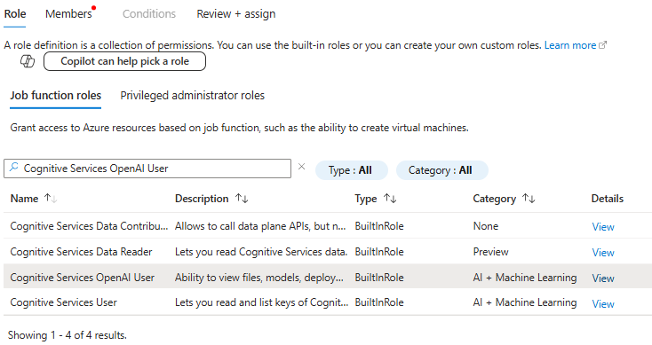{width="5.905555555555556in"
height="3.129166666666667in"}

Añadimos como miembro al sqlverver

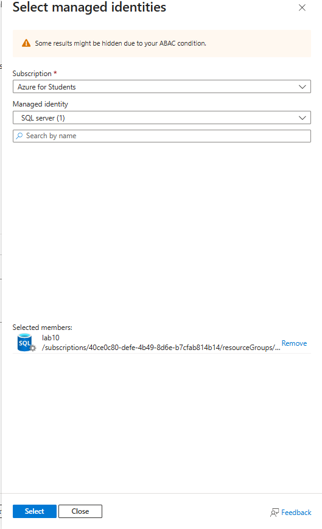{width="5.511185476815398in"
height="9.053346456692914in"}

# Create the ProductReview table

Nos conectamos a la bbdd con visual estudio y ejecutamos el scrip de
creación de tablas

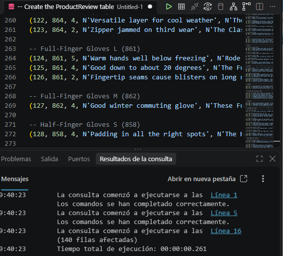{width="5.905555555555556in"
height="5.343055555555556in"}

Verificamos si se han creado bien la tablas

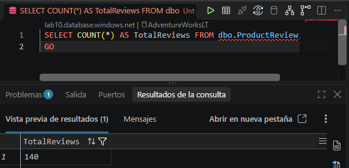{width="5.905555555555556in"
height="2.8493055555555555in"}

# Create a database scoped credential and an external model for embeddings

Creamos la credencial para la bbdd

Usando este código \-- Create a database master key if one doesn\'t
exist

IF NOT EXISTS (SELECT \* FROM sys.symmetric_keys WHERE name =
\'##MS_DatabaseMasterKey##\')

CREATE MASTER KEY ENCRYPTION BY PASSWORD = \'\<your strong password
here\>\';

GO

\-- Create a credential using Managed Identity

CREATE DATABASE SCOPED CREDENTIAL
\[https://\<your-openai-endpoint\>.openai.azure.com\]

WITH IDENTITY = \'Managed Identity\', SECRET =
\'{\"resourceid\":\"https://cognitiveservices.azure.com\"}\';

GO

Creamos un modelo externo del modelo de embedding

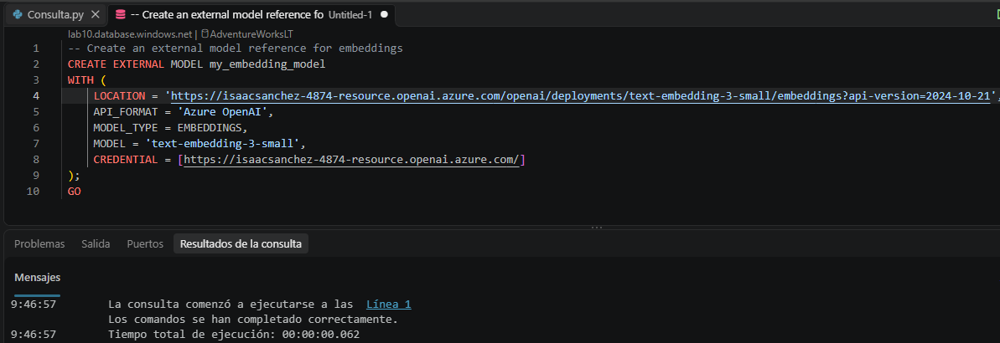{width="5.905555555555556in"
height="2.029166666666667in"}

# Add a vector column and generate embeddings

Creamos la columna de los vectores

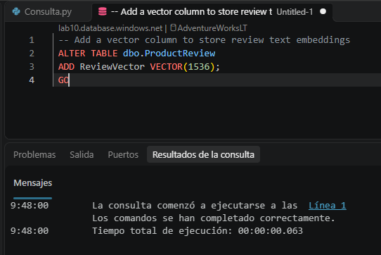{width="5.646621828521435in"
height="3.771359361329834in"}

Generamos los embeddings

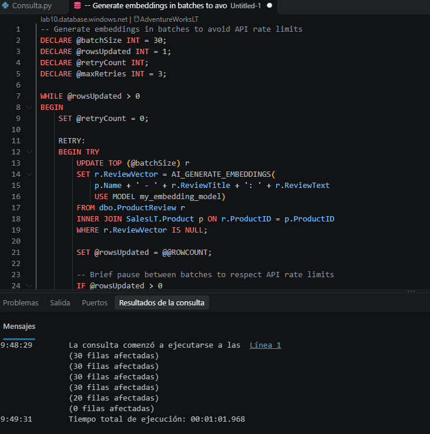{width="5.905555555555556in"
height="5.961805555555555in"}

Verificamos la correcta creacion

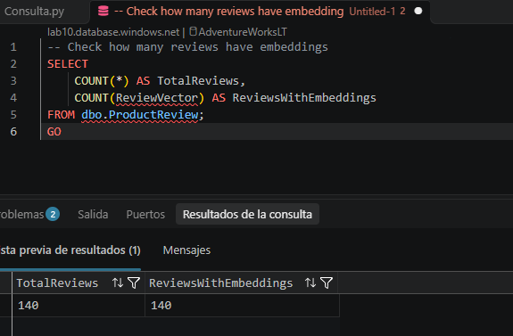{width="5.905555555555556in"
height="3.8715277777777777in"}

Habilitamos la vista previa y creamos un índice de vectores

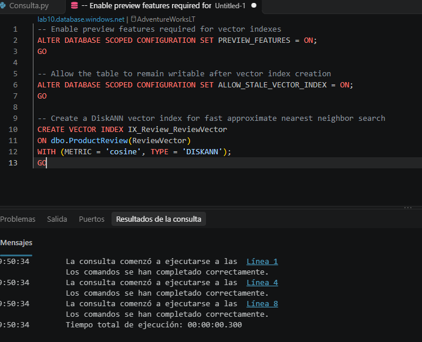{width="5.905555555555556in"
height="4.788888888888889in"}

# Retrieve data using vector search and format it as JSON context

Usando vector_search realizamos una búsqueda

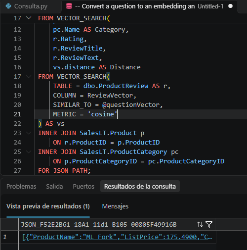{width="5.209060586176728in"
height="5.261150481189851in"}

# Build an augmented prompt with database context

Ahora, para crear la solicitud aumentada , se combinan los datos
recuperados con un mensaje del sistema y una pregunta del usuario . Esta
solicitud es la \"A\" de RAG.

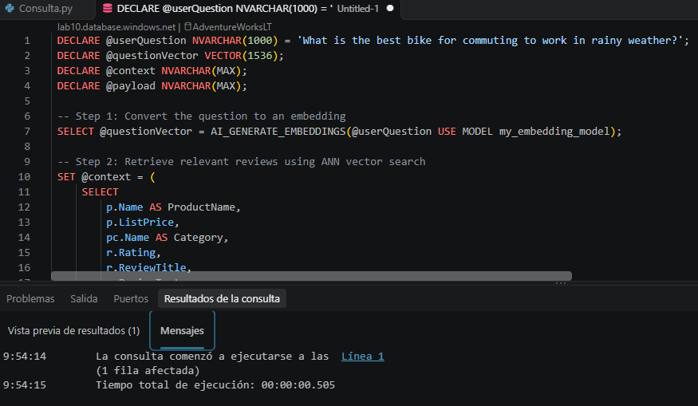{width="5.905555555555556in"
height="3.435416666666667in"}

# Call the Azure OpenAI endpoint and generate a response

Creamos el endpoint de azure y creamos una respuesta

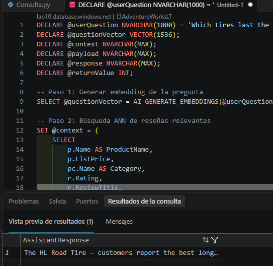{width="5.6570395888014in"
height="5.500767716535433in"}

# Create a RAG stored procedure

Creamos el procedure

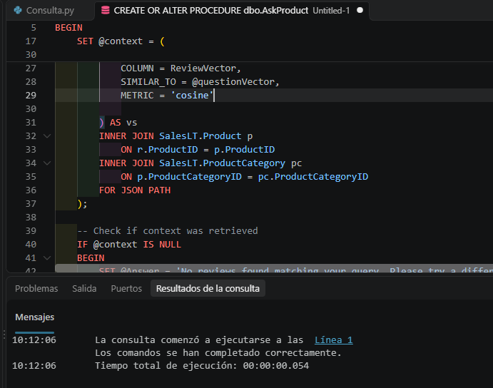{width="5.905555555555556in"
height="4.649305555555555in"}

Probar el procedimiento

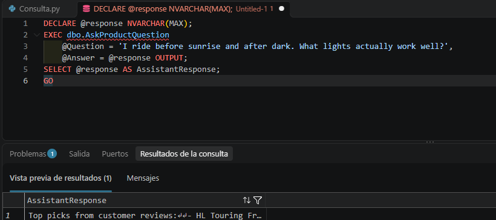{width="5.905555555555556in"
height="2.6215277777777777in"}

Prubea 2

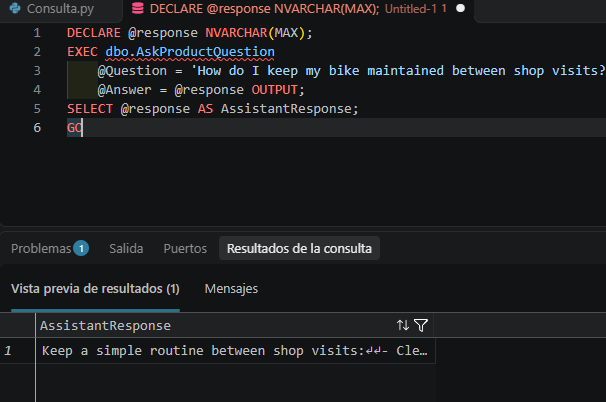{width="5.905555555555556in"
height="3.917361111111111in"}

Prueba 3

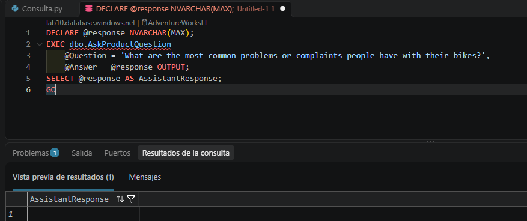{width="5.905555555555556in"
height="2.477777777777778in"}
