# Provision an Azure SQL Database

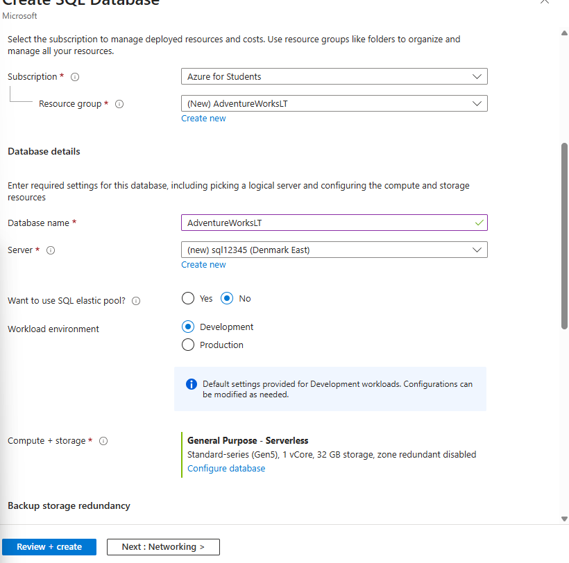{width="5.905555555555556in"
height="5.847916666666666in"}

# Configure your development environment

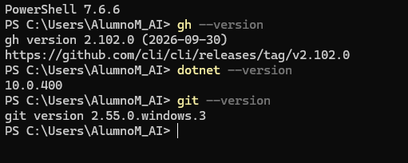{width="5.323659230096238in"
height="2.1252963692038493in"}

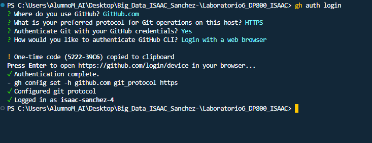{width="5.905555555555556in"
height="2.279861111111111in"}

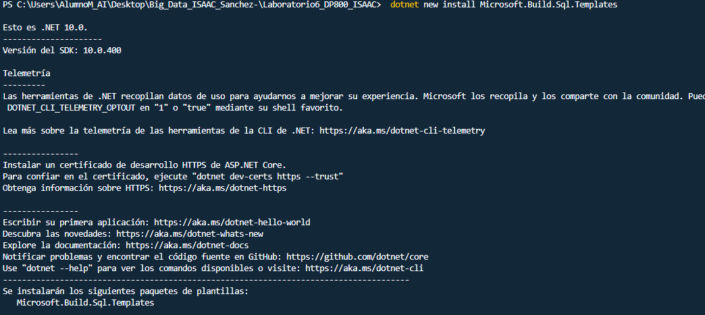{width="5.905555555555556in"
height="2.6416666666666666in"}

# Create a SQL database Project

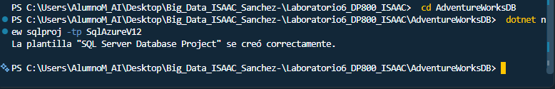{width="5.905555555555556in"
height="0.9486111111111111in"}

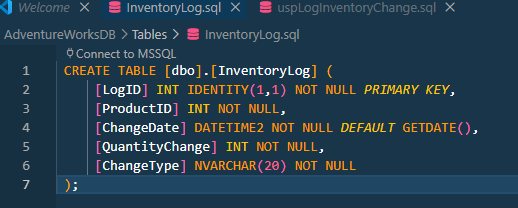{width="5.396586832895888in"
height="2.166969597550306in"}

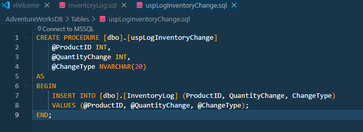{width="5.905555555555556in"
height="2.1569444444444446in"}

# Build the project locally

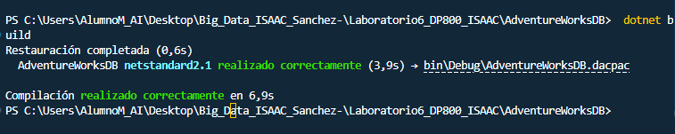{width="5.905555555555556in"
height="1.1777777777777778in"}

# Initialize Git and create a GitHub repository

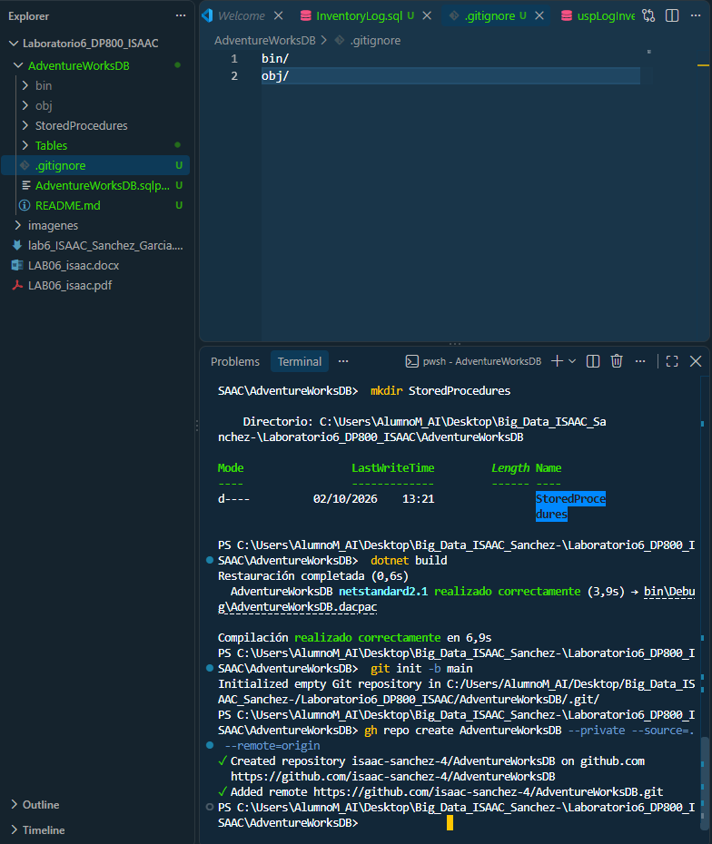{width="5.905555555555556in"
height="7.0055555555555555in"}

# Configure the GitHub secrets for deployment

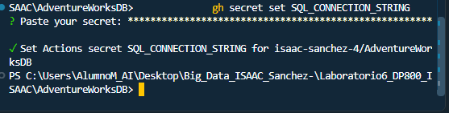{width="5.802892607174103in"
height="1.4689545056867892in"}

# Create the GitHub Actions workflow

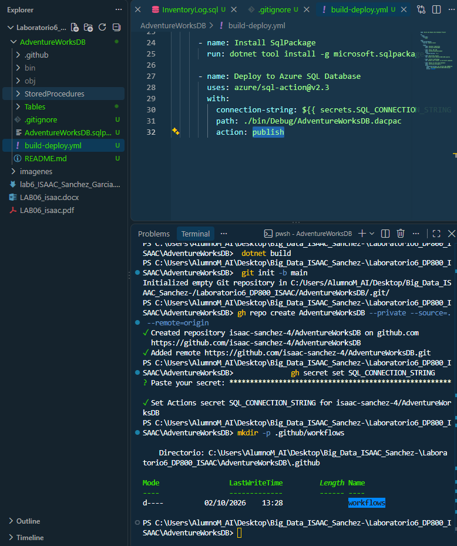{width="5.905555555555556in"
height="7.04375in"}

# Push and verify the first deployment

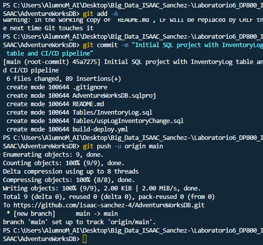{width="5.521604330708661in"
height="5.146551837270342in"}

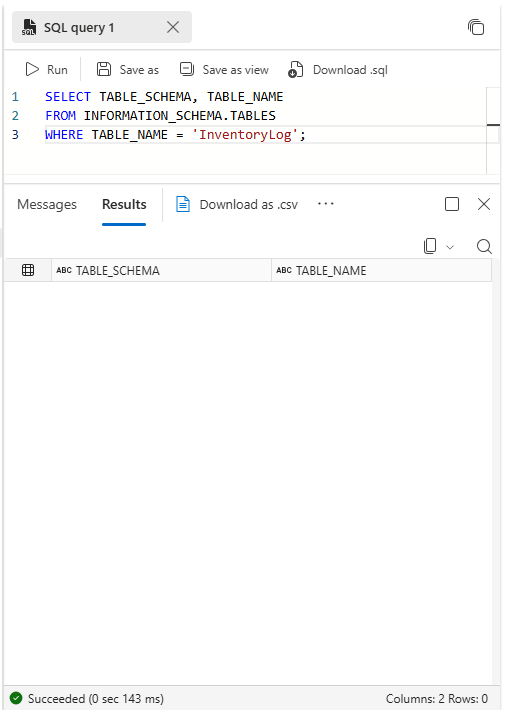{width="5.417422353455818in"
height="7.4697922134733155in"}

# Push a schema change

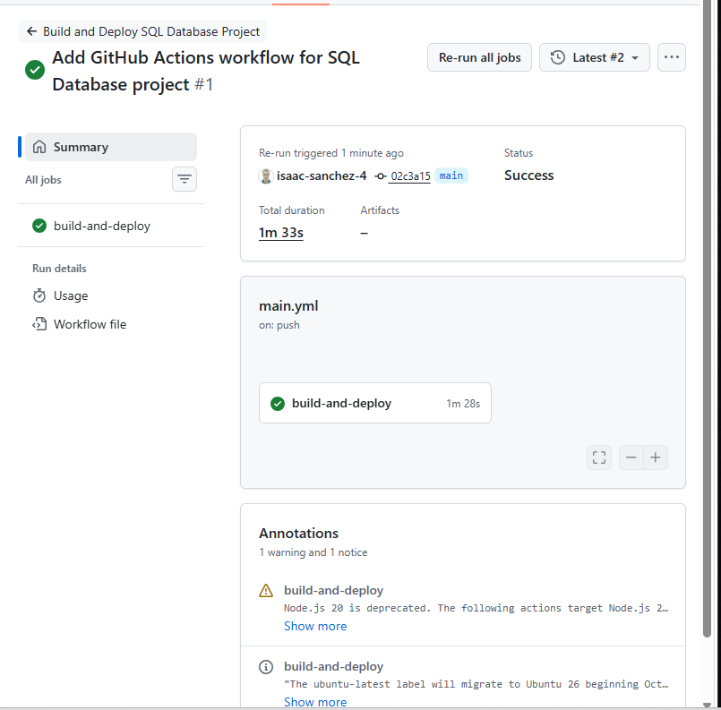{width="5.905555555555556in"
height="5.817361111111111in"}

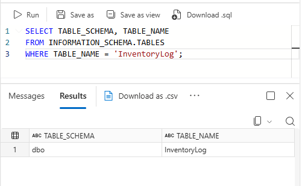{width="5.219478346456693in"
height="3.2191994750656168in"}

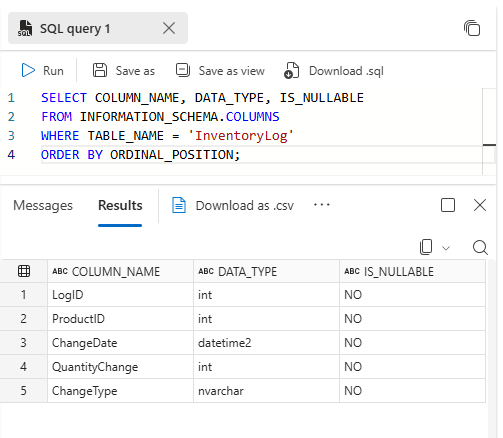{width="5.240314960629921in"
height="4.563136482939632in"}
