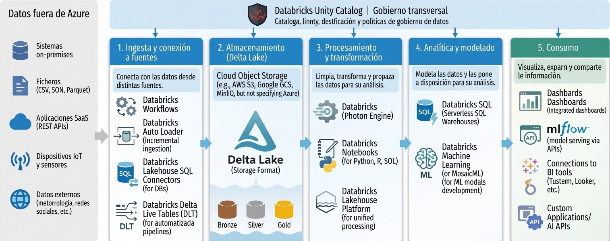
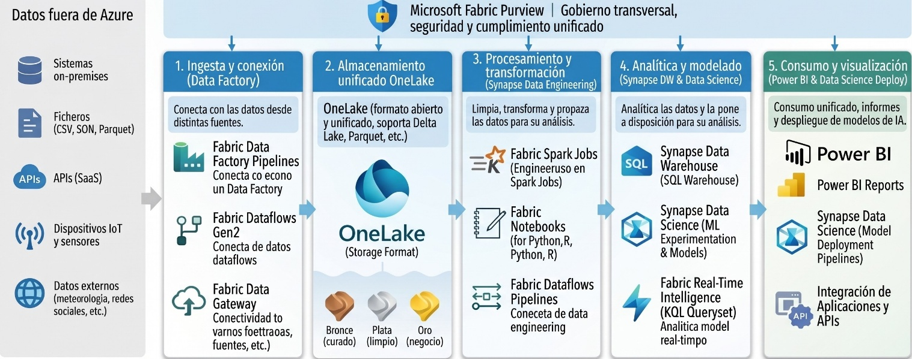
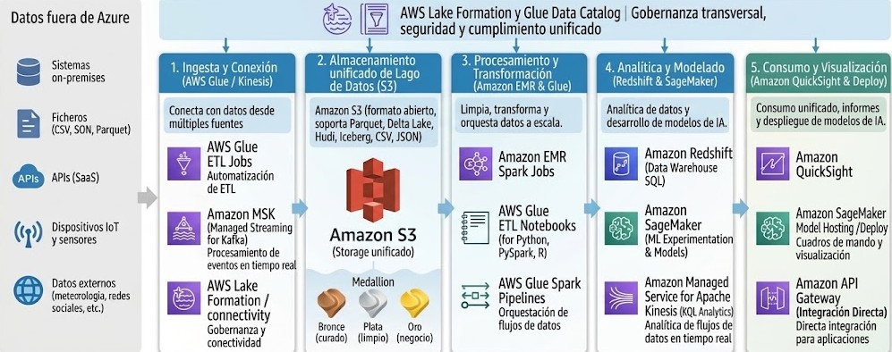
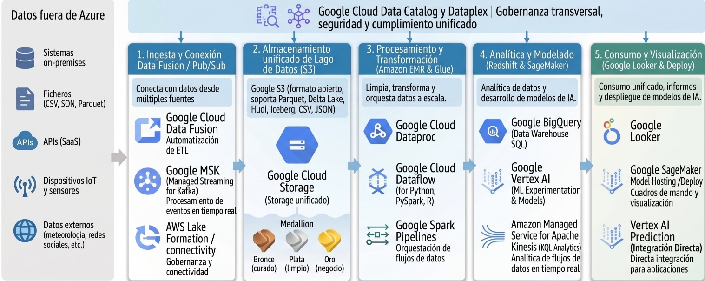
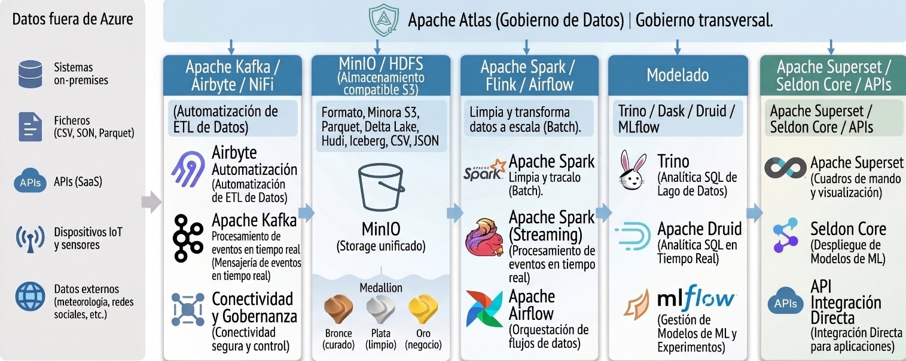
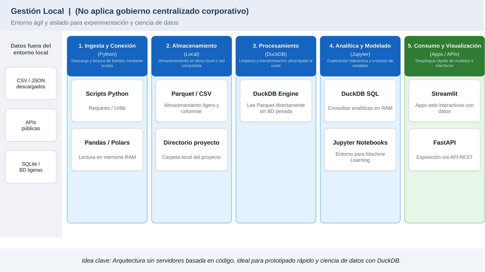
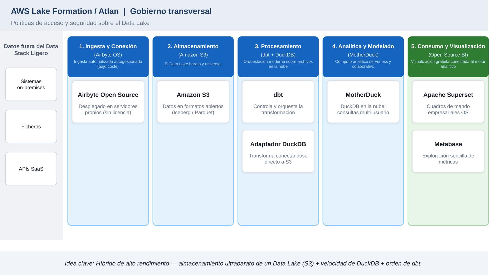
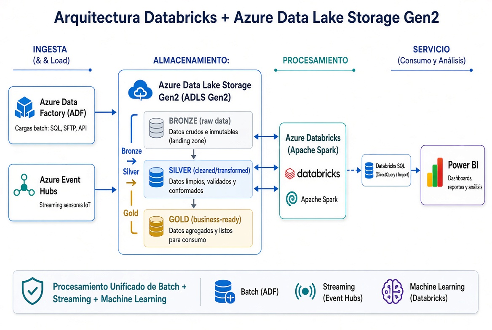
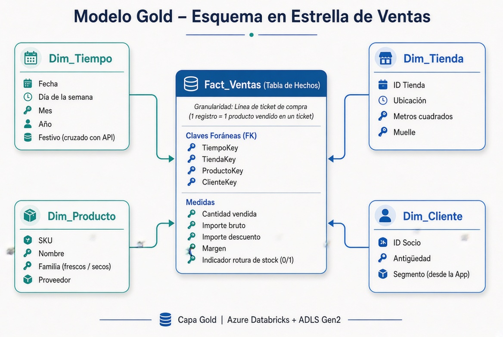

# Parte 1

## Ejercicio 1 --- Clasifica las fuentes

Clasifica cada fuente como estructurada, semiestructurada o no
estructurada y justifica tu respuesta:

1.  Exportación diaria del ERP de compras en CSV.

> Tipo de fuente estructurado: ya que como los datos vienen desde un CSV
> esos datos tienen una estructura definida.

2.  Lecturas de temperatura de las cámaras frigoríficas enviadas cada 30
    segundos en JSON.

> Tipo de fuente semiestructurada: los archivos de tipo JSON organizan
> la información mediante etiquetas formato clave- valor, pero puede
> contener nulos no esperados sin que se rompa.

3.  Grabaciones MP3 del servicio de atención al cliente.

> Tipo de fuente no estructurada: al ser un archivo de audio no puede
> contener información adicional y para extraer la información de
> utilidad es necesario procesar ese audio a texto.

4.  Tabla Empleados de la base de datos de RR. HH.

> Tipo de fuente estructurado: ya que es una base de datos relacional
> que mantiene un esquema, tipado de datos estrictos

5.  Logs de acceso de la tienda online.

> Tipo de fuente semiestructurada: los logs se suelen almacenar en texto
> plano siguiendo una estructura, pero no presenta una separación claro
> para poder guardarlo es necesario separar los datos

6.  Fotografías de los lineales tomadas por los reponedores.

> Tipo de fuente no estructurada: al igual que el caso del mp3 la
> información de esa imagen en una bbdd no es posible ver que productos
> faltan para ello es necesario el uso de un módulo de visión artificial

## Ejercicio 2 --- Elige el formato

Para cada escenario de Grupo Alimenta, elige el formato más adecuado y
justifica la decisión:

1.  Un proveedor pequeño nos envía cada semana su tarifa de precios y
    solo sabe trabajar con Excel.

> El formato más optimo sería el uso de CSV ya que como solo sabe
> utilizar Excel, csv es compatible con el no es necesario que el
> cliente aprenda a utilizar ninguna tecnología nueva.

2.  Almacenar 5 años de líneas de ticket para que los analistas estudien
    la estacionalidad de ventas por familia de producto.

> El formato más adecuado sería usar Parquet es un formato que almacena
> los datos en columnas con una gran compresión y optimizado para
> análisis además permite leer únicamente las columnas que sean de
> interés en ese momento ignorando las partes que no sean de valor
> reduciendo el coste de tiempo y procesamiento.

3.  Tabla de socios de fidelización que se actualiza a diario y sobre la
    que el delegado de protección de datos exige poder ver cómo estaba
    hace un mes.

> El formato más adecuado es delta lake es una capa añadida que trabaja
> sobre parquet las ventajas que tiene es que dispone de una función de
> salto en el tiempo que permite ver el historial de las versiones por
> lo que cumple lo pedido por el delegado de protección de datos de
> poder ver los datos de hace un mes

4.  Flujo continuo de lecturas de temperatura de las cámaras
    frigoríficas.

> El formato más adecuado es JSON porque las lecturas que genera el
> lector se realizan de forma continua siendo json el estándar para ello
> siendo muy ligero, semiestructurado y flexible permitiendo añadir
> nuevos sensores y el json se adaptara a los nuevos datos

5.  Recepción de pedidos de compra con un gran proveedor que usa EDI.

> El formato más adecuado es el edi ya que es un estándar muy antiguo en
> la actualidad no común es utilizar un conector para traducir esa
> información a un formato json o XML

## Ejercicio 3 --- OLTP u OLAP

Indica si cada necesidad corresponde a un sistema transaccional o
analítico:

1.  Aplicar un cupón de descuento en la caja.

> Transaccional OLTP: es una operación individual que se realiza en un
> momento real y afecta a como funciona el negocio necesitando un tiempo
> de respuesta casi instantáneo para que el cliente no espere y que solo
> se modifique su ticket

2.  Calcular la evolución de las ventas de productos ecológicos en los
    últimos 3 años.

> Analítico OLAP: leer miles o más registros históricos y el calculo de
> operaciones complejas si se calculara en la caja del comercio haría
> que el sistema se colapsara.

3.  Consultar si queda aceite de oliva en la tienda de Valencia ahora
    mismo.

> Transaccional OLTP: es una consulta en un momento concreto necesitando
> solo el ultimo valor más actualizado

4.  Detectar qué tiendas tienen más roturas de stock los lunes.

> Analítico OLAP: como no buscamos ver que stock falta los lunes sinos
> que tenemos que realizar una agrupación de los datos de todas las
> tiendas y analizar todos los históricos para ver cual es el producto
> con la rotura

5.  Actualizar la dirección de entrega de un pedido online en curso.

> Transaccional OLTP: es una operación crud normal en una bbdd en un
> campo concreto y único

# Parte 2

## Ejercicio 4 --- ¿Qué rol es responsable?

1.  El informe de ventas lleva dos días sin actualizarse porque ha
    fallado la carga nocturna.

> El ingeniero de datos ya que es el encargado de construir y mantener
> los pipelines de datos

2.  Hay que restaurar la base de datos de la tienda online tras un
    borrado accidental.

> El rol encargado es el administrador de BBDD ya que es el encargado de
> la parte operativa y las copias de seguridad

3.  Dirección quiere un nuevo gráfico de margen por familia de producto
    en el cuadro de mando.

> Analista de datos es el encargado de coger los datos ya limpios y
> preparados para crear visualizaciones en PowerBI

4.  Atención al cliente quiere un asistente que responda \"¿cuándo llega
    mi pedido?\".

> Ingeniero de ia ya que es necesario el uso de procesamiento npl y
> conectarse a sistemas para que el chat se comuniqué con la bbdd
> mediante una api

5.  Hay que enmascarar los teléfonos de los socios antes de que lleguen
    a la capa analítica.

> Ingeniero de datos ya que es el encargado de la aplicación de las
> políticas de privacidad

6.  Marketing quiere saber qué socios tienen mayor probabilidad de dejar
    de comprar en los próximos 3 meses.

> Científico de datos es el encargado de la predicción de abandono suele
> ser resuelto entrenando modelos de machine learning usando el
> historial de los clientes con su comportamiento.

7.  Se debe decidir si la plataforma se construye en Fabric, en
    Databricks o combinando ambos.

> Arquitecto de datos es el encargado de evaluar los costes y las
> necesidades del equipo

8.  Dos departamentos presentan en el comité cifras distintas de \"venta
    neta\" para el mismo mes.

> Analytics Engineer es el encargado en caso de que lo valores no
> coincidan de definir que es la venta neta para que ambos equipos usen
> los mismos datos y obtengan los mismos resultados

## Ejercicio 5 : Investiga y arma un diagrama de arquitectura de capas (como el de la sección 8) con cada una de estas tecnologías:

- {width="6.889763779527559in"
  height="2.735975503062117in"}Databricks (no Azure Databricks)

- {width="6.889763779527559in"
  height="2.722204724409449in"}Microsoft Fabric. Es decir, todo
  enteramente dentro de Fabric

- AWS

> {width="6.889763779527559in"
> height="2.7230085301837272in"}

- GCP

{width="6.889763779527559in"
height="2.7448753280839897in"}

- Herramientas Open Source (el mas importante de todos)

> {width="6.889583333333333in"
> height="2.7493055555555554in"}

- ¿Y qué pasa con Snowflake, dbt y DuckDB? ¿En qué casos se utilizan?
  ¿En qué capas se pueden incluir o con cuales otras tecnologías se
  pueden combinar? Crear al menos 3 diagramas para este caso

{width="6.889583333333333in"
height="3.8715277777777777in"}{width="6.889583333333333in"
height="3.8715277777777777in"}

**Sección 10: Caso práctico --- Plataforma de datos de Grupo Alimenta**

**Contexto**

Grupo Alimenta quiere tres cosas:

1.  Un **cuadro de mando de ventas, margen y roturas de stock** por
    tienda y familia de producto.

2.  Un **modelo de previsión de demanda** de productos frescos para
    reducir la merma.

3.  Un **asistente para atención al cliente** que responda sobre el
    estado de los pedidos online.

**Fuentes disponibles:**

  ---------------------------------------------------------------------------
  **Fuente**          **Tecnología**   **Tipo de dato**      **Frecuencia**
  ------------------- ---------------- --------------------- ----------------
  TPV de tiendas y    Azure SQL        Estructurado          Cambios
  ERP de compras      Database                               continuos

  App de fidelización Azure Cosmos DB  Semiestructurado      Eventos
                      (JSON)                                 continuos

  Sensores de cámaras Dispositivos IoT Semiestructurado      Cada 30 segundos
  frigoríficas                         (streaming)           

  Tarifas de          CSV por SFTP     Estructurado          Semanal
  proveedores                                                

  Facturas de         PDF escaneados   No estructurado       Por factura
  proveedores                                                

  Meteorología y      API pública      Semiestructurado      Diario
  festivos                                                   
  ---------------------------------------------------------------------------

**Tareas**

1.  **Clasificación.** Clasifica cada fuente (estructurada,
    semiestructurada, no estructurada) e indica si es OLTP, fichero o
    stream.

> TPV de tiendas y ERP de compras 🡪 OLPT
>
> App de fidelización🡪 OLPT
>
> Sensores de cámaras frigoríficas🡪Stream
>
> Tarifas de proveedores🡪 Fichero
>
> Facturas de proveedores🡪Fichero
>
> Meteorología y festivos🡪Fichero

2.  **Arquitectura.** Dibuja una arquitectura con capas Bronze, Silver y
    Gold. Indica qué servicio de Azure usarías en cada paso y justifica
    si optas por Fabric, Databricks u otro stack

> usaría databricks con Azure data lake por la gran flexibilidad que
> presenta.
>
> {width="5.905555555555556in"
> height="3.963888888888889in"}

3.  **Formatos.** Indica el formato de almacenamiento de cada capa y por
    qué.

- Capa bronce formatos de origen json csv etc. esta capa es un registro
  histórico sin procesar

- Capa silver el formato seria un data lake porque no permite realizar
  operaciones de eliminado y actualizado de los datos crear tablas etc.

- Capa gold el formato seria delta lake es un almacenamiento comprimido
  y se está optimizado para grandes lecturas

4.  **Modelo Gold.** Diseña el esquema en estrella de ventas: tabla de
    hechos, granularidad, medidas y al menos cuatro dimensiones.

> tabla de hechos: Fact_ventas.
>
> La granularidad es que a cada línea del ticket es un registro es decir
> cada producto se convierte en un registro
>
> Medidas (Métricas en la tabla de hechos): Cantidad vendida, Importe
> bruto, Importe descuento, Margen, Indicador de rotura de stock (0 o 1)
>
> Dimensiones (4).
>
> Dim_Tiempo: Fecha, día de la semana, mes, año, festivo (cruzado con
> API).
>
> Dim_Tienda: ID Tienda, ubicación, metros cuadrados, muelle.
>
> Dim_Producto: SKU, nombre, familia (frescos, secos), proveedor.
>
> Dim_Cliente: ID Socio, antigüedad, segmento (desde la App).
>
> {width="5.905511811023622in"
> height="3.963974190726159in"}

5.  **Roles.** Asigna cada paso de la arquitectura a uno de los siete
    roles vistos, incluyendo arquitecto de datos, analytics engineer y
    científico de datos.

> los roles establecidos serian.

- Arquitecto de datos. Encargado del diseño de la estructura en Azure y
  es el encargado de las políticas de red y seguridad

- Ingeniero de datos. Encargado de crear los pipelines en Azure data
  Factory y en pyspark para la ingesta de los datos hasta las capas
  bronce en adelante

- Analytics engineer. Escribe el código para la trasformación de los
  datos al modelo desde la capa silver a la capa gold usando la lógica
  de negocio.

- Científico de datos. Es el encargado de consumir los datos de la capa
  silver y gold y usarlos parra entrenar al modelo de previsión de
  demanda

- Analista de datos. Encargado de crear las vistas de powerBi usando el
  esquema gold

- Ingeniero de IA. Encargado de crear asistentes utilizando los datos de
  los pedidos para reducir las perdidas

- Data Stewart. Se encarga de configurar la parte de Azure purview para
  clasificar la información de los clientes

6.  **Métricas.** Como analytics engineer, redacta la definición oficial
    de \"rotura de stock\" y dos pruebas de calidad que aplicarías a la
    tabla Gold.

> La definición seria.
>
> Momento en el que el inventario final de producto en una tienda
> específica es igual a 0 al cierre de la jornada, habiéndose obtenido
> demanda potencial la cual no queda satisfecha
>
> Pruebas.

- Prueba de no duplicados🡪 la clave *ID_LineaTicket DE LA TABLA
  Fact_Ventas* no pude tener duplicados.

- Prueba de integridad referencial🡪 todos los productos de la tabla
  *Fact_Ventas* han de estar obligatoriamente Dim*\_Producto.*

7.  **Ciencia de datos.** Indica qué tablas y variables necesitaría el
    científico de datos para el modelo de previsión de demanda y cómo
    escribirías sus predicciones de vuelta en la plataforma.

> Tablas necesarias: Fact_Ventas, Dim_Producto, datos meteorológicos y
> festivos, e inventario las predicciones se escribían de nuevo en una
> tabla en la capa gold para así poder cruzar las ventas reales con la
> predicción

8.  **Gobierno.** Los datos de socios incluyen nombre, teléfono y
    correo. Explica qué harías en cada capa y qué papel juega Purview.

- capa bronce🡪 los datos de los socios están en crudo este acceso solo a
  de estar limitado para las personas con autorización

- capa silver🡪 se enmascaran los datos de los campos sensibles como
  nombre

- capa gold 🡪aquí solo llegan los datos importantes, pero asegurando la
  privacidad

- Purview 🡪 encargado del escaneo del data lake de forma automática
  detectando donde hay datos sensibles y aplica los filtros de
  confidencialidad

9.  **IA.** Explica qué datos necesitaría el ingeniero de IA para
    construir el asistente en Foundry y qué requisitos de calidad le
    exigirías como ingeniero de datos.

> Los datos necesarios son los pdfs de las facturas y los tickets
> extraídos y la base de datos de la app para la consulta de los estados
> del pedido online.
>
> Los requisitos exigidos serian la latencia ha de ser mínima para que
> los datos se actualicen al instante, la extracción de los datos ha de
> hacerse de forma limpia sin caracteres que no sean relevantes
