# Práctica 23 - Opcional - Microsoft Fabric
## De los orígenes al informe: Arquitectura Medallion y Star Schema

**Autor:** Isaac Sánchez García  
**Fecha:** 25/11/2026  
**Workspace:** `WS-DP600-Lab-ISAAC`  
**Entorno:** Microsoft Fabric - Licencia Trial  

---

## Contenido

- [1. Introducción y arquitectura Medallion](#1-introducción-y-arquitectura-medallion)
- [2. Preparación del entorno](#2-preparación-del-entorno)
- [3. Capa Bronze - Ingesta de datos crudos](#3-capa-bronze---ingesta-de-datos-crudos)
- [4. Capa Silver - Limpieza y conformación](#4-capa-silver---limpieza-y-conformación)
- [5. Capa Gold - Star Schema en Data Warehouse](#5-capa-gold---star-schema-en-data-warehouse)
- [6. Carga incremental y SCD Tipo 2](#6-carga-incremental-y-scd-tipo-2)
- [7. Modelo Semántico SM_Ventas y DAX](#7-modelo-semántico-sm_ventas-y-dax)
- [8. Informe en Power BI RPT_Ventas](#8-informe-en-power-bi-rpt_ventas)
- [9. Orquestación con Data Pipeline PL_Medallion](#9-orquestación-con-data-pipeline-pl_medallion)
- [10. Mejora adicional - 3 Datamarts sobre Gold](#10-mejora-adicional---3-datamarts-sobre-gold)
- [11. Errores encontrados y soluciones aplicadas](#11-errores-encontrados-y-soluciones-aplicadas)
- [12. Conclusiones](#12-conclusiones)

---

## 1. Introducción y arquitectura Medallion

El objetivo de este proyecto se basa en diseñar e implementar un flujo de datos completo end to end en Microsoft Fabric desde la generación e ingesta de los datos crudos con errores metidos a propósito hasta el consumo final en un informe de Power BI y la automatización de todo el proceso con un Data Pipeline

Para montar la solución se ha usado el Patrón 2 de arquitectura Medallion que recomienda Microsoft donde las capas Bronze y Silver van sobre Lakehouses con ficheros CSV y tablas Delta procesadas en PySpark mientras que la capa Gold se monta en un Data Warehouse usando T-SQL para construir un esquema en estrella - Star Schema - con control de cambios lentos SCD Tipo 1 y Tipo 2 Como mejora extra sobre Gold se ha creado también un esquema "datamart" con tres vistas separadas por departamento para el consumo de negocio

### Ítems creados en el workspace WS-DP600-Lab-ISAAC

| Capa o función | Ítem de Fabric | Nombre | Contenido |
| :--- | :--- | :--- | :--- |
| Bronze | Lakehouse | `LH_Bronze` | Ficheros CSV en crudo dentro de "Files/raw/" tal cual llegan del origen |
| Ingesta | Notebook PySpark | `NB_01_Bronze_Ingesta` | Genera y guarda los 4 orígenes simulados con errores deliberados |
| Silver | Lakehouse | `LH_Silver` | Tablas Delta ya limpias con los tipos corregidos y sin duplicados |
| Transformación | Notebook PySpark | `NB_02_Silver_Limpieza` | Limpia los datos normaliza las fechas pasa los importes a decimal y escribe en Delta |
| Gold | Warehouse | `WH_Gold` | Esquema en estrella "gold" en T-SQL procedimientos almacenados y los 3 datamarts en "datamart" |
| Orquestación | Data Pipeline | `PL_Medallion` | Encadena de forma automática las 7 actividades desde la ingesta hasta el aviso por correo |
| Capa semántica | Semantic Model | `SM_Ventas` | Modelo en modo Direct Lake sobre "WH_Gold" con las relaciones y las 13 medidas DAX |
| Consumo | Report Power BI | `RPT_Ventas` | Informe de 3 páginas - Resumen ejecutivo Logística y SCD Tipo 2 |

---

## 2. Preparación del entorno

Para realizar la práctica sin tener limitaciones se ha activado la prueba de Microsoft Fabric en modo trial

Lo primero que se ha hecho dentro de Fabric es crear un área de trabajo dedicada con el nombre "WS-DP600-Lab-ISAAC" para mantener aislados todos los recursos del proyecto

Dentro de este workspace se han aprovisionado los tres elementos base que forman la arquitectura Medallion:
- **LH_Bronze** - Lakehouse creado con la opción de "Lakehouse schemas" desactivada destinado a guardar los CSV crudos
- **LH_Silver** - Lakehouse también sin esquemas activados donde se guardarán las tablas Delta ya limpias
- **WH_Gold** - Data Warehouse encargado de alojar el esquema en estrella y las vistas de los datamarts

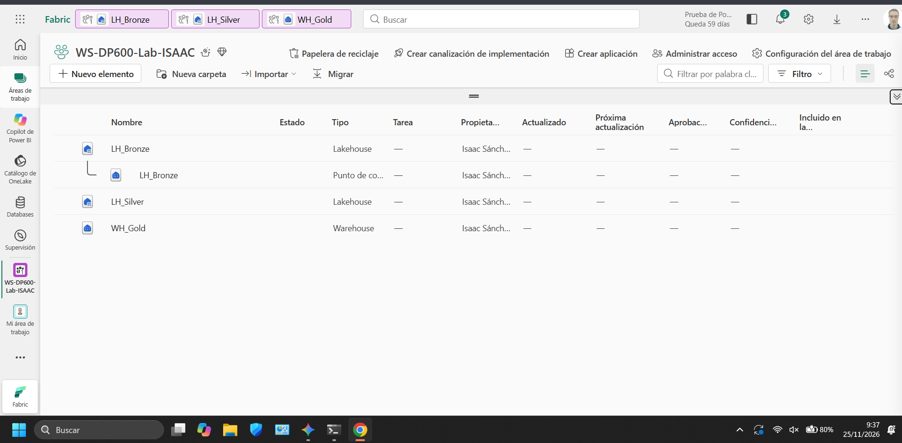

---

## 3. Capa Bronze - Ingesta de datos crudos

En la capa Bronze el objetivo es guardar todo exactamente igual que llega del origen sin tocar ni limpiar nada para tener siempre una copia real por si hiciera falta reprocesar más adelante

Para ello se ha creado el notebook "NB_01_Bronze_Ingesta" conectando "LH_Bronze" como lakehouse por defecto y escribiendo los cuatro ficheros en formato CSV dentro de la ruta "Files/raw/"

### Orígenes generados y suciedad deliberada
- **productos** - catálogo del CRM con 10 filas donde se mete un duplicado a propósito del producto "P003" y valores nulos en subcategoría y marca para "P009"
- **clientes** - datos del ERP con 6 filas incluyendo un correo nulo en el cliente "C004"
- **tiendas** - maestro con 3 tiendas entre canal físico y online
- **ventas** - líneas de pedido del POS con un total de 1.225 filas repartidas en 1.200 pedidos normales 15 líneas duplicadas a propósito y 10 pedidos de prueba con el prefijo "TEST-" además de llevar dos formatos de fecha mezclados con "OrderDate" en formato ISO y "ShipDate" en formato "dd/MM/yyyy"

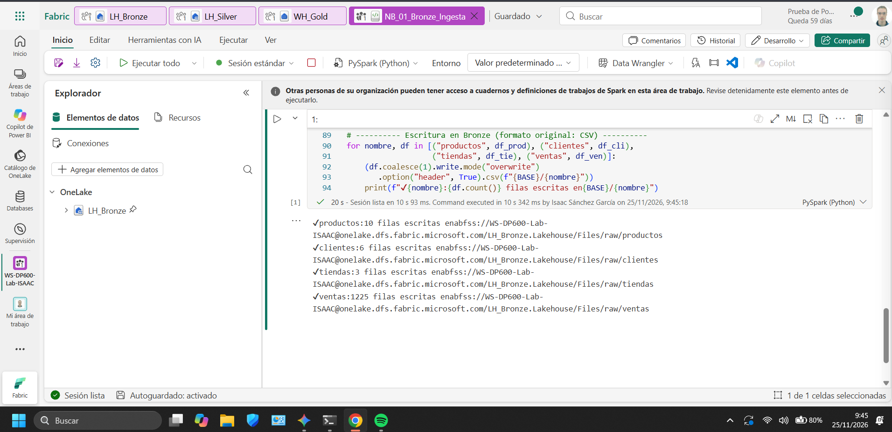

---

## 4. Capa Silver - Limpieza y conformación

El objetivo de la capa Silver es coger los datos crudos de Bronze corregir todos los errores que venían del origen estandarizar los formatos y guardar el resultado ya limpio en formato tabla Delta dentro de "LH_Silver"

Para hacer todo este proceso se ha creado el notebook "NB_02_Silver_Limpieza" que lee los cuatro ficheros CSV de Bronze y aplica las reglas de limpieza a cada tabla:
- **Productos** - se elimina el duplicado del producto "P003" se rellenan los valores nulos de subcategoría y marca con textos por defecto como "Sin subcategoría" y "Sin marca" y se pasa el precio a formato decimal
- **Clientes** - se eliminan posibles duplicados se rellena el correo vacío con "desconocido@example.com" y se juntan el nombre y el apellido en una sola columna llamada "FullName"
- **Tiendas** - se eliminan duplicados por código de tienda
- **Ventas** - es donde está el trabajo más importante ya que se quitan las 15 líneas duplicadas y los 10 pedidos de prueba que empiezan por "TEST-" se unifican los dos formatos de fecha de "OrderDate" y "ShipDate" a tipo fecha se pasan los importes a tipo decimal para evitar errores de redondeo con el dinero y se calculan dos columnas nuevas para el importe bruto "GrossAmount" y el importe neto "NetAmount"

Por último se guardan los cuatro resultados como tablas Delta en "LH_Silver" con los nombres "dim_producto_src" "dim_cliente_src" "dim_tienda_src" y "ventas"

Al terminar la ejecución se verifica que las cuatro tablas aparecen en "LH_Silver" y que la tabla de ventas se queda exactamente en 1.200 filas limpias tras haber eliminado los 15 duplicados y los 10 pedidos de prueba

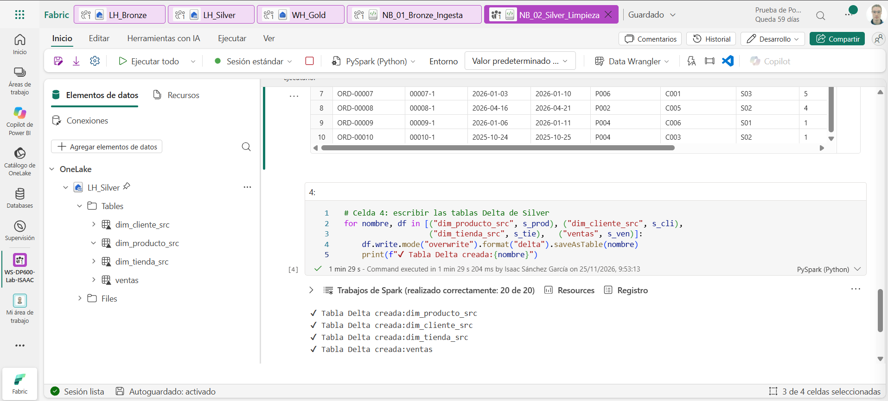

---

## 5. Capa Gold - Star Schema en Data Warehouse

En la capa Gold ya montamos el modelo final pensado para analizar los datos dentro del Warehouse "WH_Gold" creando un esquema llamado "gold" con un modelo en estrella

### 5.1 Creación de tablas y calendario
Primero se crean las 5 tablas del modelo: las dimensiones "Dim_Date" "Dim_Product" "Dim_Customer" y "Dim_Store" y la tabla de hechos "Fact_Sales" donde cada fila es una línea de pedido Para "Dim_Date" se genera un calendario completo desde 2024 hasta 2027 con año mes trimestre día y fin de semana usando el formato "YYYYMMDD" como clave

### 5.2 Carga de dimensiones
Para leer los datos limpios se conecta "LH_Silver" dentro de "WH_Gold" y se cargan las dimensiones de producto tienda y cliente En todas las dimensiones se mete además una fila con clave "-1" llamada "Desconocido" para que si alguna venta no encuentra coincidencia no se quede vacía ni se pierda

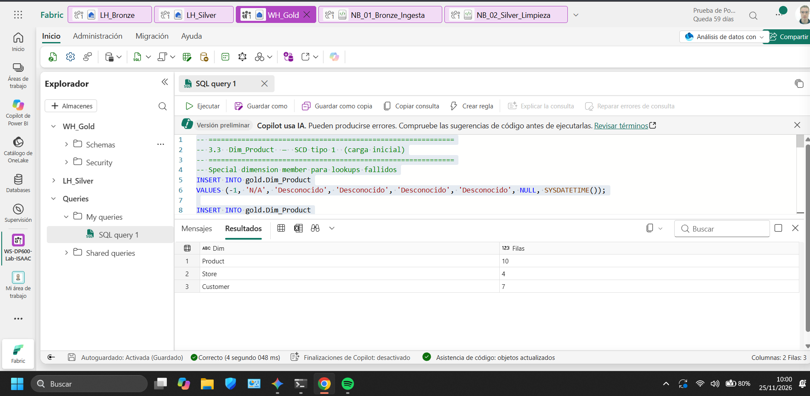

### 5.3 Carga de Fact_Sales y relaciones
Una vez cargadas las dimensiones se carga "Fact_Sales" cruzando los datos de ventas con cada dimensión para traer sus claves Al comprobar los resultados entran las 1.200 filas completas y con 0 registros desconocidos Por último se declaran las claves primarias y foráneas para que Power BI reconozca las relaciones más adelante y se crea la vista "Dim_Order" para poder consultar los números de pedido

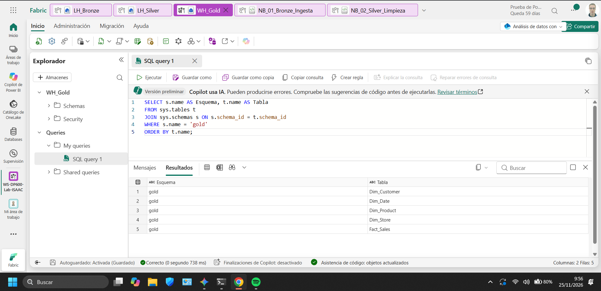

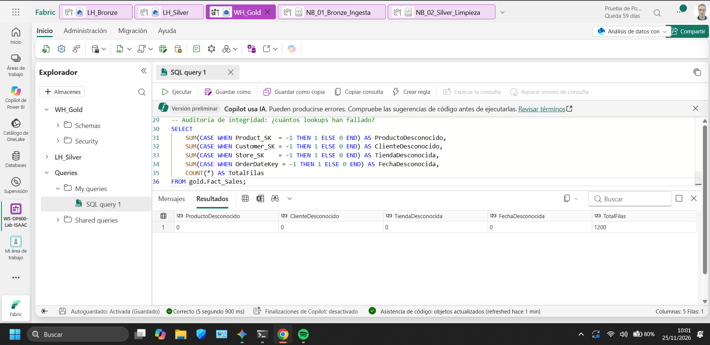

---

## 6. Carga incremental y SCD Tipo 2

Para no tener que borrar y volver a cargar todo cada vez que llegan datos nuevos se han creado tres procedimientos almacenados en "WH_Gold" que luego se lanzarán desde el pipeline:
- **sp_Load_Dim_Product** - aplica SCD Tipo 1 con un "MERGE" de forma que si cambia algún dato del producto se sobrescribe y si es nuevo se inserta
- **sp_Load_Dim_Customer** - aplica SCD Tipo 1 para el correo y el segmento y SCD Tipo 2 para la ciudad guardando así el histórico cuando un cliente se muda
- **sp_Load_Fact_Sales** - carga solo las líneas de pedido nuevas comprobando con un "NOT EXISTS" que no estén ya en la tabla para evitar duplicados

### Prueba de SCD Tipo 2 con cambio de ciudad
Para comprobar que el histórico funciona bien se ha simulado que la clienta Ana García - "C001" - se muda de Madrid a Zaragoza modificando su ciudad en "NB_02_Silver_Limpieza" y ejecutando después "sp_Load_Dim_Customer" en "WH_Gold"

Al consultar la tabla "Dim_Customer" aparecen dos filas para "C001": la versión antigua de Madrid marcada como no vigente - "RecIsCurrent = 0" - con fecha de fin de hoy y la nueva versión de Zaragoza activa - "RecIsCurrent = 1"

De esta forma todas las ventas anteriores de Ana siguen asociadas a Madrid sin reescribir la historia y solo las ventas futuras se guardarán bajo Zaragoza

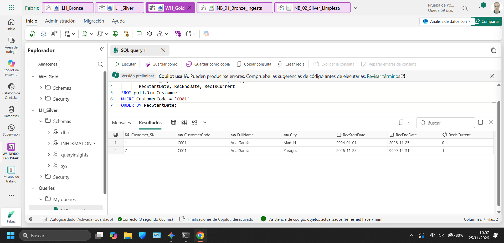

---

## 7. Modelo Semántico SM_Ventas y DAX

Desde "WH_Gold" se ha creado el modelo semántico "SM_Ventas" en modo Direct Lake incluyendo las cinco tablas del esquema en estrella - "Dim_Date" "Dim_Product" "Dim_Customer" "Dim_Store" y "Fact_Sales" - dejando fuera la vista "Dim_Order"

### 7.1 Relaciones del modelo
En la vista de modelo se han unido las claves de "Fact_Sales" con sus dimensiones de muchos a uno:
- **Relaciones activas** - "OrderDateKey" con "Dim_Date" "Product_SK" con "Dim_Product" "Customer_SK" con "Dim_Customer" y "Store_SK" con "Dim_Store"
- **Relación inactiva** - "ShipDateKey" con "Dim_Date" que queda inactiva porque Power BI solo deja una relación activa entre las mismas dos tablas y se activará luego con DAX para calcular las ventas por fecha de envío

### 7.2 Limpieza del modelo
Antes de hacer el informe se han aplicado varios ajustes básicos para que el modelo sea cómodo de usar:
- Marcar "Dim_Date" como tabla de fechas usando la columna "FullDate"
- Ordenar "MonthName" por la columna "Month" para que los meses salgan en orden y no alfabéticamente
- Crear la jerarquía "Calendario" con año trimestre mes y día
- Ocultar todas las claves técnicas las columnas de auditoría "Rec*" y las columnas numéricas de "Fact_Sales" para obligar a usar las medidas

### 7.3 Medidas DAX y comprobación
Se ha creado una tabla llamada "_Medidas" para tener agrupadas las 13 medidas DAX del proyecto:
- **Base** - "Ventas Netas" "Ventas Brutas" "Unidades" y "Descuento Total"
- **Pedidos** - "Nº Pedidos" y "Nº Líneas"
- **Ratios** - "% Descuento" y "Ticket Medio" usando "DIVIDE"
- **Fecha de envío** - "Ventas por Fecha de Envío" y "Días Medios de Envío" activando la relación inactiva con "USERELATIONSHIP"
- **Tiempo** - "Ventas Netas AA" "Variación YoY %" y "Ventas Netas YTD"

Para terminar se ha lanzado una consulta SQL en "WH_Gold" comprobando que los totales de ventas netas unidades número de pedidos y porcentaje de descuento coinciden exactamente con lo que devuelven las medidas DAX

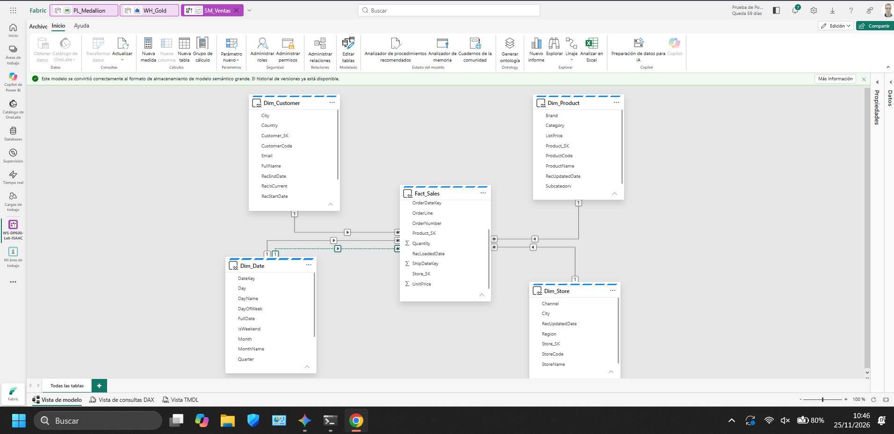

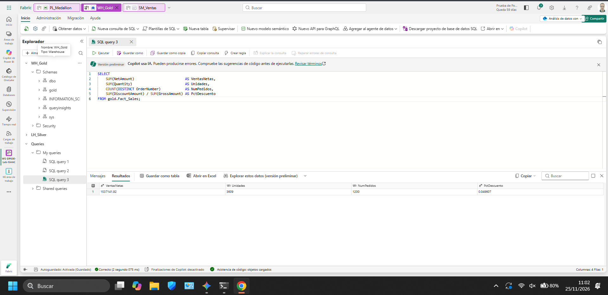

---

## 8. Informe en Power BI RPT_Ventas

A partir del modelo semántico "SM_Ventas" se ha creado el informe "RPT_Ventas" dividido en tres páginas para enseñar el funcionamiento del modelo de datos en la parte de consumo

### 8.1 Página 1 - Resumen ejecutivo
Esta primera página junta los datos generales del negocio usando las medidas base y las de tiempo:
- **Cuatro tarjetas** - muestran los totales de "Ventas Netas" "Unidades" "Nº Pedidos" y "Ticket Medio"
- **Gráfico de líneas** - compara la evolución mensual de "Ventas Netas" contra "Ventas Netas AA"
- **Gráfico de barras** - reparte las "Ventas Netas" según la categoría del producto
- **Matriz** - usa la jerarquía "Calendario" en las filas y el canal de la tienda en columnas para poder bajar de año a trimestre mes y día
- **Dos segmentaciones** - permiten filtrar toda la página por año y por segmento de cliente

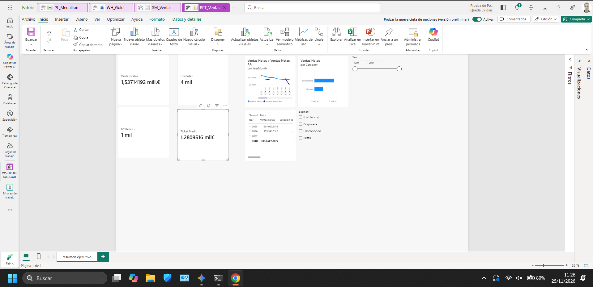

### 8.2 Página 2 - Logística
Esta página sirve para demostrar cómo funciona la relación inactiva de la fecha de envío usando una sola tabla de calendario:
- **Gráfico de columnas agrupadas** - compara por mes "Ventas Netas" por fecha de pedido frente a "Ventas por Fecha de Envío"
- **Tarjeta** - muestra los "Días Medios de Envío"
- **Tabla por tienda** - desglosa las dos métricas de ventas y los días medios de envío para cada tienda

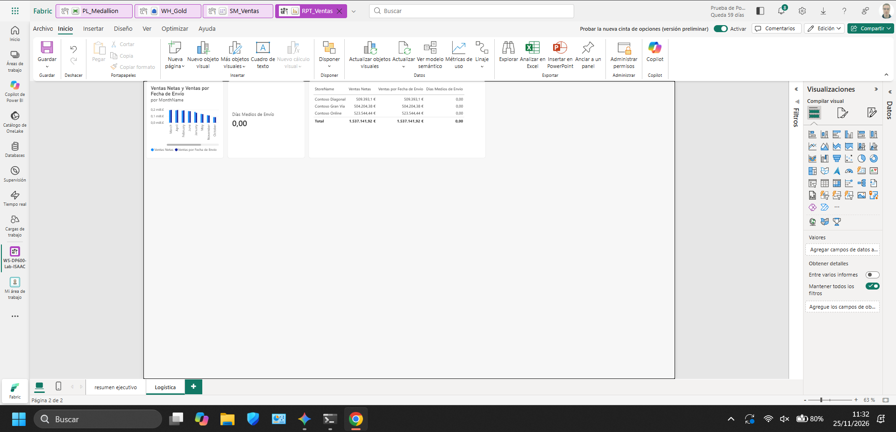

### 8.3 Página 3 - Efecto del SCD Tipo 2
La última página comprueba visualmente que el histórico de clientes se mantiene bien:
- **Tabla** - muestra el nombre del cliente ciudad "Ventas Netas" y "Nº Pedidos"
- **Segmentación** - filtra por código de cliente marcando "C001" para ver a Ana García conservando sus 190 pedidos y sus 245.455,02 € históricos bajo Madrid

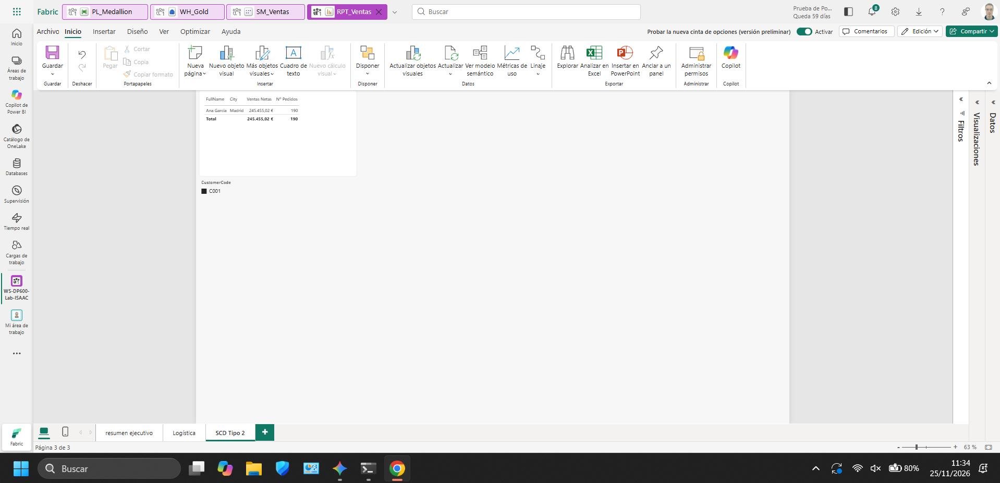

---

## 9. Orquestación con Data Pipeline PL_Medallion

Para automatizar todo el flujo desde la ingesta hasta el refresco del informe se ha creado el pipeline "PL_Medallion" encadenando 7 actividades en orden usando la flecha verde para que cada paso solo empiece si el anterior termina bien:
1. **NB_01_Bronze_Ingesta** - lanza el notebook que genera los CSV crudos en Bronze
2. **NB_02_Silver_Limpieza** - ejecuta la limpieza y guarda las tablas Delta en Silver
3. **products** - ejecuta el procedimiento "gold.sp_Load_Dim_Product" en "WH_Gold"
4. **customers** - ejecuta "gold.sp_Load_Dim_Customer" para actualizar clientes y el SCD Tipo 2
5. **sales** - ejecuta "gold.sp_Load_Fact_Sales" para cargar los hechos nuevos
6. **SM_Ventas** - actualiza el modelo semántico en modo Direct Lake que al no copiar datos solo refresca los metadatos en pocos segundos
7. **Carga PL_Medallion completada** - envía un correo por Outlook avisando de que el proceso ha terminado bien

El orden de los procedimientos almacenados es clave porque las dimensiones de producto y cliente tienen que cargarse siempre antes que la tabla de ventas para que al cruzar las claves encuentre las versiones vigentes y no mande registros al valor "-1"

Al guardar y ejecutar el pipeline completo las 7 actividades han terminado en verde en la pestaña de salida y ha llegado el correo de confirmación a la bandeja de entrada

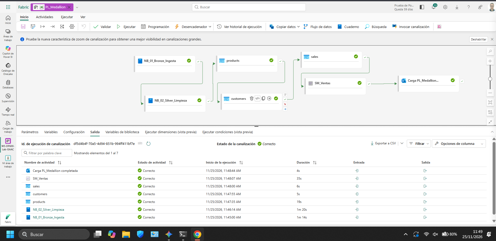

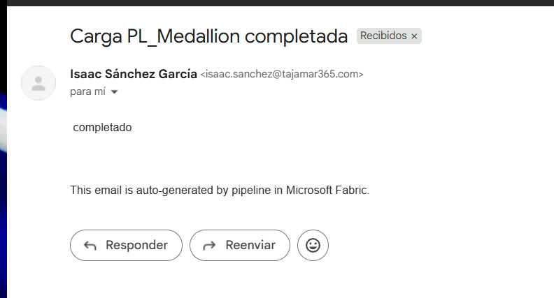

---

## 10. Mejora adicional - 3 Datamarts sobre Gold

Como mejora extra sobre la práctica base se han creado tres datamarts separados por departamento dentro de "WH_Gold" para que cada área de negocio consulte solo los datos que necesita sin tener que cruzar todas las tablas del modelo a mano

Para organizarlo bien se ha creado un esquema nuevo llamado "datamart" con tres vistas SQL que leen directamente desde el esquema "gold":
- **datamart.vw_DM_Ventas** - enfocado al equipo comercial con los datos de facturación descuentos productos tiendas y fecha de pedido
- **datamart.vw_DM_Logistica** - pensado para envíos juntando la fecha de pedido la fecha de envío los días que tarda en salir y los datos de cada tienda
- **datamart.vw_DM_Clientes** - agrupa los pedidos las unidades y las ventas netas por cliente segmento ciudad y mes manteniendo el campo "RecIsCurrent" para seguir viendo el histórico del SCD Tipo 2

Al ejecutar la consulta de comprobación sobre las tres vistas los datos cargan sin errores y en "vw_DM_Clientes" se vuelve a ver el efecto del histórico con Ana García en Madrid marcada con "RecIsCurrent = 0"

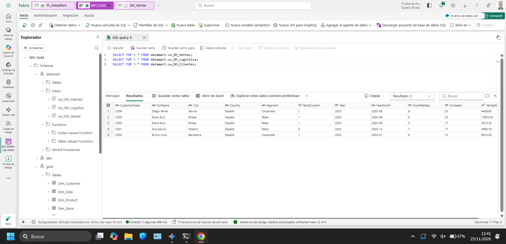

---

## 11. Errores encontrados y soluciones aplicadas

Durante el desarrollo de la práctica han ido saliendo varios problemas o limitaciones propias de la plataforma que se han resuelto de la siguiente manera:
- **Sin modelo semántico automático en WH_Gold** - en las versiones actuales de Fabric ya no se crea un modelo semántico por defecto al generar un Warehouse así que hubo que crear "SM_Ventas" a mano en modo Direct Lake seleccionando las cinco tablas del esquema en estrella
- **Dos fechas contra la misma tabla de calendario** - Power BI no deja tener dos relaciones activas entre "Fact_Sales" y "Dim_Date" por lo que la relación de "ShipDateKey" se quedó inactiva y se solucionó activándola solo cuando hace falta con "USERELATIONSHIP" dentro de las medidas DAX
- **Meses desordenados en los gráficos** - al sacar los meses por nombre en el informe salían ordenados alfabéticamente en lugar de por orden natural y se arregló configurando la columna "MonthName" para que se ordene usando la columna numérica "Month"

---

## 12. Conclusiones

Con esta práctica se ha conseguido montar un flujo completo de datos en Microsoft Fabric desde los ficheros CSV en crudo con errores hasta el informe final en Power BI y la automatización entera con un Data Pipeline

Usar la arquitectura Medallion repartida entre Lakehouse para Bronze y Silver y Data Warehouse para Gold permite mantener todo muy ordenado limpiando la suciedad antes de llegar al modelo en estrella además el uso de SCD Tipo 2 en clientes asegura que los cambios como una mudanza no borren ni alteren las ventas históricas

Por último el modo Direct Lake en "SM_Ventas" hace que el refresco dentro del pipeline tarde solo unos segundos y añadir el esquema "datamart" con las tres vistas deja los datos listos para que cada departamento consulte solo lo que necesita sin tocar el modelo principal

---

## Estructura del repositorio

```text
.
├── README.md
├── Practica 23 - Opcional - MS Fabric.pdf
├── presentacion_fabric_dp600.pptx
└── images/
    ├── 01_entorno_workspace.png
    ├── 02_bronze_ingesta.png
    ├── 03_silver_limpieza.png
    ├── 04_gold_dimensiones.png
    ├── 05_gold_fact_sales.png
    ├── 06_scd2_ana_garcia.png
    ├── 07_modelo_semantico.png
    ├── 08_validacion_sql.png
    ├── 09_rpt_pagina1_resumen.png
    ├── 10_rpt_pagina2_logistica.png
    ├── 11_rpt_pagina3_scd2.png
    ├── 12_pipeline_medallion.png
    ├── 13_correo_confirmacion.png
    └── 14_datamarts_gold.png
```