# Sección 3 --- Estimar el coste antes de desplegar

  --------------------------------------------------------------------------
  **Escenario**   **Horas de   **Coste      **Coste   **Coste   **Total,
                  cómputo**    cómputo**    disco (72 IP (72    estimado**
                                            h)**      h)**      
  --------------- ------------ ------------ --------- --------- ------------
  **A. VM         72           2,81 €       0,22 €    0,31 €    **3,34 €**
  encendida todo                                                
  el                                                            
  laboratorio**                                                 

  **B. VM con     36           1,40 €       0,22 €    0,31 €    **1,93 €**
  apagado                                                       
  automático                                                    
  nocturno**                                                    

  **C. VM         8            0,31 €       0,22 €    0,31 €    **0,84 €**
  encendida solo                                                
  8 h en total**                                                
  --------------------------------------------------------------------------

Resultados de la calculadora

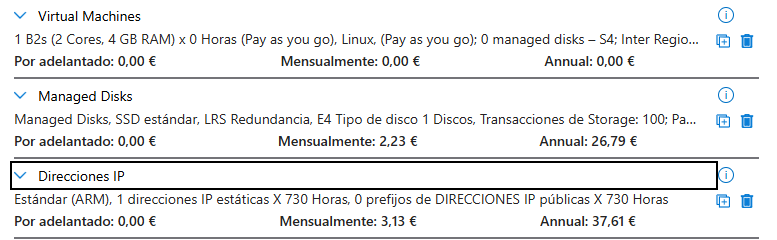{width="5.905555555555556in"
height="1.823611111111111in"}

# Sección 4 --- Crear el Resource Group etiquetado

## Paso 1. Crear el Resource Group

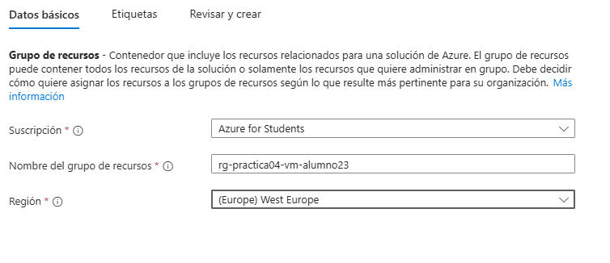{width="5.905555555555556in"
height="2.5527777777777776in"}

## Paso 2. Añadir Tags

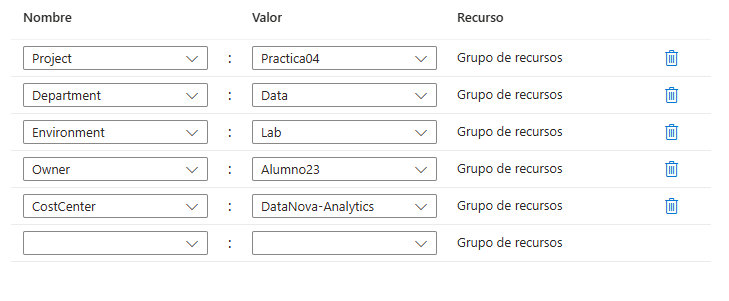{width="5.905555555555556in"
height="2.4381944444444446in"}

## Creación del grupo y verificación de creación 

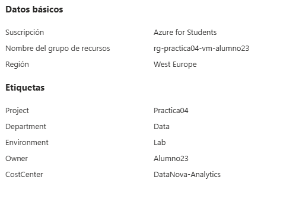{width="5.198641732283464in"
height="3.7296872265966754in"}

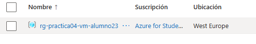{width="5.490349956255468in"
height="0.9480489938757656in"}

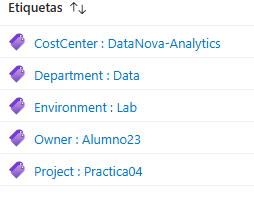{width="2.6462029746281717in"
height="2.073206474190726in"}

# Sección 5 --- Crear un Budget específico para el laboratorio

## Paso 1. Abrir Budget con el ámbito correcto

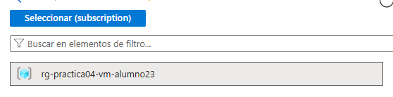{width="5.813311461067366in"
height="1.4377001312335957in"}

## Paso 2. Definir el importe a partir de tu estimación

Ejemplo:

Total, estimado Escenario B = 1,62 €

Budget del laboratorio = 2 €

## Paso 3. Configurar el Budget

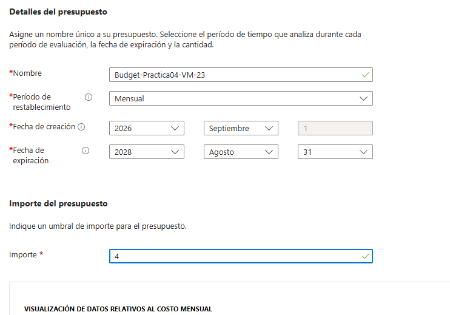{width="5.905555555555556in"
height="4.1305555555555555in"}

## Paso 4. Configurar las alertas

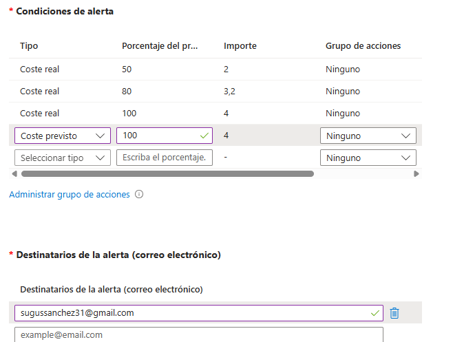{width="5.905555555555556in"
height="4.354861111111111in"}

### Creado 

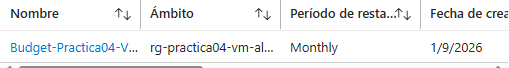{width="5.302823709536308in"
height="0.7084317585301837in"}

# Sección 6 --- Desplegar la máquina virtual

## Paso 1. Iniciar la creación

## Paso 2. Pestaña Basics

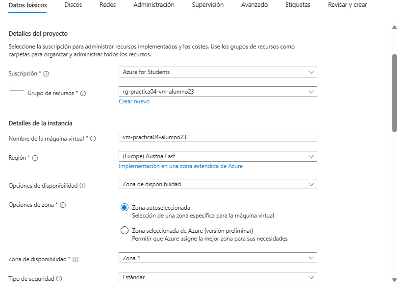{width="5.905555555555556in"
height="4.240972222222222in"}

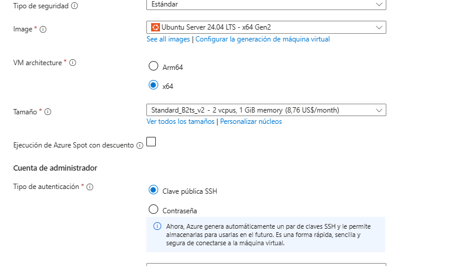{width="5.905555555555556in"
height="3.407638888888889in"}

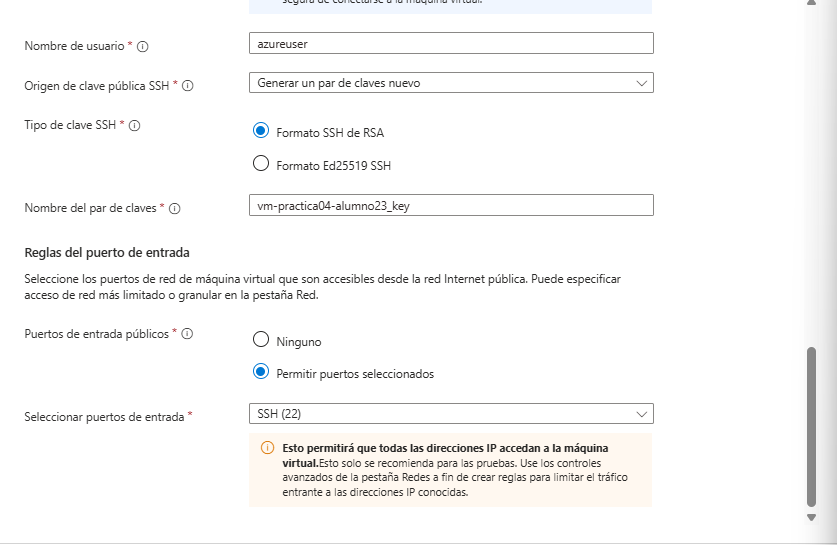{width="5.905555555555556in"
height="3.845138888888889in"}

## Paso 3. Pestaña Disks

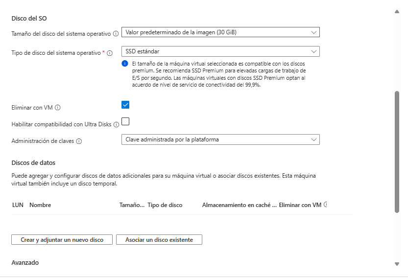{width="5.905555555555556in"
height="4.027083333333334in"}

## Paso 4. Pestaña Networking

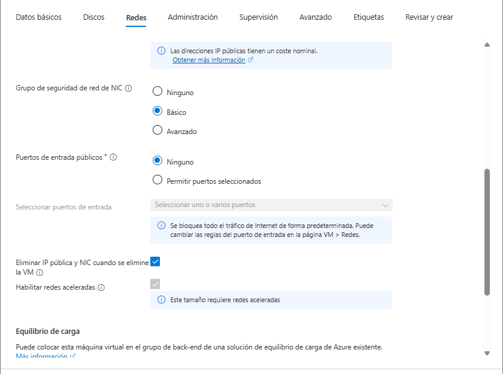{width="5.905555555555556in"
height="4.394444444444445in"}

## Paso 5. Pestaña Management --- Apagado automático

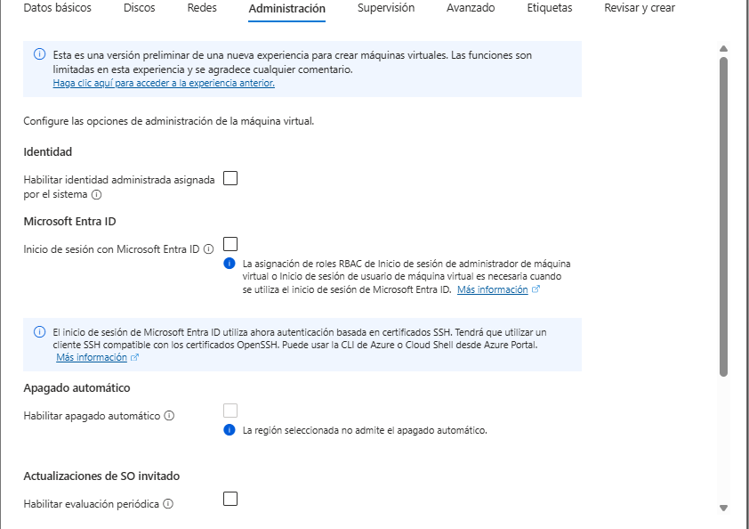{width="5.905555555555556in"
height="4.165972222222222in"}

## Paso 6. Pestaña Tags

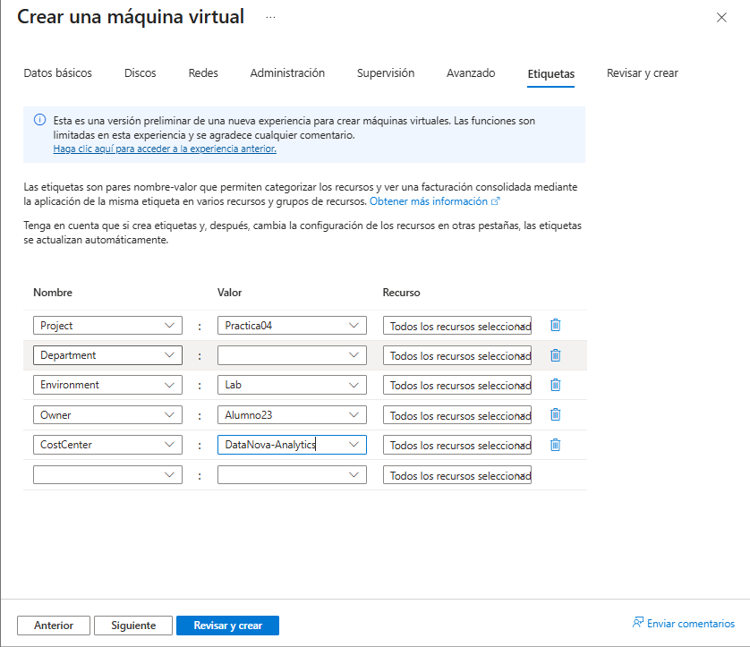{width="5.905555555555556in"
height="5.095138888888889in"}

## Paso 7. Revisar y crear

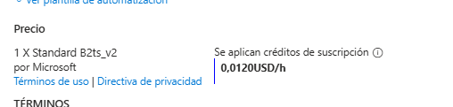{width="5.292404855643045in"
height="1.2605927384076991in"}

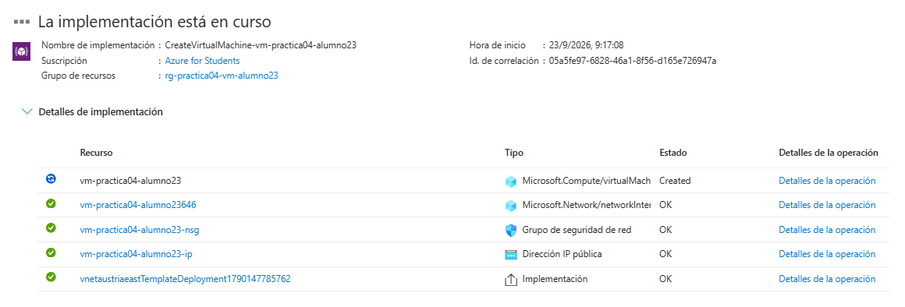{width="5.905555555555556in"
height="2.0055555555555555in"}

# Sección 7 

  -------------------------------------------------------------------------------------------------
                               Recurso                               Tipo        ¿Tiene   ¿Genera
                                                                                 los 5    coste?
                                                                                 Tags?    
  ------------------------------------------------------------------ ----------- -------- ---------
                        vm-practica04-alumno23                       Virtual     si       Si
                                                                     machine              

   vm-practica04-alumno23_OsDisk_1_95fe15e705904150be408c81007f2832  Disk        si       si

                      vm-practica04-alumno23-ip                      Public IP   si       Si
                                                                     address              

                      vm-practica04-alumno23646                      Network     si       Si
                                                                     interface            

                      vm-practica04-alumno23646                      Network     si       si
                                                                     security             
                                                                     group                

                     vm-practica04-alumno23646nsg                    Virtual     si       Si
                                                                     network              
  -------------------------------------------------------------------------------------------------

# Sección 8 --- Primera revisión en Cost Analysis

## Paso 1. Abrir Cost Analysis con el ámbito del Resource Group

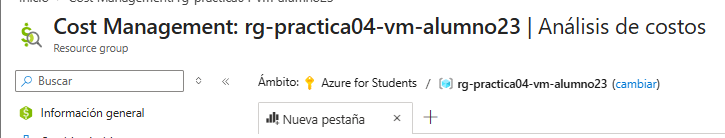{width="5.905555555555556in"
height="1.1243055555555554in"}

## Paso 2. Ver el coste por recurso

  -----------------------------------
     **Recurso**     **Coste
                     acumulado**
  ------------------ ----------------
   Máquina virtual   0.16

        Disco        0.07

      IP pública     0.05

        Otros        0

   **Total (Actual   0.29
       Cost)**       
  -----------------------------------

## Paso 3. Ver el coste por medidor

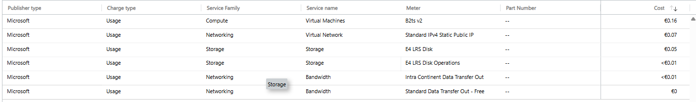{width="5.905555555555556in"
height="0.8729166666666667in"}

## Paso 4. Ver el coste diario

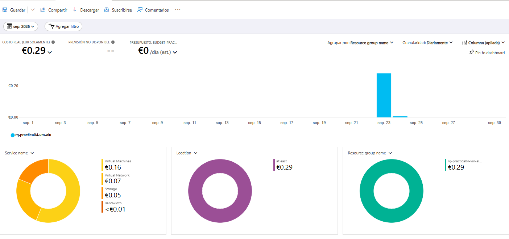{width="5.905555555555556in"
height="2.7805555555555554in"}

## Paso 5. Ver el coste por Tag

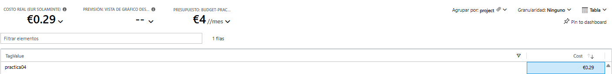{width="5.905555555555556in"
height="0.7173611111111111in"}

## Paso 6. Consultar la previsión

  --------------------------------------
  **Dato**                   **Valor**
  -------------------------- -----------
  Actual Cost                0.29

  Forecasted Cost (fin de    
  mes)                       

  Budget del laboratorio     4

  ¿Actual supera el Budget?  No

  ¿Forecast supera el        Sí
  Budget?                    
  --------------------------------------

## Paso 7. Revisar las alertas

  ----------------------------------------------
     **Alerta**    **¿Se ha         **Fecha y
                   activado?**      hora**
  ---------------- ---------------- ------------
    Actual 50 %    no               

    Actual 80 %    no               

    Actual 100 %   No               

  Forecasted 100 % no               
  ----------------------------------------------

# Sección 9 --- Experimento: apagar no es lo mismo que desasignar

## Paso 2. Desasignarla

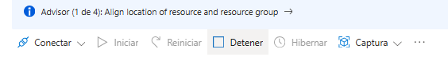{width="5.875820209973753in"
height="0.7501049868766404in"}

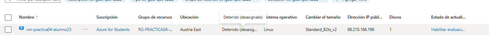{width="5.905555555555556in"
height="0.5222222222222223in"}

## Paso 3. Observar el efecto al día siguiente

  ----------------------------------------------------------
  **Medidor**         **Coste Día  **Coste Día  **Coste Día
                      1**          2**          3**
  ------------------- ------------ ------------ ------------
  Cómputo B2s         0.16         0            0

  Disco Standard SSD  0.07         0.07         0

  IP pública          0.05         0.05         0
  ----------------------------------------------------------

1.  ¿Qué medidor baja cuando la VM está desasignada?

El de computo

2.  ¿Qué medidores siguen generando coste?

Continúan generando coste la ip y el almacenamiento

3.  Si un compañero deja 20 VMs apagadas desde el sistema operativo
    durante un fin de semana, ¿qué está pagando DataNova?

Estarían pagando 0.16 por día y maquina entorno a los 6.4 por el fin de
semana

4.  ¿Qué acción garantizaría que \*\*ningún\*\* medidor siga cobrando?

Eliminar la maquina virtual

# Sección 10 --- Comparar estimación y coste real

  ------------------------------------------------------------------------
  **Concepto**     **Estimado         **Real (Cost       **Diferencia**
                   (Sección 3)**      Analysis)**        
  ---------------- ------------------ ------------------ -----------------
  Cómputo          1.4€               0.16€              -1.24€

  Disco            0.22€              0.07€              -0.15€

  IP pública       0.31€              0.05€              -0.26€

  **Total**        1.93€              0.29€              -1.64€
  ------------------------------------------------------------------------

1.  ¿Qué escenario de la Sección 3 se parece más a lo que realmente
    ocurrió?

> en el escenario de la sección 3 el coste esta por debajo de lo
> estimado

2.  ¿Qué componente se desvió más de lo estimado? ¿Por qué?

El computo de la maquina porque como se terminó eligiendo una más
económica el cálculo bajo

3.  ¿Algún coste no estaba en tu estimación?

El tráfico de red que, aunque el gasto es de cero o un valor
insignificante en el presupuesto no esta

4.  Si DataNova tuviera que mantener este servidor para 10 analistas
    durante un mes, 8 horas al día y 22 días, ¿qué coste estimarías con
    los datos reales que has obtenido?

> 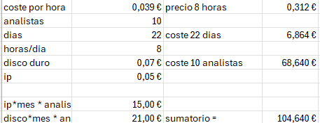{width="4.761081583552056in"
> height="1.8440069991251093in"}

# Sección 12 

  -----------------------------------------------------------------------
  **Elemento**        **Resultado**
  ------------------- ---------------------------------------------------
  **Nombre de la      Práctica 04 --- VM Linux con control de costes
  práctica**          

  **Resource Group**  rg-practica04-vm-alumno23

  **Servicios         Virtual Machines, Managed Disks (Standard SSD),
  utilizados**        Public IP, Virtual Network.

  **Coste estimado    1,93 €
  antes de            
  desplegar**         

  **Budget            2,00 €
  disponible**        

  **Alertas           Actual 50 %, Actual 80 %, Actual 100 % y Forecasted
  configuradas**      100 %.

  **Alertas           Ninguna
  activadas**         

  **Coste observado** 0,29 €

  **Recurso con mayor Máquina virtual (Cómputo B2s) con 0,16 €.
  coste**             

  **Recursos          El grupo de recursos completo
  eliminados**        (rg-practica04-vm-alumno23) y el presupuesto
                      asociado.

  **Observaciones**   Se comprobó que apagar la VM desde el sistema
                      operativo sigue generando costes. Para detener la
                      facturación de cómputo es necesario desasignarla
                      desde el portal, aunque el almacenamiento y la IP
                      pública se seguirán cobrando.
  -----------------------------------------------------------------------

# Sección 13 --- Ejercicio final

Un equipo de DataNova Engineering despliega cinco VMs de pruebas con
esta configuración:

  ----------------------------------------------------------------------
  Budget del proyecto = 50 €
  ----------------------------------------------------------------------
  Actual Cost (día 10 del mes) = 22 €

  Forecasted Cost = 68 €

  Apagado automático = No configurado

  Estado de 3 VMs = Stopped (no deallocated)

  ----------------------------------------------------------------------

**1. ¿Qué alertas se habrán activado con umbrales Actual 50 %, 80 %, 100
% y Forecasted 100 %?**

> La única alerta activa seria la de Forecasted ya que aun no se ha
> llegado en el dia 10 a la mitad del presupuesto, pero la predicción
> esta actualmente en 68 que supera los 50

------------------------------------------------------------------------

**2. ¿Por qué el Forecasted Cost es tan superior al Actual Cost?**

> Porque el coste del forecasted se calcula según el calculo diario en
> este caso 2.2 euros dia y lo multiplica por el número de días por mes

------------------------------------------------------------------------

**3. ¿Qué parte del gasto de las 3 VMs detenidas se podría eliminar sin
borrarlas?**

> Se podría reducir bastante el gasto ya que las maquinas han sido
> apagadas desde el so si se hubieran apagado desde la interfaz de Azure
> el gasto de la maquina baja a 0 y solo se pagaría la ip y el disco

------------------------------------------------------------------------

**4. Ordena estas acciones de mayor a menor impacto en el ahorro
inmediato:**

- \[1 \] Desasignar las 3 VMs detenidas.

- \[2 \] Configurar apagado automático en las 5 VMs.

- \[3 \] Cambiar los discos de Premium SSD a Standard SSD.

- \[4 \] Eliminar las IP públicas que no se usan.

- \[ 5\] Añadir Tags a todos los recursos.

------------------------------------------------------------------------

5.  **¿Cuál de las acciones anteriores no ahorra dinero, pero es
    imprescindible para analizarlo?**

> La acción que no produce ningún beneficio económico es la de poner
> tags pero a su vez es muy importante porque nos permite filtrar por
> los gatos
