# Parte1

## Aprovisionar un recurso de Azure SQL Database

1.  Inicia sesión en el [portal de
    Azure](https://portal.azure.com/?azure-portal=true) con tu cuenta de
    Azure.

2.  En la esquina superior izquierda de la página, seleccione **+ Crear
    un recurso** . En el cuadro **Buscar en Marketplace** , escriba
    Azure SQLy pulse Intro. En los resultados de la búsqueda, seleccione
    **Azure SQL** (publicado por Microsoft).

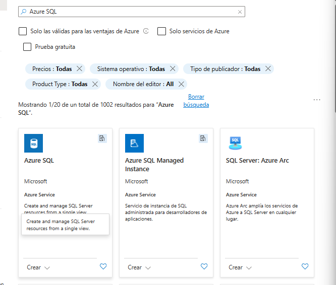{width="5.905555555555556in"
height="5.01875in"}

3.  En la página **de Azure SQL** , seleccione **Crear** . En la página
    **Buscar la solución de Azure SQL adecuada para su carga de
    trabajo** , en el mosaico **Crear una base de datos** , seleccione
    **Más detalles** y, a continuación, seleccione **Crear base de datos
    SQL** .

***Consejo:** Una única base de datos SQL es la opción más sencilla de
configurar y perfecta para aprender. Las demás opciones (como
Hyperscale, grupos elásticos o instancias administradas) añaden
funciones que aún no necesitas.*

4.  Introduzca los siguientes valores en la página **Crear base de datos
    SQL** y deje el resto de las propiedades con su configuración
    predeterminada:

    - **Suscripción** : Seleccione su suscripción de Azure.

    - **Grupo de recursos** : Cree un nuevo grupo de recursos con el
      nombre que desee.

***¿Qué es un grupo de recursos?** Es simplemente una carpeta que agrupa
recursos de Azure relacionados. Cuando termine, puede eliminar la
carpeta para borrar todo con un solo clic.*

- **Nombre de la base de datos** :Dealership

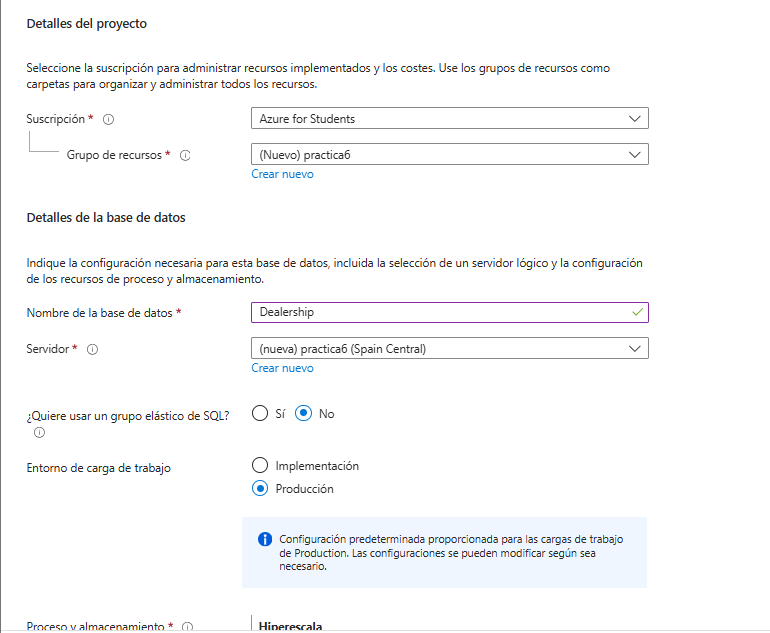{width="5.905555555555556in"
height="4.854861111111111in"}

- **Servidor** : Seleccione **Crear nuevo** y cree un nuevo servidor con
  un nombre único en cualquier ubicación disponible. Use **la
  autenticación SQL** y especifique su nombre como nombre de usuario del
  administrador del servidor y una contraseña suficientemente compleja
  (¡recuerde la contraseña, la necesitará más adelante!).

Seleccione **Aceptar** para cerrar el formulario del servidor.

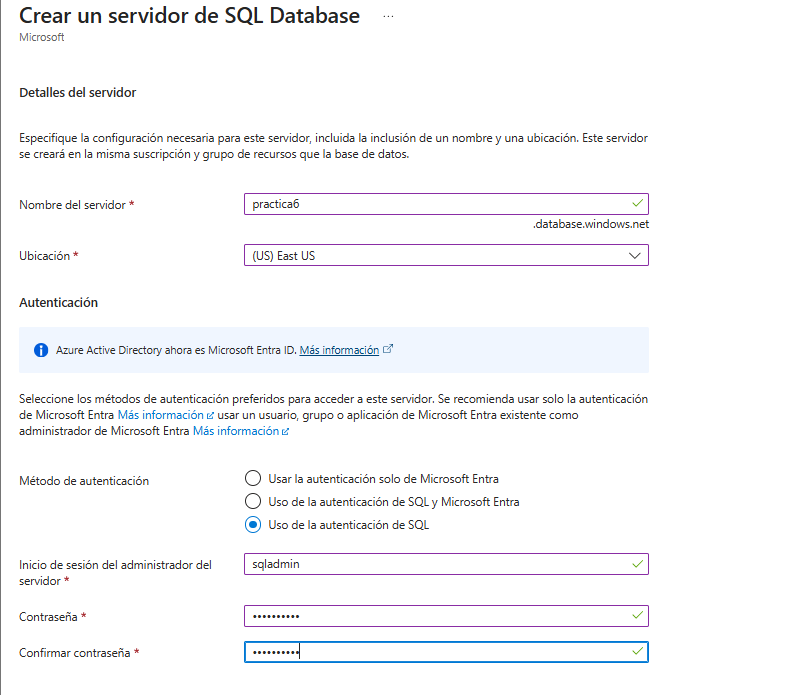{width="5.905555555555556in"
height="5.182638888888889in"}

- **¿Desea utilizar el grupo elástico de SQL?** : *No*

- **Entorno de carga de trabajo** : *Desarrollo*

- **Computación + almacenamiento** : Dejar sin cambios.

- **Redundancia de almacenamiento de respaldo** : *Almacenamiento de
  respaldo con redundancia local*

***Consejo:** La autenticación SQL (nombre de usuario y contraseña) es
la forma más rápida de iniciar sesión en este laboratorio. Las opciones
**de Desarrollo** y **Redundancia Local** mantienen los costos lo más
bajos posible para una base de datos de práctica corta.*

5.  Seleccione **Siguiente: Redes \>** . En la página **Redes , en la
    sección Conectividad de red** , seleccione **Punto de conexión
    público** . A continuación, en la sección **Reglas de firewall ,
    establezca tanto Permitir que los servicios y recursos de Azure
    accedan a este servidor** como **Agregar la dirección IP del cliente
    actual** en **Sí** .

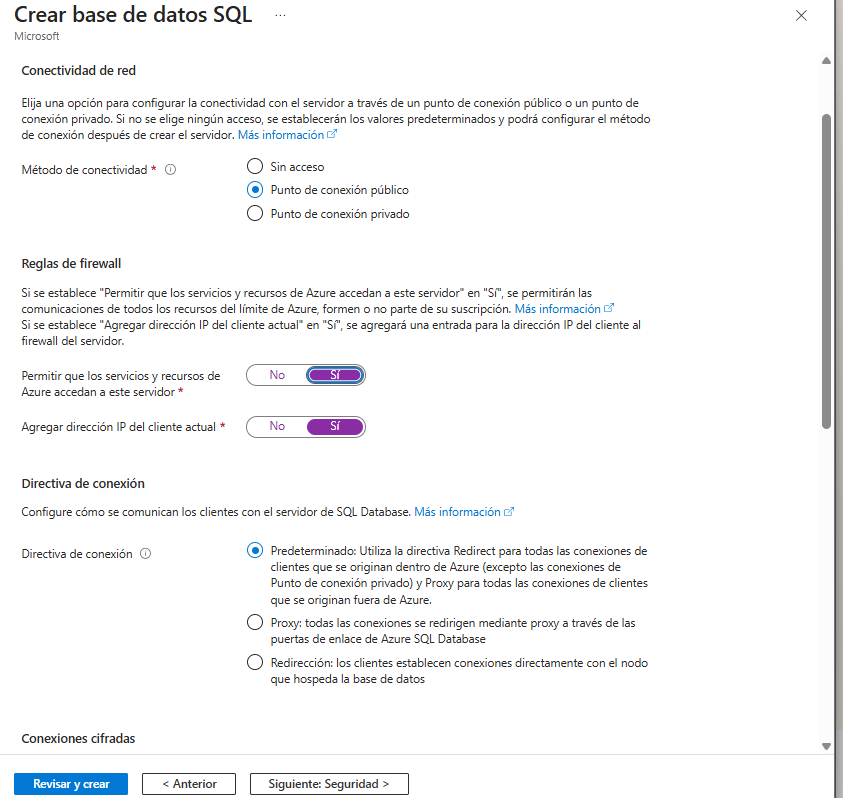{width="5.905555555555556in"
height="5.590277777777778in"}

***Consejo:** Un cortafuegos bloquea las conexiones no deseadas. Esta
configuración permite el acceso justo para que \*usted\* pueda
conectarse a la base de datos durante la práctica. En un proyecto real,
el acceso sería mucho más restringido.*

6.  Seleccione **Siguiente: Seguridad \>** y asegúrese de que la opción
    **Habilitar Microsoft Defender para SQL** esté configurada en
    **Ahora no** .

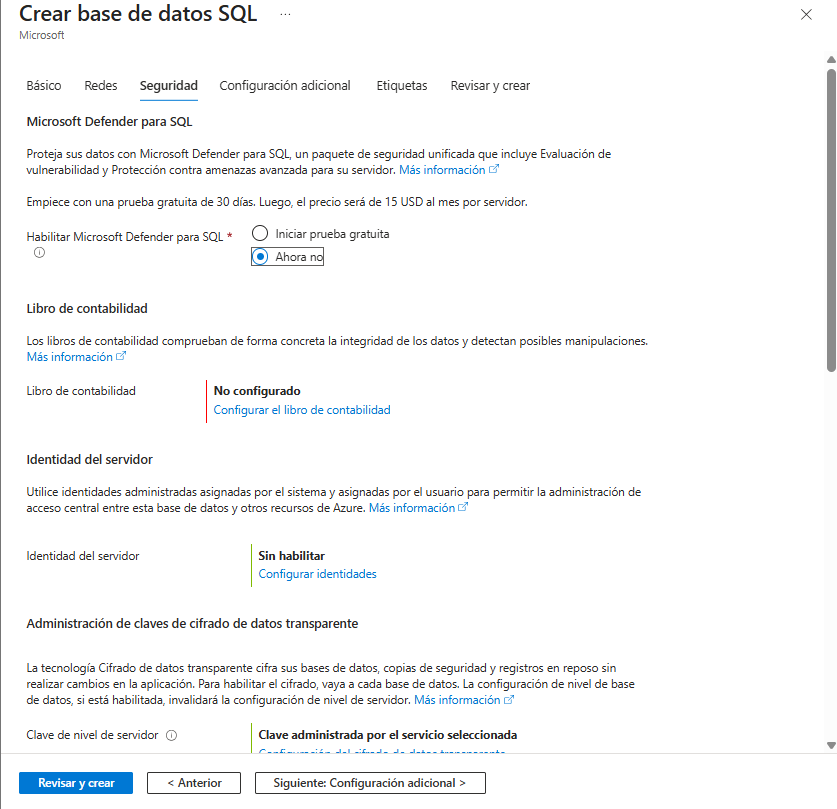{width="5.905555555555556in"
height="5.708333333333333in"}

***Consejo:** Defender es un complemento de seguridad de pago. Puedes
prescindir de él sin problema para este breve ejercicio gratuito.*

7.  Seleccione **Siguiente: Configuración adicional \>** . En la pestaña
    **Configuración adicional** , asegúrese de que la opción **Usar
    datos existentes** esté configurada en **Ninguno** .

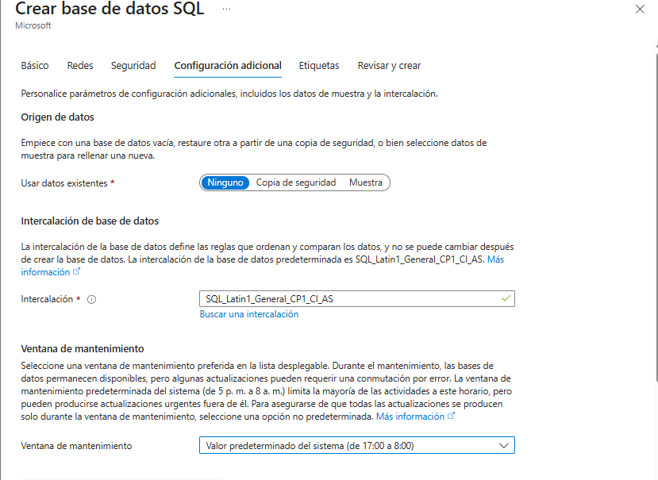{width="5.905555555555556in"
height="4.309722222222222in"}

***Importante:** Si dejas este valor como **Ninguno,** obtendrás una
base de datos completamente vacía. Esto es lo que necesitas, ya que
crearás tus propias tablas y datos automotrices en la siguiente
sección.*

8.  Seleccione **Revisar + crear**, revise la configuración y, a
    continuación, seleccione **Crear**.

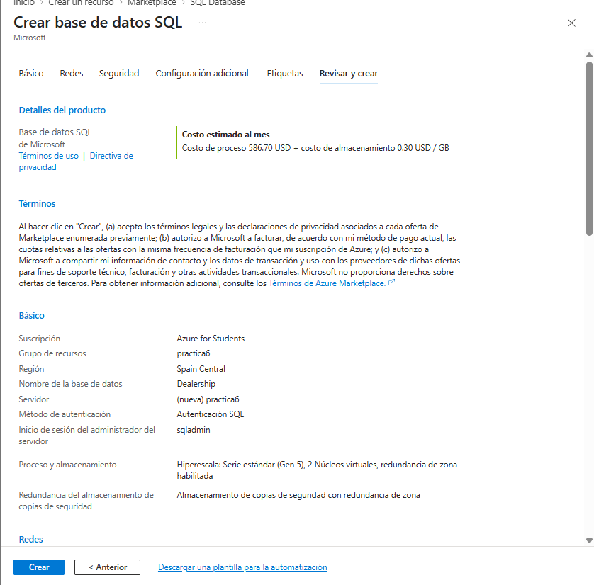{width="5.905555555555556in"
height="5.820833333333334in"}

9.  Espere unos minutos a que finalice la implementación. Cuando
    termine, seleccione **Ir al recurso**.

## Cree las tablas de la base de datos y agregue datos de ejemplo.

Tu base de datos está creada, pero vacía. En una base de datos
relacional, los datos se almacenan en **tablas**, que son como hojas de
cálculo formadas por filas y columnas. Ahora crearás dos tablas y las
llenarás con una pequeña cantidad de datos de ejemplo.

1.  En el menú del lado izquierdo de la página de la base de datos,
    seleccione **Editor de consultas (vista previa)** . En el panel de
    inicio de sesión, seleccione la pestaña **Autenticación SQL**,
    ingrese el nombre de usuario y **la contraseña del administrador del
    servidor** que creó anteriormente y, a continuación, seleccione
    **Conectar** .

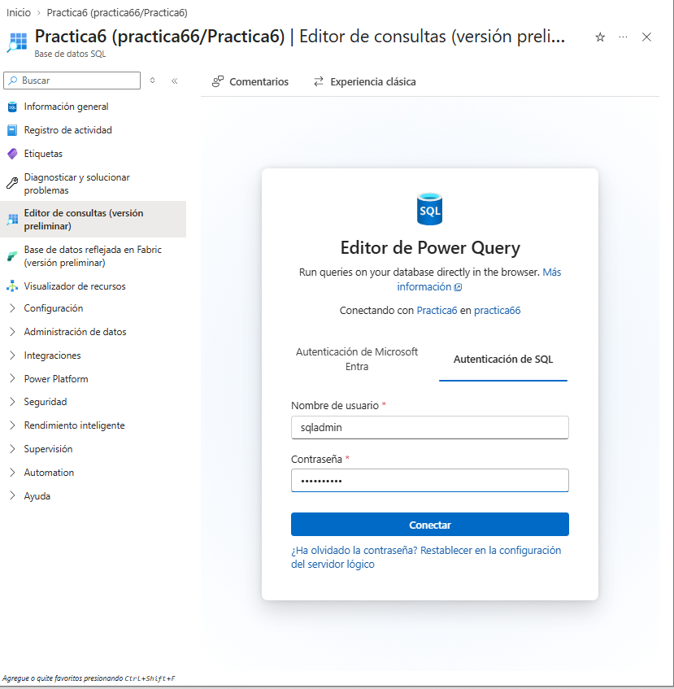{width="5.905555555555556in"
height="6.034027777777778in"}

***Nota:** Si aparece un error que indica que la dirección IP de su
cliente no está permitida, seleccione el enlace **\"Lista de direcciones
IP permitidas\"** en el mensaje para otorgar acceso y, a continuación,
intente conectarse de nuevo.*

El editor de consultas es donde escribirás y ejecutarás comandos SQL.
Selecciona **+ Nueva consulta** para abrir una pestaña de consulta en
blanco.

2.  En la pestaña de consulta, pegue el siguiente código SQL. Esto crea
    una tabla **de fabricantes** (las empresas que fabrican vehículos) y
    una tabla **de vehículos** (los coches que vende el concesionario).

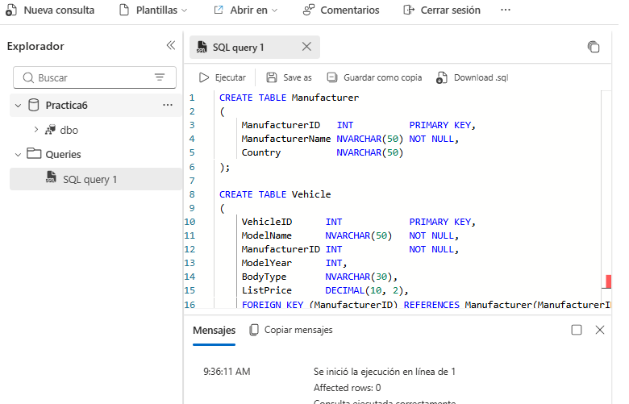{width="5.905555555555556in"
height="3.7930555555555556in"}

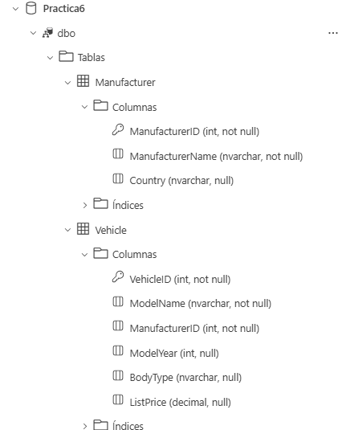{width="4.490209973753281in"
height="5.573694225721785in"}

3.  Seleccione **▷ Ejecutar** encima de la consulta. Debería ver un
    mensaje que confirma que la consulta se ejecutó correctamente. Sus
    dos tablas ya existen, pero están vacías.

4.  Reemplace todo el SQL en la pestaña de consulta con el siguiente
    código, que agrega fabricantes y vehículos de ejemplo. Luego
    seleccione **▷ Ejecutar** .

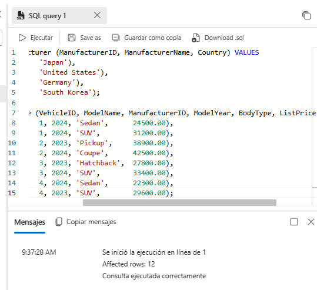{width="5.615367454068242in"
height="5.1361329833770775in"}

## Consultar los datos

Ahora que su base de datos contiene datos, puede utilizar sentencias SQL
**SELECT** para recuperarlos y explorarlos.

1.  Reemplace todo el código SQL en la pestaña de consulta con el
    siguiente código y seleccione **▷ Ejecutar** . Esto devolverá todas
    las columnas y todas las filas de la tabla **Vehículo** .

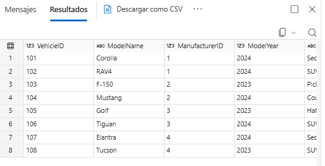{width="5.552858705161855in"
height="2.8337292213473315in"}

Reemplace la consulta con el siguiente código y seleccione **▷
Ejecutar** . Esto devuelve solo columnas específicas, por lo que los
resultados son más fáciles de leer.

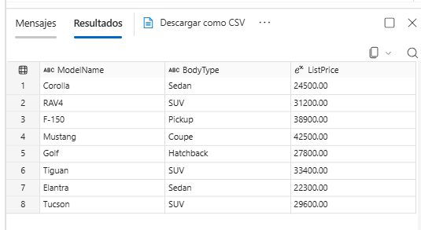{width="5.573694225721785in"
height="3.052509842519685in"}

Ahora intenta filtrar los datos. Reemplaza la consulta con el siguiente
código y selecciona **▷ Ejecutar** . La cláusula **WHERE** devuelve solo
los vehículos que cuestan menos de \$30,000, y **ORDER BY** los ordena
del más barato al más caro.

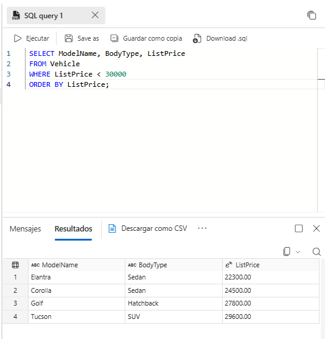{width="5.563276465441819in"
height="5.813311461067366in"}

Finalmente, intente una consulta que combine datos de ambas tablas.
Reemplace la consulta con el siguiente código y seleccione **▷
Ejecutar** .

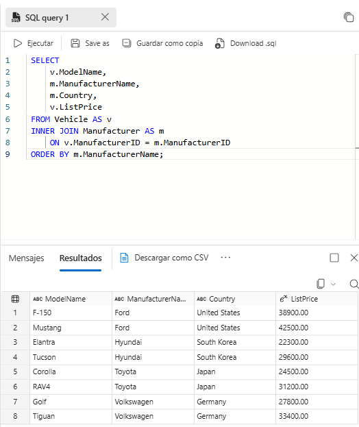{width="5.459095581802274in"
height="6.490488845144357in"}

## Limpiar

Cuando hayas terminado de explorar, debes eliminar los recursos que
creaste para no incurrir en costos adicionales.

1.  En el portal de Azure, navegue hasta el **grupo de recursos** que
    creó al inicio del laboratorio (por ejemplo, dp900-lab-rg).

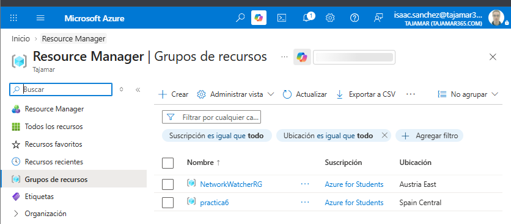{width="5.905555555555556in"
height="2.5993055555555555in"}

Seleccione **Eliminar grupo de recursos** , confirme la eliminación
introduciendo el nombre del grupo de recursos y seleccione **Eliminar**
.

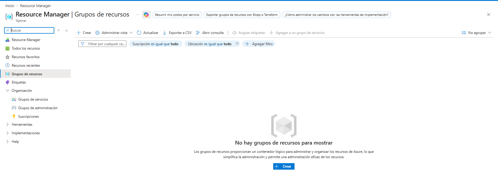{width="5.905555555555556in"
height="2.0506944444444444in"}

# Parte 2

## Aprovisione una cuenta de Azure Storage

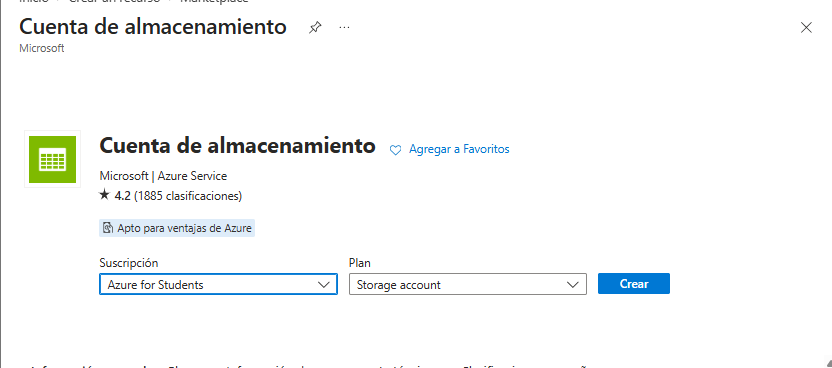{width="5.905555555555556in"
height="2.6118055555555557in"}

Introduzca los siguientes valores en la pestaña **\"Información
básica\"** de la página \" **Crear una cuenta de almacenamiento\"** :

- **Suscripción** : Seleccione su suscripción de Azure.

- **Grupo de recursos** : Seleccione **Crear nuevo** e introduzca un
  nombre de su elección, como por ejemplo dp900-lab-rg.

***¿Qué es un grupo de recursos?** Es simplemente una carpeta que agrupa
recursos de Azure relacionados. Cuando termine, puede eliminar la
carpeta para borrar todo con un solo clic.*

- **Nombre de la cuenta de almacenamiento** : Introduzca un nombre único
  para su cuenta de almacenamiento utilizando únicamente letras
  minúsculas y números (este nombre no debe estar siendo utilizado por
  nadie más).

- **Región** : Seleccione cualquier ubicación disponible cerca de usted.

- **Rendimiento** : *Estándar*

- **Redundancia** : *Almacenamiento con redundancia local (LRS)*

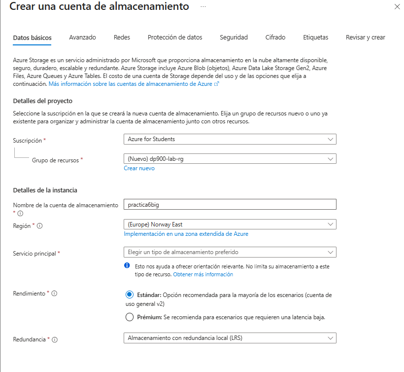{width="5.905555555555556in"
height="5.430555555555555in"}

Seleccione **Siguiente: Avanzado \>** y vea las opciones de
configuración avanzada. En particular, tenga en cuenta que aquí puede
habilitar el espacio de nombres jerárquico para admitir Azure Data Lake
Storage Gen2. Deje la opción **Habilitar espacio de nombres jerárquico
[desactivada]{.underline}** (la habilitará más adelante) y, a
continuación, seleccione **Siguiente: Redes \>** para ver las opciones
de red de su cuenta de almacenamiento.

Seleccione **Siguiente: Protección de datos \>** y, a continuación, en
la sección **Recuperación** , [desactive]{.underline} todas las opciones
**de Habilitar eliminación temporal...** Estas opciones conservan los
archivos eliminados para su posterior recuperación, pero pueden causar
problemas más adelante al habilitar el espacio de nombres jerárquico.

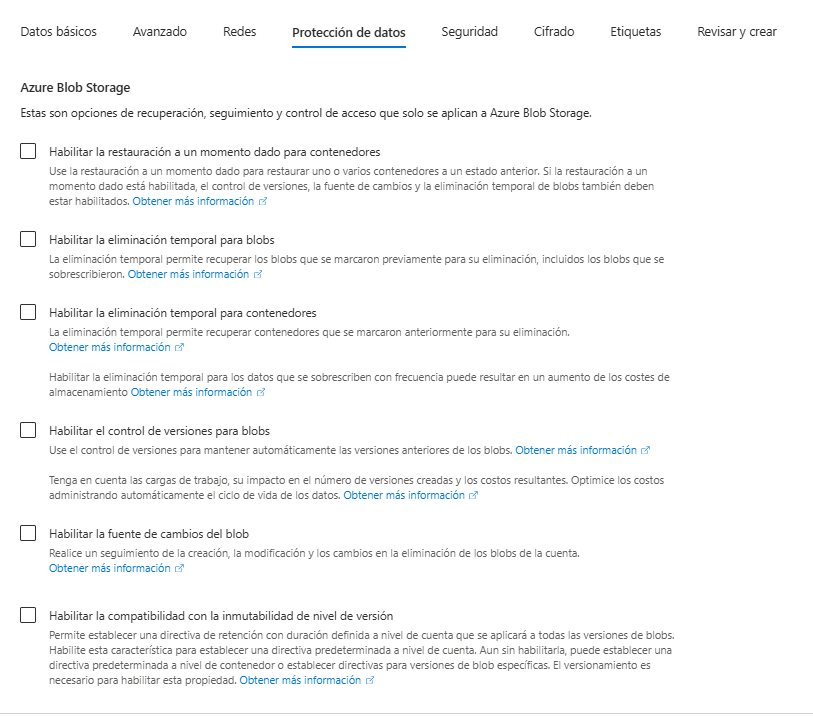{width="5.905555555555556in"
height="5.208333333333333in"}

Continúe por las páginas restantes **de Siguiente \>** sin cambiar
ninguna de las configuraciones predeterminadas y, a continuación, en la
página **Revisar** , espere a que se validen sus selecciones y
seleccione **Crear** para crear su cuenta de Azure Storage.

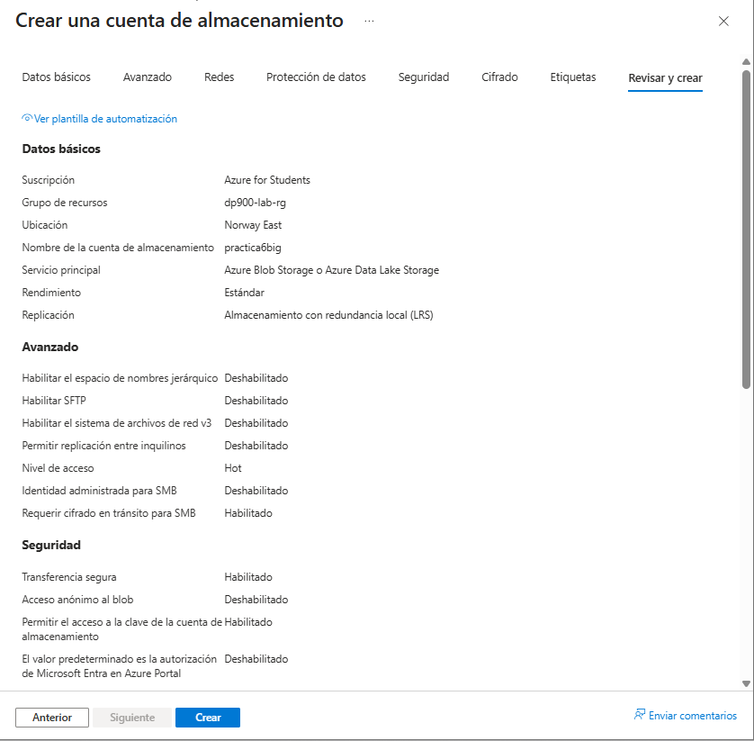{width="5.905555555555556in"
height="5.8in"}

Espere a que finalice la implementación. A continuación, seleccione **Ir
al recurso** para abrir la cuenta de almacenamiento que se implementó.

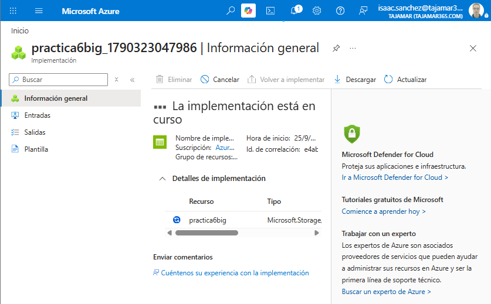{width="5.905555555555556in"
height="3.6618055555555555in"}

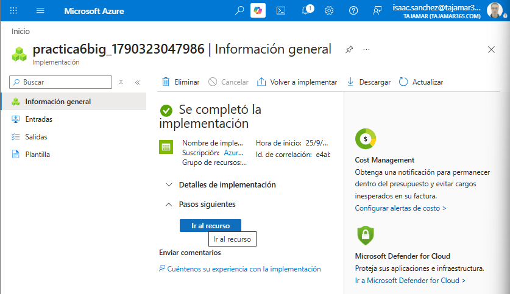{width="5.905555555555556in"
height="3.408333333333333in"}

## Explorar el almacenamiento de blobs

1.  Descarga el archivo JSON
    [product1.json](https://aka.ms/product1.json?azure-portal=true)https://aka.ms/product1.json
    y guárdalo en tu ordenador (puedes guardarlo en cualquier carpeta;
    lo subirás al almacenamiento de blobs más adelante).

*Si el archivo JSON se muestra en su navegador, haga clic con el botón
derecho en la página y seleccione **Guardar como** . Nombre el archivo
**product1.json** y guárdelo en su carpeta de descargas.*

2.  En la página del portal de Azure para su contenedor de
    almacenamiento, en el lado izquierdo, en la sección **Almacenamiento
    de datos** , seleccione **Contenedores** .

3.  En la página **Contenedores** , seleccione **+ Agregar contenedor**
    . En el panel **Nuevo contenedor** , ingrese el nombre data.

Tenga en cuenta que el **nivel de acceso anónimo** se establece
automáticamente en **Privado (sin acceso anónimo)** y no se puede
cambiar, ya que el acceso anónimo está deshabilitado de forma
predeterminada en la cuenta de almacenamiento. Seleccione **Crear** .

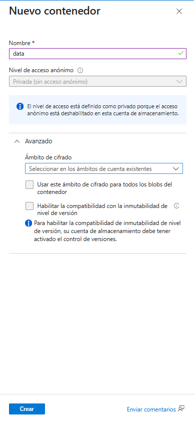{width="4.042230971128609in"
height="8.7928937007874in"}

Una vez creado el contenedor **de datos , verifique que aparezca en la
página de Contenedores** .

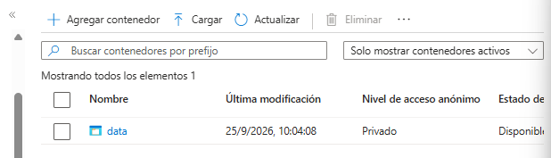{width="5.905555555555556in"
height="1.6909722222222223in"}

1.  En el panel de la izquierda, en la sección superior, seleccione
    **Explorador de almacenamiento** . Esta página le proporciona una
    interfaz basada en navegador que puede usar para trabajar con los
    datos de su cuenta de almacenamiento.

2.  Una vez creado el contenedor **de datos , verifique que aparezca en
    la página de Contenedores** .

3.  En la página del explorador de almacenamiento, seleccione
    **Contenedores de blobs** y verifique que su contenedor **de datos
    aparezca en la lista.**

4.  Seleccione el contenedor **de datos** y observe que está vacío.

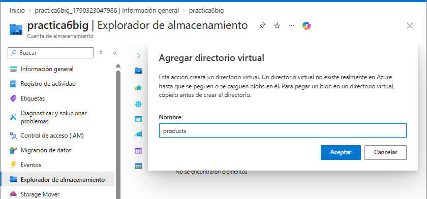{width="5.905555555555556in"
height="2.7555555555555555in"}

Carga de los datos

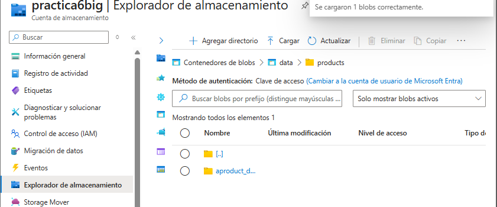{width="5.905555555555556in"
height="2.457638888888889in"}

## Explora Azure Data Lake Storage Gen2

1.  Descarga el archivo JSON
    [product2.json](https://aka.ms/product2.json?azure-portal=true)https://aka.ms/product2.json
    y guárdalo en tu ordenador en la misma carpeta donde descargaste
    previamente **product1.json** ; lo subirás al almacenamiento de
    blobs más adelante.

2.  En la página del portal de Azure para su cuenta de almacenamiento,
    en el lado izquierdo, desplácese hacia abajo hasta la sección
    **Configuración** y seleccione **Actualización de Data Lake Gen2** .

> 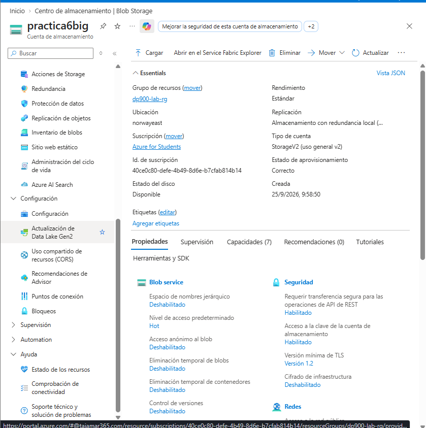{width="5.905555555555556in"
> height="5.934027777777778in"}

3.  En la página **de actualización de Data Lake Gen2** , expanda y
    complete cada paso para actualizar su cuenta de almacenamiento y
    habilitar el espacio de nombres jerárquico y la compatibilidad con
    Azure Data Lake Storage Gen. Esto puede tardar un tiempo.

> 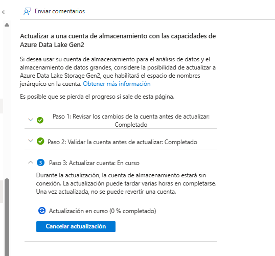{width="5.604948600174978in"
> height="5.219478346456693in"}

***Consejo** : La actualización implica un cambio de funcionalidad a
nivel de cuenta; los datos se conservan, pero la semántica del
directorio cambia para admitir operaciones avanzadas.*

4.  Cuando finalice la actualización, en el panel de la izquierda, en la
    sección superior, seleccione **Explorador de almacenamiento** y
    vuelva a la raíz del contenedor de blobs **de datos** , que aún
    contiene la carpeta **product_data** .

5.  Seleccione la carpeta **product_data** y verifique que aún contenga
    el archivo **product1.json** que subió anteriormente.

6.  Utilice el botón **⤒ Cargar** para abrir el panel **de carga de
    blobs** .

7.  En el panel **de carga de archivos** , seleccione el archivo
    **product2.json** que guardó en su ordenador. A continuación,
    seleccione el botón **Cargar** .

8.  Cierre el panel **de carga de blobs** si aún está abierto y
    verifique que la carpeta **product_data** contenga ahora el archivo
    **product2.json** .

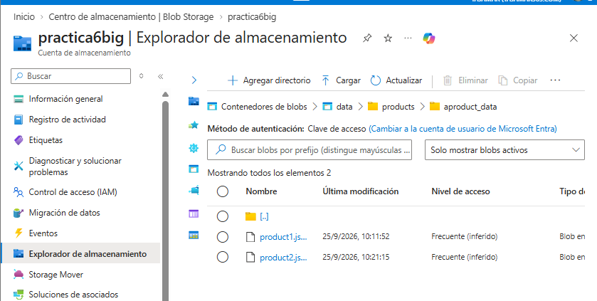{width="5.905555555555556in"
height="2.9770833333333333in"}

9.  En el lado izquierdo, en la sección **Almacenamiento de datos** ,
    seleccione **Contenedores** .

10. Abra el contenedor **de datos** y verifique que la carpeta
    **product_data** que creó aparezca en la lista.

11. Seleccione el icono **‧‧‧** en el extremo derecho de la carpeta y
    tenga en cuenta que, con el espacio de nombres jerárquico
    habilitado, puede realizar tareas de configuración a nivel de
    carpeta; incluyendo el cambio de nombre de carpetas y la
    configuración de permisos ( **Administrar ACL** ).

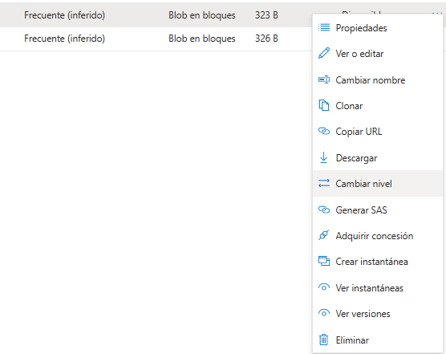{width="5.792474846894138in"
height="4.594390857392826in"}

## Explorar Azure Files

Azure Files ofrece una forma de crear recursos compartidos de archivos
basados ​​en la nube.

1.  En la página del portal de Azure correspondiente a su cuenta de
    almacenamiento, en el lado izquierdo, en la sección **Almacenamiento
    de datos** , seleccione **Recursos compartidos de archivos
    clásicos** .

2.  En la página **de recursos compartidos de archivos clásicos** ,
    seleccione **+ recurso compartido de archivos clásico** . En la
    pestaña **Básico** , introduzca el nombre filesy deje el **nivel de
    acceso** configurado como **Optimizado para transacciones** .

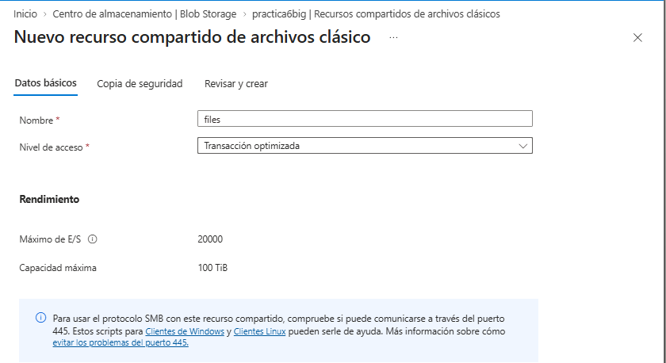{width="5.905555555555556in"
height="3.2194444444444446in"}

3.  Seleccione **Siguiente: Copia de seguridad \>** y desactive la
    casilla de **verificación Habilitar copia de seguridad** para
    desactivarla. A continuación, seleccione **Revisar + crear** y, en
    la pestaña **Revisar + crear** , seleccione **Crear** .

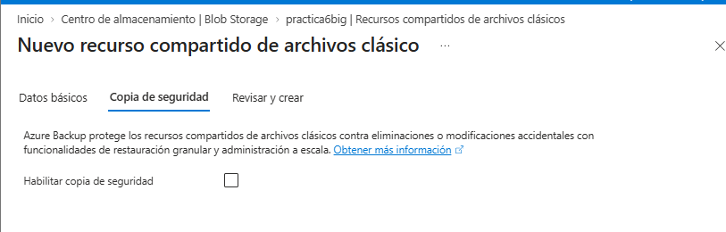{width="5.905555555555556in"
height="1.8881944444444445in"}

4.  Una vez creada la **carpeta compartida, vuelva a la página de
    carpetas compartidas clásicas** y abra su nueva **carpeta**
    compartida.

5.  En la parte superior de la página, seleccione **Conectar** . A
    continuación, en el panel **Conectar** , observe que hay pestañas
    para los sistemas operativos más comunes (Windows, Linux y macOS)
    que contienen scripts que puede ejecutar para conectarse a la
    carpeta compartida desde un equipo cliente.

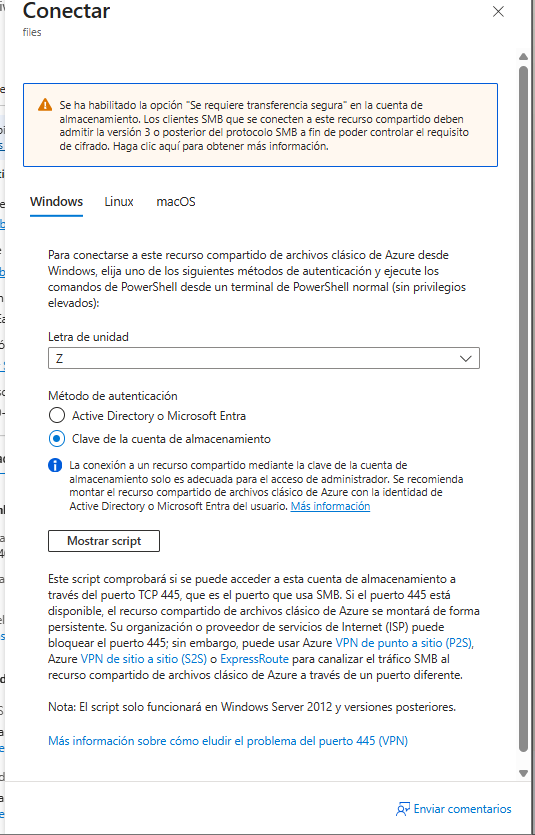{width="5.573694225721785in"
height="8.699130577427821in"}

## Limpieza

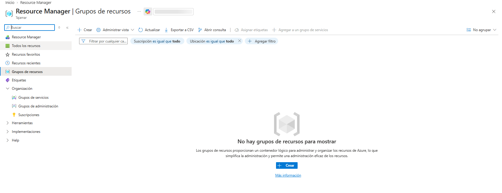{width="5.905555555555556in"
height="2.2743055555555554in"}

# Parte 3

## Create a Cosmos DB account

Crea una cuenta de Cosmos DB

El aprovisionamiento consiste simplemente en crear y configurar un nuevo
recurso. Para usar Cosmos DB, primero debe crear una cuenta de Cosmos
DB. En este laboratorio, creará una cuenta que utiliza **Azure Cosmos DB
para NoSQL** , la opción diseñada para almacenar y consultar datos JSON.

1.  En el portal de Azure, seleccione **+ Crear un recurso** en la parte
    superior izquierda y busque Azure Cosmos DB. En los resultados,
    seleccione **Azure Cosmos DB** y seleccione **Crear** .

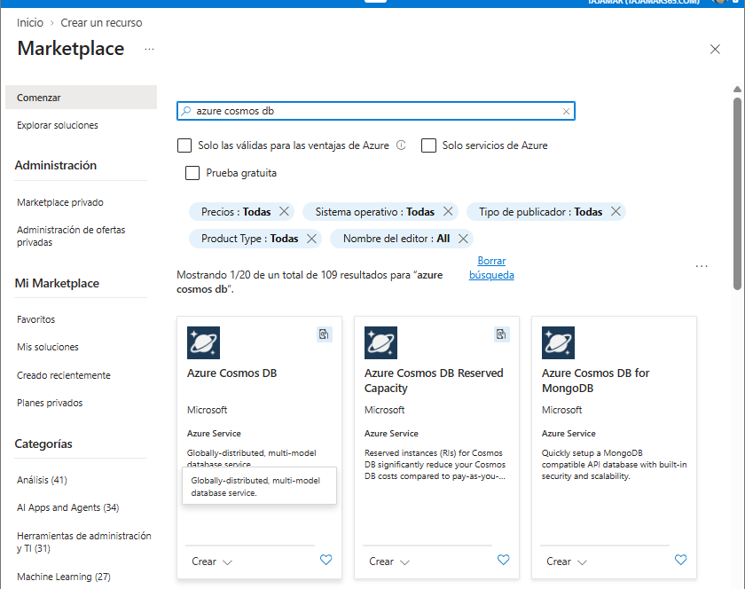{width="5.905555555555556in"
height="4.668055555555555in"}

2.  En el mosaico **de Azure Cosmos DB para NoSQL** , seleccione
    **Crear** .

> 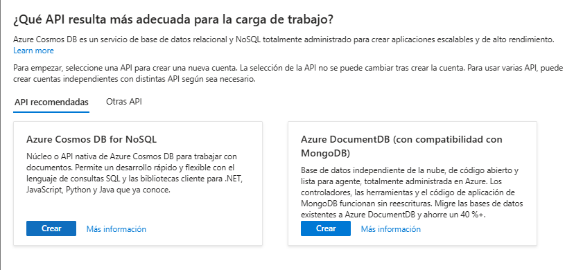{width="5.905555555555556in"
> height="2.78125in"}

*.*

3.  Introduzca los siguientes datos y, a continuación, seleccione
    **Revisar + crear** :

4.  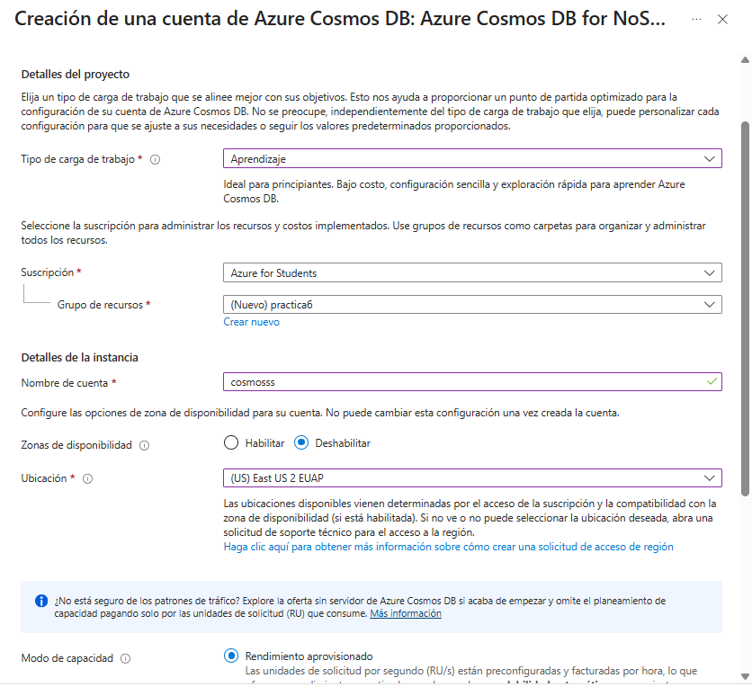{width="5.905555555555556in"
    height="5.397222222222222in"}

5.  Espere a que finalice el despliegue. Luego, acceda al recurso
    desplegado.

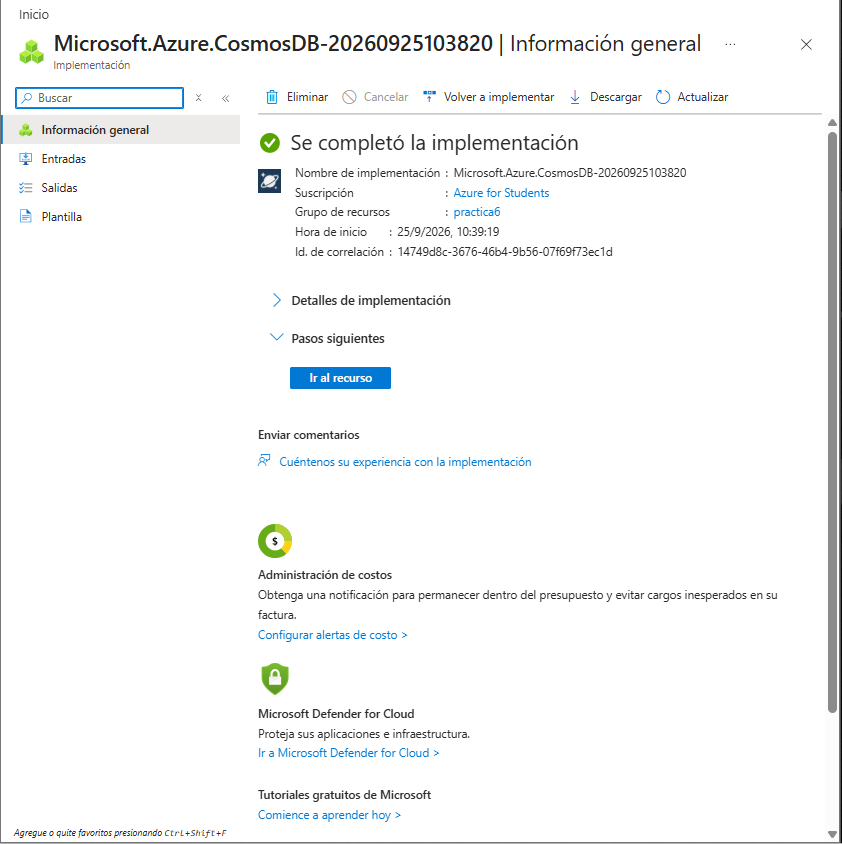{width="5.905555555555556in"
height="5.919444444444444in"}

## Cree una base de datos de ejemplo

*Durante todo este procedimiento, cierre cualquier aviso que se muestre
en el portal*.

1.  En la página de su nueva cuenta de Cosmos DB, en el panel de la
    izquierda, seleccione **Explorador de datos**.

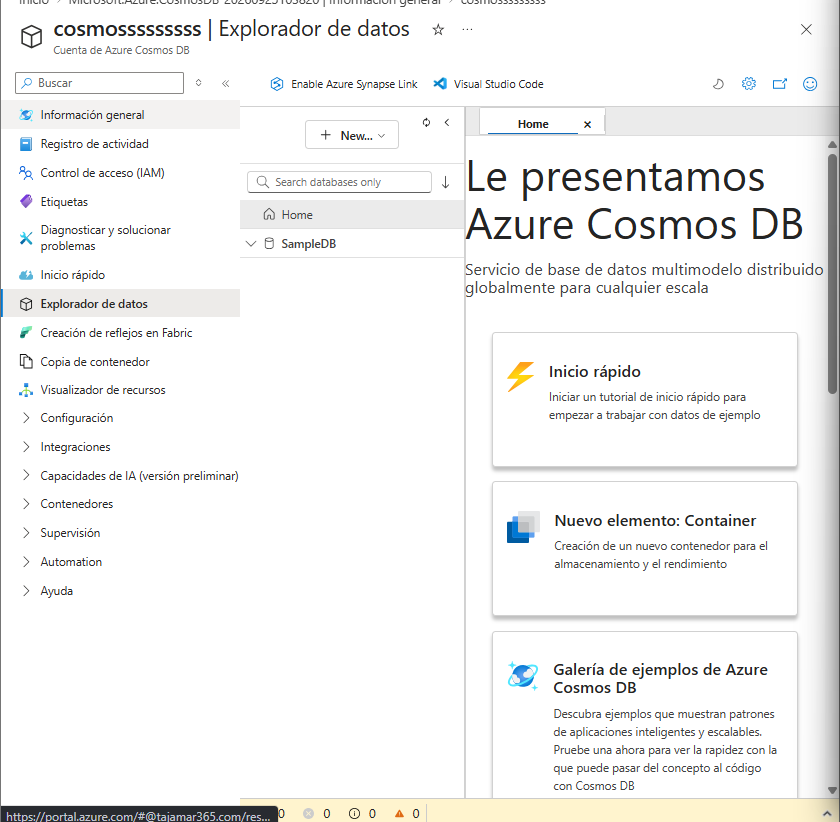{width="5.905555555555556in"
height="5.779166666666667in"}

2.  En la página **Explorador de datos**, seleccione **Iniciar inicio
    rápido**.

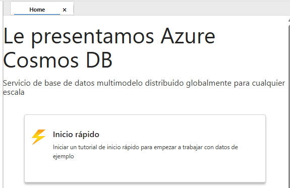{width="5.905555555555556in"
height="3.8305555555555557in"}

3.  En el panel **Nuevo contenedor** , revise la configuración
    predefinida para la base de datos de ejemplo (una base de datos
    llamada **SampleDB** , un contenedor llamado **SampleContainer** y
    una clave de partición **/categoryId** ) y, a continuación,
    seleccione **Aceptar** . Es posible que aparezca un breve tutorial
    guiado junto al panel; puede seguirlo paso a paso con **Siguiente**
    o simplemente seleccionar **Aceptar** para continuar.

4.  Observe el estado en el panel en la parte inferior de la pantalla
    hasta que se haya creado la base de datos **SampleDB** y su
    contenedor **SampleContainer** (lo que puede tardar un minuto
    aproximadamente).

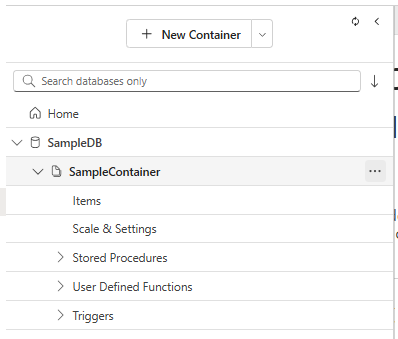{width="4.146411854768154in"
height="3.5317432195975504in"}

## Ver y crear elementos

1.  En la página Explorador de datos, expanda la base de datos
    **SampleDB** y el contenedor **SampleContainer** , y seleccione
    **Elementos** para ver una lista de los elementos que contiene.
    Estos elementos representan datos de productos, cada uno con un
    identificador único y otras propiedades. Seleccione cualquier
    elemento para ver una representación JSON de sus datos en el panel
    de la derecha.

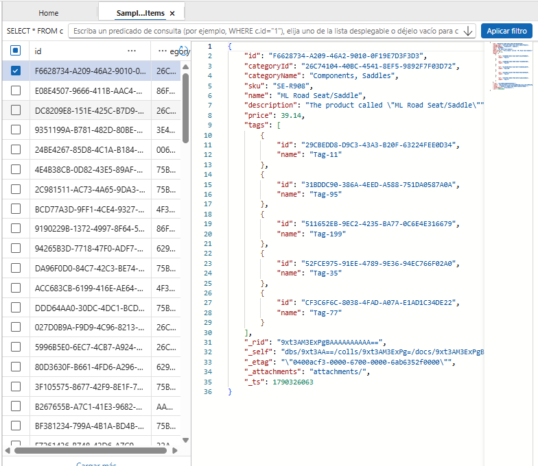{width="5.905555555555556in"
height="5.122222222222222in"}

2.  En la parte superior de la página, seleccione **Nuevo elemento**
    para crear un nuevo elemento en blanco.

> 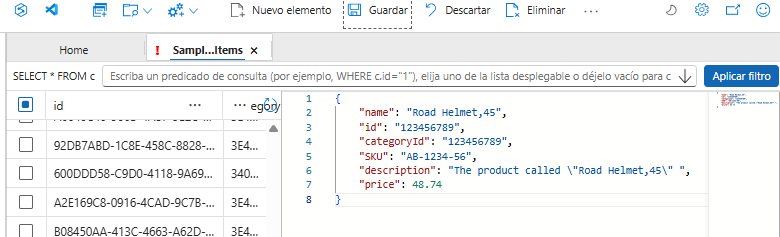{width="5.905555555555556in"
> height="1.7944444444444445in"}

3.  Modifique el JSON para el nuevo elemento de la siguiente manera y, a
    continuación, seleccione **Guardar**.

4.  Tras guardar el nuevo elemento, observe que se añaden
    automáticamente propiedades de metadatos adicionales.

    - *\_rid --- El identificador interno del recurso que utiliza Cosmos
      DB para identificar el elemento internamente.*

    - *\_self --- El enlace completo al recurso para el artículo.*

    - *\_etag --- La etiqueta de entidad utilizada para las
      comprobaciones de concurrencia optimista.*

    - *\_ts --- La marca de tiempo Unix (en segundos) en la que se
      modificó el elemento por última vez.*

    - *\_adjuntos --- Un enlace a los archivos adjuntos del documento
      (si los hay).*

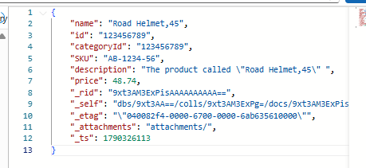{width="4.781917104111986in"
height="2.1982239720034995in"}

## Consultar la base de datos

1.  En la página **Explorador de datos** , seleccione el icono **Nueva
    consulta SQL** .

2.  En el editor de consultas SQL, revise la consulta predeterminada (
    SELECT \* FROM c) y utilice el botón **Ejecutar consulta** para
    ejecutarla.

> 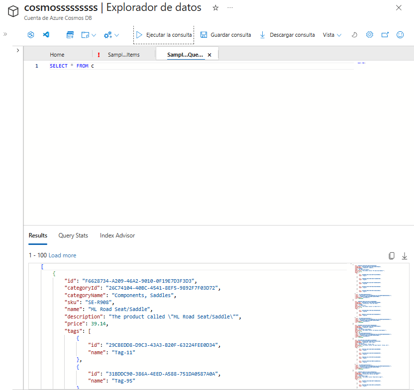{width="5.905555555555556in"
> height="5.572222222222222in"}

3.  Revise los resultados, que incluyen la representación JSON completa
    de todos los elementos.

4.  Modifique la consulta de la siguiente manera:

5.  Utilice el botón **Ejecutar consulta** para ejecutar la consulta
    revisada y comprobar los resultados, que incluyen entidades JSON
    para cualquier elemento cuyo campo **de nombre** contenga el texto
    \"Casco\".

> 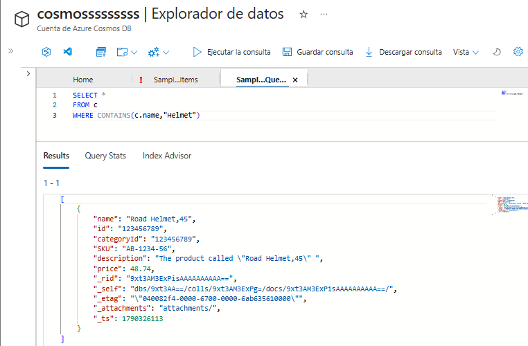{width="5.905555555555556in"
> height="3.875in"}

6.  Cierra el editor de consultas SQL y descarta los cambios.

Ya has visto cómo crear y consultar entidades JSON en una base de datos
Cosmos DB mediante la interfaz del explorador de datos en el portal de
Azure. En un escenario real, un desarrollador de aplicaciones usaría uno
de los muchos kits de desarrollo de software (SDK) específicos para cada
lenguaje de programación para llamar a la API NoSQL y trabajar con los
datos de la base de datos.

## Limpieza
