/\*

=============================================================

Create Database and Schemas

=============================================================

Script Purpose:

This script creates a new database named \'DataWarehouse\' after
checking if it already exists.

If the database exists, it is dropped and recreated. Additionally, the
script sets up three schemas

within the database: \'bronze\', \'silver\', and \'gold\'.

WARNING:

Running this script will drop the entire \'DataWarehouse\' database if
it exists.

All data in the database will be permanently deleted. Proceed with
caution

and ensure you have proper backups before running this script.

\*/

USE master;

GO

\-- Drop and recreate the \'DataWarehouse\' database

IF EXISTS (SELECT 1 FROM sys.databases WHERE name = \'DataWarehouse\')

BEGIN

ALTER DATABASE DataWarehouse SET SINGLE_USER WITH ROLLBACK IMMEDIATE;

DROP DATABASE DataWarehouse;

END;

GO

\-- Create the \'DataWarehouse\' database

CREATE DATABASE DataWarehouse;

GO

USE DataWarehouse;

GO

\-- Create Schemas

CREATE SCHEMA bronze;

GO

CREATE SCHEMA silver;

GO

CREATE SCHEMA gold;

GO

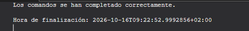{width="5.209060586176728in"
height="0.6667596237970254in"}

Creación de la capa de bronce

## Crear las tablas Bronze

Creación de las tablas y comprobación de los campos creados

USE DataWarehouse;

GO

\--
===============================================================================

\-- 7.1 CREAR LAS 6 TABLAS EN BRONZE

\--
===============================================================================

IF OBJECT_ID(\'bronze.crm_cust_info\', \'U\') IS NOT NULL

DROP TABLE bronze.crm_cust_info;

GO

CREATE TABLE bronze.crm_cust_info (

cst_id INT,

cst_key NVARCHAR(50),

cst_firstname NVARCHAR(50),

cst_lastname NVARCHAR(50),

cst_marital_status NVARCHAR(50),

cst_gndr NVARCHAR(50),

cst_create_date DATE

);

GO

IF OBJECT_ID(\'bronze.crm_prd_info\', \'U\') IS NOT NULL

DROP TABLE bronze.crm_prd_info;

GO

CREATE TABLE bronze.crm_prd_info (

prd_id INT,

prd_key NVARCHAR(50),

prd_nm NVARCHAR(50),

prd_cost INT,

prd_line NVARCHAR(50),

prd_start_dt DATETIME,

prd_end_dt DATETIME

);

GO

IF OBJECT_ID(\'bronze.crm_sales_details\', \'U\') IS NOT NULL

DROP TABLE bronze.crm_sales_details;

GO

CREATE TABLE bronze.crm_sales_details (

sls_ord_num NVARCHAR(50),

sls_prd_key NVARCHAR(50),

sls_cust_id INT,

sls_order_dt INT,

sls_ship_dt INT,

sls_due_dt INT,

sls_sales INT,

sls_quantity INT,

sls_price INT

);

GO

IF OBJECT_ID(\'bronze.erp_loc_a101\', \'U\') IS NOT NULL

DROP TABLE bronze.erp_loc_a101;

GO

CREATE TABLE bronze.erp_loc_a101 (

cid NVARCHAR(50),

cntry NVARCHAR(50)

);

GO

IF OBJECT_ID(\'bronze.erp_cust_az12\', \'U\') IS NOT NULL

DROP TABLE bronze.erp_cust_az12;

GO

CREATE TABLE bronze.erp_cust_az12 (

cid NVARCHAR(50),

bdate DATE,

gen NVARCHAR(50)

);

GO

IF OBJECT_ID(\'bronze.erp_px_cat_g1v2\', \'U\') IS NOT NULL

DROP TABLE bronze.erp_px_cat_g1v2;

GO

CREATE TABLE bronze.erp_px_cat_g1v2 (

id NVARCHAR(50),

cat NVARCHAR(50),

subcat NVARCHAR(50),

maintenance NVARCHAR(50)

);

GO

\--
===============================================================================

\-- 7.4 CREAR EL PROCEDIMIENTO ALMACENADO DE CARGA (bronze.load_bronze)

\--
===============================================================================

CREATE OR ALTER PROCEDURE bronze.load_bronze AS

BEGIN

DECLARE \@start_time DATETIME, \@end_time DATETIME, \@batch_start_time
DATETIME, \@batch_end_time DATETIME;

BEGIN TRY

SET \@batch_start_time = GETDATE();

PRINT \'================================================\';

PRINT \'Loading Bronze Layer\';

PRINT \'================================================\';

PRINT
\'\-\-\-\-\-\-\-\-\-\-\-\-\-\-\-\-\-\-\-\-\-\-\-\-\-\-\-\-\-\-\-\-\-\-\-\-\-\-\-\-\-\-\-\-\-\-\--\';

PRINT \'Loading CRM Tables\';

PRINT
\'\-\-\-\-\-\-\-\-\-\-\-\-\-\-\-\-\-\-\-\-\-\-\-\-\-\-\-\-\-\-\-\-\-\-\-\-\-\-\-\-\-\-\-\-\-\-\--\';

SET \@start_time = GETDATE();

PRINT \'\>\> Truncating Table: bronze.crm_cust_info\';

TRUNCATE TABLE bronze.crm_cust_info;

PRINT \'\>\> Inserting Data Into: bronze.crm_cust_info\';

BULK INSERT bronze.crm_cust_info

FROM \'C:\\sql\\dwh_project\\datasets\\source_crm\\cust_info.csv\'

WITH (

FIRSTROW = 2,

FIELDTERMINATOR = \',\',

TABLOCK

);

SET \@end_time = GETDATE();

PRINT \'\>\> Load Duration: \' + CAST(DATEDIFF(second, \@start_time,
\@end_time) AS NVARCHAR) + \' seconds\';

PRINT \'\>\> \-\-\-\-\-\-\-\-\-\-\-\--\';

SET \@start_time = GETDATE();

PRINT \'\>\> Truncating Table: bronze.crm_prd_info\';

TRUNCATE TABLE bronze.crm_prd_info;

PRINT \'\>\> Inserting Data Into: bronze.crm_prd_info\';

BULK INSERT bronze.crm_prd_info

FROM \'C:\\sql\\dwh_project\\datasets\\source_crm\\prd_info.csv\'

WITH (

FIRSTROW = 2,

FIELDTERMINATOR = \',\',

TABLOCK

);

SET \@end_time = GETDATE();

PRINT \'\>\> Load Duration: \' + CAST(DATEDIFF(second, \@start_time,
\@end_time) AS NVARCHAR) + \' seconds\';

PRINT \'\>\> \-\-\-\-\-\-\-\-\-\-\-\--\';

SET \@start_time = GETDATE();

PRINT \'\>\> Truncating Table: bronze.crm_sales_details\';

TRUNCATE TABLE bronze.crm_sales_details;

PRINT \'\>\> Inserting Data Into: bronze.crm_sales_details\';

BULK INSERT bronze.crm_sales_details

FROM \'C:\\sql\\dwh_project\\datasets\\source_crm\\sales_details.csv\'

WITH (

FIRSTROW = 2,

FIELDTERMINATOR = \',\',

TABLOCK

);

SET \@end_time = GETDATE();

PRINT \'\>\> Load Duration: \' + CAST(DATEDIFF(second, \@start_time,
\@end_time) AS NVARCHAR) + \' seconds\';

PRINT \'\>\> \-\-\-\-\-\-\-\-\-\-\-\--\';

PRINT
\'\-\-\-\-\-\-\-\-\-\-\-\-\-\-\-\-\-\-\-\-\-\-\-\-\-\-\-\-\-\-\-\-\-\-\-\-\-\-\-\-\-\-\-\-\-\-\--\';

PRINT \'Loading ERP Tables\';

PRINT
\'\-\-\-\-\-\-\-\-\-\-\-\-\-\-\-\-\-\-\-\-\-\-\-\-\-\-\-\-\-\-\-\-\-\-\-\-\-\-\-\-\-\-\-\-\-\-\--\';

SET \@start_time = GETDATE();

PRINT \'\>\> Truncating Table: bronze.erp_loc_a101\';

TRUNCATE TABLE bronze.erp_loc_a101;

PRINT \'\>\> Inserting Data Into: bronze.erp_loc_a101\';

BULK INSERT bronze.erp_loc_a101

FROM \'C:\\sql\\dwh_project\\datasets\\source_erp\\loc_a101.csv\'

WITH (

FIRSTROW = 2,

FIELDTERMINATOR = \',\',

TABLOCK

);

SET \@end_time = GETDATE();

PRINT \'\>\> Load Duration: \' + CAST(DATEDIFF(second, \@start_time,
\@end_time) AS NVARCHAR) + \' seconds\';

PRINT \'\>\> \-\-\-\-\-\-\-\-\-\-\-\--\';

SET \@start_time = GETDATE();

PRINT \'\>\> Truncating Table: bronze.erp_cust_az12\';

TRUNCATE TABLE bronze.erp_cust_az12;

PRINT \'\>\> Inserting Data Into: bronze.erp_cust_az12\';

BULK INSERT bronze.erp_cust_az12

FROM \'C:\\sql\\dwh_project\\datasets\\source_erp\\cust_az12.csv\'

WITH (

FIRSTROW = 2,

FIELDTERMINATOR = \',\',

TABLOCK

);

SET \@end_time = GETDATE();

PRINT \'\>\> Load Duration: \' + CAST(DATEDIFF(second, \@start_time,
\@end_time) AS NVARCHAR) + \' seconds\';

PRINT \'\>\> \-\-\-\-\-\-\-\-\-\-\-\--\';

SET \@start_time = GETDATE();

PRINT \'\>\> Truncating Table: bronze.erp_px_cat_g1v2\';

TRUNCATE TABLE bronze.erp_px_cat_g1v2;

PRINT \'\>\> Inserting Data Into: bronze.erp_px_cat_g1v2\';

BULK INSERT bronze.erp_px_cat_g1v2

FROM \'C:\\sql\\dwh_project\\datasets\\source_erp\\px_cat_g1v2.csv\'

WITH (

FIRSTROW = 2,

FIELDTERMINATOR = \',\',

TABLOCK

);

SET \@end_time = GETDATE();

PRINT \'\>\> Load Duration: \' + CAST(DATEDIFF(second, \@start_time,
\@end_time) AS NVARCHAR) + \' seconds\';

PRINT \'\>\> \-\-\-\-\-\-\-\-\-\-\-\--\';

SET \@batch_end_time = GETDATE();

PRINT \'==========================================\';

PRINT \'Loading Bronze Layer is Completed\';

PRINT \' - Total Load Duration: \' + CAST(DATEDIFF(SECOND,
\@batch_start_time, \@batch_end_time) AS NVARCHAR) + \' seconds\';

PRINT \'==========================================\';

END TRY

BEGIN CATCH

PRINT \'==========================================\';

PRINT \'ERROR OCCURED DURING LOADING BRONZE LAYER\';

PRINT \'Error Message: \' + ERROR_MESSAGE();

PRINT \'Error Number: \' + CAST (ERROR_NUMBER() AS NVARCHAR);

PRINT \'Error State: \' + CAST (ERROR_STATE() AS NVARCHAR);

PRINT \'==========================================\';

END CATCH

END;

GO

\--
===============================================================================

\-- EJECUTAR LA CARGA Y COMPROBAR FILAS

\--
===============================================================================

EXEC bronze.load_bronze;

GO

SELECT \'crm_cust_info\' AS tabla, COUNT(\*) AS filas FROM
bronze.crm_cust_info UNION ALL

SELECT \'crm_prd_info\', COUNT(\*) FROM bronze.crm_prd_info UNION ALL

SELECT \'crm_sales_details\', COUNT(\*) FROM bronze.crm_sales_details
UNION ALL

SELECT \'erp_cust_az12\', COUNT(\*) FROM bronze.erp_cust_az12 UNION ALL

SELECT \'erp_loc_a101\', COUNT(\*) FROM bronze.erp_loc_a101 UNION ALL

SELECT \'erp_px_cat_g1v2\', COUNT(\*) FROM bronze.erp_px_cat_g1v2;

Salida

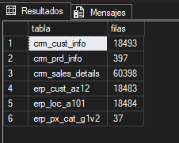{width="2.354494750656168in"
height="1.885680227471566in"}

## Carga de datos y revisión de ellos

\-- ¿Llegaron todas las filas?

SELECT COUNT(\*) AS filas FROM bronze.crm_cust_info; \-- Esperado: 18494

\-- ¿Cada valor está en su columna? Revisa visualmente las primeras
filas

SELECT TOP 10 \* FROM bronze.crm_cust_info;

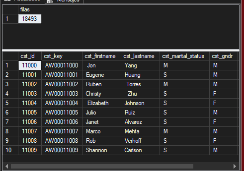{width="5.115297462817148in"
height="3.594251968503937in"}

Capa silver

## Crear tablas silver 

/\*

===============================================================================

DDL Script: Create Silver Tables

===============================================================================

Script Purpose:

This script creates tables in the \'silver\' schema, dropping existing
tables

if they already exist.

Run this script to re-define the DDL structure of \'bronze\' Tables

===============================================================================

\*/

IF OBJECT_ID(\'silver.crm_cust_info\', \'U\') IS NOT NULL

DROP TABLE silver.crm_cust_info;

GO

CREATE TABLE silver.crm_cust_info (

cst_id INT,

cst_key NVARCHAR(50),

cst_firstname NVARCHAR(50),

cst_lastname NVARCHAR(50),

cst_marital_status NVARCHAR(50),

cst_gndr NVARCHAR(50),

cst_create_date DATE,

dwh_create_date DATETIME2 DEFAULT GETDATE()

);

GO

IF OBJECT_ID(\'silver.crm_prd_info\', \'U\') IS NOT NULL

DROP TABLE silver.crm_prd_info;

GO

CREATE TABLE silver.crm_prd_info (

prd_id INT,

cat_id NVARCHAR(50),

prd_key NVARCHAR(50),

prd_nm NVARCHAR(50),

prd_cost INT,

prd_line NVARCHAR(50),

prd_start_dt DATE,

prd_end_dt DATE,

dwh_create_date DATETIME2 DEFAULT GETDATE()

);

GO

IF OBJECT_ID(\'silver.crm_sales_details\', \'U\') IS NOT NULL

DROP TABLE silver.crm_sales_details;

GO

CREATE TABLE silver.crm_sales_details (

sls_ord_num NVARCHAR(50),

sls_prd_key NVARCHAR(50),

sls_cust_id INT,

sls_order_dt DATE,

sls_ship_dt DATE,

sls_due_dt DATE,

sls_sales INT,

sls_quantity INT,

sls_price INT,

dwh_create_date DATETIME2 DEFAULT GETDATE()

);

GO

IF OBJECT_ID(\'silver.erp_loc_a101\', \'U\') IS NOT NULL

DROP TABLE silver.erp_loc_a101;

GO

CREATE TABLE silver.erp_loc_a101 (

cid NVARCHAR(50),

cntry NVARCHAR(50),

dwh_create_date DATETIME2 DEFAULT GETDATE()

);

GO

IF OBJECT_ID(\'silver.erp_cust_az12\', \'U\') IS NOT NULL

DROP TABLE silver.erp_cust_az12;

GO

CREATE TABLE silver.erp_cust_az12 (

cid NVARCHAR(50),

bdate DATE,

gen NVARCHAR(50),

dwh_create_date DATETIME2 DEFAULT GETDATE()

);

GO

IF OBJECT_ID(\'silver.erp_px_cat_g1v2\', \'U\') IS NOT NULL

DROP TABLE silver.erp_px_cat_g1v2;

GO

CREATE TABLE silver.erp_px_cat_g1v2 (

id NVARCHAR(50),

cat NVARCHAR(50),

subcat NVARCHAR(50),

maintenance NVARCHAR(50),

dwh_create_date DATETIME2 DEFAULT GETDATE()

);

GO

Salida

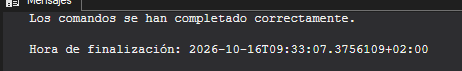{width="4.813171478565179in"
height="0.739686132983377in"}

Clientes del crm

SELECT cst_id, COUNT(\*) AS repeticiones

FROM bronze.crm_cust_info

GROUP BY cst_id

HAVING COUNT(\*) \> 1 OR cst_id IS NULL;

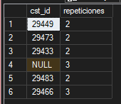{width="1.7710804899387576in"
height="1.5210454943132108in"}

Datos sin duplicados

SELECT \* FROM bronze.crm_cust_info WHERE cst_id = 29466 ORDER BY
cst_create_date;

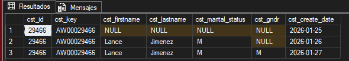{width="5.905555555555556in"
height="1.0409722222222222in"}

Creamos las reglas para los clientes

\-- Espacios sobrantes en los textos

SELECT cst_firstname FROM bronze.crm_cust_info WHERE cst_firstname !=
TRIM(cst_firstname); \-- 15 filas

SELECT cst_lastname FROM bronze.crm_cust_info WHERE cst_lastname !=
TRIM(cst_lastname); \-- 17 filas

\-- Valores distintos en columnas de baja cardinalidad

SELECT DISTINCT cst_marital_status FROM bronze.crm_cust_info; \-- M, S,
NULL

SELECT DISTINCT cst_gndr FROM bronze.crm_cust_info; \-- M, F, NULL

Salida

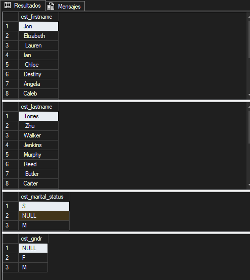{width="5.156969597550306in"
height="5.771639326334208in"}

Trasformado

\-- Extracto de scripts/silver/proc_load_silver.sql

TRUNCATE TABLE silver.crm_cust_info;

INSERT INTO silver.crm_cust_info (

cst_id,

cst_key,

cst_firstname,

cst_lastname,

cst_marital_status,

cst_gndr,

cst_create_date

)

SELECT

cst_id,

cst_key,

TRIM(cst_firstname) AS cst_firstname,

TRIM(cst_lastname) AS cst_lastname,

CASE

WHEN UPPER(TRIM(cst_marital_status)) = \'S\' THEN \'Single\'

WHEN UPPER(TRIM(cst_marital_status)) = \'M\' THEN \'Married\'

ELSE \'n/a\'

END AS cst_marital_status, \-- Normalize marital status values to
readable format

CASE

WHEN UPPER(TRIM(cst_gndr)) = \'F\' THEN \'Female\'

WHEN UPPER(TRIM(cst_gndr)) = \'M\' THEN \'Male\'

ELSE \'n/a\'

END AS cst_gndr, \-- Normalize gender values to readable format

cst_create_date

FROM (

SELECT

\*,

ROW_NUMBER() OVER (PARTITION BY cst_id ORDER BY cst_create_date DESC) AS
flag_last

FROM bronze.crm_cust_info

WHERE cst_id IS NOT NULL

) t

WHERE flag_last = 1; \-- Select the most recent record per customer

Salida

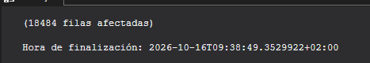{width="4.865262467191601in"
height="0.8334492563429571in"}

Productos del crm

SELECT prd_key,

SUBSTRING(prd_key, 1, 5) AS parte_categoria,

SUBSTRING(prd_key, 7, LEN(prd_key)) AS parte_producto

FROM bronze.crm_prd_info;

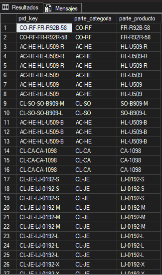{width="3.3858891076115487in"
height="5.75080271216098in"}

Separar las claves para la unión

\-- Costes nulos o negativos

SELECT prd_id, prd_nm, prd_cost

FROM bronze.crm_prd_info

WHERE prd_cost IS NULL OR prd_cost \< 0; \-- 2 productos sin coste

\-- Valores de la línea de producto (fíjate en el espacio final)

SELECT DISTINCT \'\[\' + prd_line + \'\]\' AS prd_line FROM
bronze.crm_prd_info;

\-- \[M \], \[R \], \[S \], \[T \], NULL

\-- Fechas de fin anteriores a la de inicio

SELECT prd_key, prd_nm, prd_start_dt, prd_end_dt

FROM bronze.crm_prd_info

WHERE prd_end_dt \< prd_start_dt; \-- 200 filas

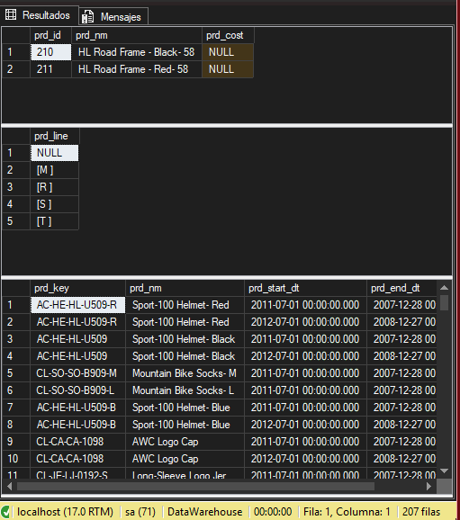{width="5.323659230096238in"
height="6.021673228346457in"}

Crm ventas

SELECT sls_order_dt, COUNT(\*) AS filas

FROM bronze.crm_sales_details

WHERE sls_order_dt \<= 0 OR LEN(sls_order_dt) != 8

GROUP BY sls_order_dt;

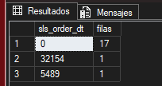{width="2.1252963692038493in"
height="1.1251574803149607in"}

Detención de los datos incoherentes

SELECT sls_ord_num, sls_sales, sls_quantity, sls_price

FROM bronze.crm_sales_details

WHERE sls_sales != sls_quantity \* sls_price

OR sls_sales IS NULL OR sls_quantity IS NULL OR sls_price IS NULL

OR sls_sales \<= 0 OR sls_quantity \<= 0 OR sls_price \<= 0

ORDER BY sls_sales, sls_quantity, sls_price;

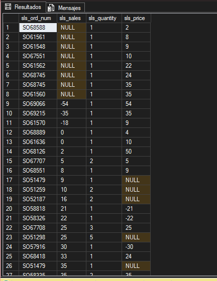{width="4.5006277340332455in"
height="5.834146981627296in"}

Transformación

\-- Extracto de scripts/silver/proc_load_silver.sql

TRUNCATE TABLE silver.crm_sales_details;

INSERT INTO silver.crm_sales_details (

sls_ord_num,

sls_prd_key,

sls_cust_id,

sls_order_dt,

sls_ship_dt,

sls_due_dt,

sls_sales,

sls_quantity,

sls_price

)

SELECT

sls_ord_num,

sls_prd_key,

sls_cust_id,

CASE

WHEN sls_order_dt = 0 OR LEN(sls_order_dt) != 8 THEN NULL

ELSE CAST(CAST(sls_order_dt AS VARCHAR) AS DATE)

END AS sls_order_dt,

CASE

WHEN sls_ship_dt = 0 OR LEN(sls_ship_dt) != 8 THEN NULL

ELSE CAST(CAST(sls_ship_dt AS VARCHAR) AS DATE)

END AS sls_ship_dt,

CASE

WHEN sls_due_dt = 0 OR LEN(sls_due_dt) != 8 THEN NULL

ELSE CAST(CAST(sls_due_dt AS VARCHAR) AS DATE)

END AS sls_due_dt,

CASE

WHEN sls_sales IS NULL OR sls_sales \<= 0 OR sls_sales != sls_quantity
\* ABS(sls_price)

THEN sls_quantity \* ABS(sls_price)

ELSE sls_sales

END AS sls_sales, \-- Recalculate sales if original value is missing or
incorrect

sls_quantity,

CASE

WHEN sls_price IS NULL OR sls_price \<= 0

THEN sls_sales / NULLIF(sls_quantity, 0)

ELSE sls_price \-- Derive price if original value is invalid

END AS sls_price

FROM bronze.crm_sales_details;

Salida

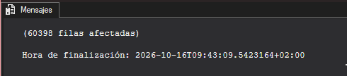{width="5.104878608923885in"
height="1.1251574803149607in"}

datos demográficos del ERP

\-- La clave no casa con el CRM

SELECT TOP 5 cid FROM bronze.erp_cust_az12; \-- NASAW00011000 \...

\-- Fechas de nacimiento fuera de rango

SELECT bdate FROM bronze.erp_cust_az12

WHERE bdate \< \'1924-01-01\' OR bdate \> GETDATE(); \-- Hay cumpleaños
en 2042, 2050\... e incluso 9999

\-- Valores de género sin estandarizar

SELECT DISTINCT \'\[\' + gen + \'\]\' AS gen FROM bronze.erp_cust_az12;

\-- \[Male\], \[Female\], \[M\], \[F\], \[ \], NULL

Salida

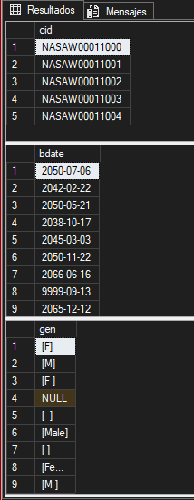{width="2.229478346456693in"
height="5.729966097987751in"}

Trasformado

\-- Extracto de scripts/silver/proc_load_silver.sql

TRUNCATE TABLE silver.erp_cust_az12;

INSERT INTO silver.erp_cust_az12 (

cid,

bdate,

gen

)

SELECT

CASE

WHEN cid LIKE \'NAS%\' THEN SUBSTRING(cid, 4, LEN(cid)) \-- Remove
\'NAS\' prefix if present

ELSE cid

END AS cid,

CASE

WHEN bdate \> GETDATE() THEN NULL

ELSE bdate

END AS bdate, \-- Set future birthdates to NULL

CASE

WHEN UPPER(TRIM(gen)) IN (\'F\', \'FEMALE\') THEN \'Female\'

WHEN UPPER(TRIM(gen)) IN (\'M\', \'MALE\') THEN \'Male\'

ELSE \'n/a\'

END AS gen \-- Normalize gender values and handle unknown cases

FROM bronze.erp_cust_az12;

Salida

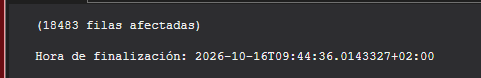{width="5.0111154855643045in"
height="0.8126137357830271in"}

Integración en el crm

SELECT cid FROM silver.erp_cust_az12

WHERE cid NOT IN (SELECT cst_key FROM silver.crm_cust_info); \-- 0 filas

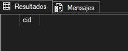{width="2.1982239720034995in"
height="0.8855402449693788in"}

País del cliente

Detección y trasformado

SELECT DISTINCT cntry FROM bronze.erp_loc_a101 ORDER BY cntry;

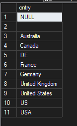{width="1.614808617672791in"
height="2.614948600174978in"}

\-- Extracto de scripts/silver/proc_load_silver.sql

TRUNCATE TABLE silver.erp_loc_a101;

INSERT INTO silver.erp_loc_a101 (

cid,

cntry

)

SELECT

REPLACE(cid, \'-\', \'\') AS cid,

CASE

WHEN TRIM(cntry) = \'DE\' THEN \'Germany\'

WHEN TRIM(cntry) IN (\'US\', \'USA\') THEN \'United States\'

WHEN TRIM(cntry) = \'\' OR cntry IS NULL THEN \'n/a\'

ELSE TRIM(cntry)

END AS cntry \-- Normalize and Handle missing or blank country codes

FROM bronze.erp_loc_a101;

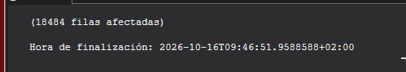{width="5.198641732283464in"
height="0.9272123797025372in"}

SELECT cntry, COUNT(\*) FROM silver.erp_loc_a101 GROUP BY cntry

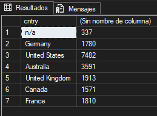{width="2.698292869641295in"
height="2.0106977252843397in"}

Categorías de productos

Detección

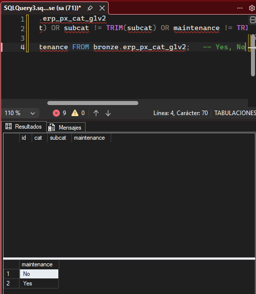{width="5.302823709536308in"
height="6.094600831146106in"}

Trasformado

\-- Extracto de scripts/silver/proc_load_silver.sql

TRUNCATE TABLE silver.erp_px_cat_g1v2;

INSERT INTO silver.erp_px_cat_g1v2 (

id,

cat,

subcat,

maintenance

)

SELECT

id,

cat,

subcat,

maintenance

FROM bronze.erp_px_cat_g1v2;

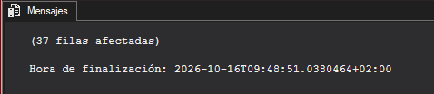{width="4.979861111111111in"
height="1.083484251968504in"}

Comprobación de la integración

SELECT DISTINCT cat_id

FROM silver.crm_prd_info

WHERE cat_id NOT IN (SELECT id FROM silver.erp_px_cat_g1v2); \-- CO_PE

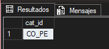{width="1.8960979877515312in"
height="0.8542858705161854in"}

Automatización del proyecto

/\*

===============================================================================

Stored Procedure: Load Silver Layer (Bronze -\> Silver)

===============================================================================

Script Purpose:

This stored procedure performs the ETL (Extract, Transform, Load)
process to

populate the \'silver\' schema tables from the \'bronze\' schema.

Actions Performed:

\- Truncates Silver tables.

\- Inserts transformed and cleansed data from Bronze into Silver tables.

Parameters:

None.

This stored procedure does not accept any parameters or return any
values.

Usage Example:

EXEC Silver.load_silver;

===============================================================================

\*/

CREATE OR ALTER PROCEDURE silver.load_silver AS

BEGIN

DECLARE \@start_time DATETIME, \@end_time DATETIME, \@batch_start_time
DATETIME, \@batch_end_time DATETIME;

BEGIN TRY

SET \@batch_start_time = GETDATE();

PRINT \'================================================\';

PRINT \'Loading Silver Layer\';

PRINT \'================================================\';

PRINT
\'\-\-\-\-\-\-\-\-\-\-\-\-\-\-\-\-\-\-\-\-\-\-\-\-\-\-\-\-\-\-\-\-\-\-\-\-\-\-\-\-\-\-\-\-\-\-\--\';

PRINT \'Loading CRM Tables\';

PRINT
\'\-\-\-\-\-\-\-\-\-\-\-\-\-\-\-\-\-\-\-\-\-\-\-\-\-\-\-\-\-\-\-\-\-\-\-\-\-\-\-\-\-\-\-\-\-\-\--\';

\-- Loading silver.crm_cust_info

SET \@start_time = GETDATE();

PRINT \'\>\> Truncating Table: silver.crm_cust_info\';

TRUNCATE TABLE silver.crm_cust_info;

PRINT \'\>\> Inserting Data Into: silver.crm_cust_info\';

INSERT INTO silver.crm_cust_info (

cst_id,

cst_key,

cst_firstname,

cst_lastname,

cst_marital_status,

cst_gndr,

cst_create_date

)

SELECT

cst_id,

cst_key,

TRIM(cst_firstname) AS cst_firstname,

TRIM(cst_lastname) AS cst_lastname,

CASE

WHEN UPPER(TRIM(cst_marital_status)) = \'S\' THEN \'Single\'

WHEN UPPER(TRIM(cst_marital_status)) = \'M\' THEN \'Married\'

ELSE \'n/a\'

END AS cst_marital_status, \-- Normalize marital status values to
readable format

CASE

WHEN UPPER(TRIM(cst_gndr)) = \'F\' THEN \'Female\'

WHEN UPPER(TRIM(cst_gndr)) = \'M\' THEN \'Male\'

ELSE \'n/a\'

END AS cst_gndr, \-- Normalize gender values to readable format

cst_create_date

FROM (

SELECT

\*,

ROW_NUMBER() OVER (PARTITION BY cst_id ORDER BY cst_create_date DESC) AS
flag_last

FROM bronze.crm_cust_info

WHERE cst_id IS NOT NULL

) t

WHERE flag_last = 1; \-- Select the most recent record per customer

SET \@end_time = GETDATE();

PRINT \'\>\> Load Duration: \' + CAST(DATEDIFF(SECOND, \@start_time,
\@end_time) AS NVARCHAR) + \' seconds\';

PRINT \'\>\> \-\-\-\-\-\-\-\-\-\-\-\--\';

\-- Loading silver.crm_prd_info

SET \@start_time = GETDATE();

PRINT \'\>\> Truncating Table: silver.crm_prd_info\';

TRUNCATE TABLE silver.crm_prd_info;

PRINT \'\>\> Inserting Data Into: silver.crm_prd_info\';

INSERT INTO silver.crm_prd_info (

prd_id,

cat_id,

prd_key,

prd_nm,

prd_cost,

prd_line,

prd_start_dt,

prd_end_dt

)

SELECT

prd_id,

REPLACE(SUBSTRING(prd_key, 1, 5), \'-\', \'\_\') AS cat_id, \-- Extract
category ID

SUBSTRING(prd_key, 7, LEN(prd_key)) AS prd_key, \-- Extract product key

prd_nm,

ISNULL(prd_cost, 0) AS prd_cost,

CASE

WHEN UPPER(TRIM(prd_line)) = \'M\' THEN \'Mountain\'

WHEN UPPER(TRIM(prd_line)) = \'R\' THEN \'Road\'

WHEN UPPER(TRIM(prd_line)) = \'S\' THEN \'Other Sales\'

WHEN UPPER(TRIM(prd_line)) = \'T\' THEN \'Touring\'

ELSE \'n/a\'

END AS prd_line, \-- Map product line codes to descriptive values

CAST(prd_start_dt AS DATE) AS prd_start_dt,

CAST(

LEAD(prd_start_dt) OVER (PARTITION BY prd_key ORDER BY prd_start_dt) - 1

AS DATE

) AS prd_end_dt \-- Calculate end date as one day before the next start
date

FROM bronze.crm_prd_info;

SET \@end_time = GETDATE();

PRINT \'\>\> Load Duration: \' + CAST(DATEDIFF(SECOND, \@start_time,
\@end_time) AS NVARCHAR) + \' seconds\';

PRINT \'\>\> \-\-\-\-\-\-\-\-\-\-\-\--\';

\-- Loading crm_sales_details

SET \@start_time = GETDATE();

PRINT \'\>\> Truncating Table: silver.crm_sales_details\';

TRUNCATE TABLE silver.crm_sales_details;

PRINT \'\>\> Inserting Data Into: silver.crm_sales_details\';

INSERT INTO silver.crm_sales_details (

sls_ord_num,

sls_prd_key,

sls_cust_id,

sls_order_dt,

sls_ship_dt,

sls_due_dt,

sls_sales,

sls_quantity,

sls_price

)

SELECT

sls_ord_num,

sls_prd_key,

sls_cust_id,

CASE

WHEN sls_order_dt = 0 OR LEN(sls_order_dt) != 8 THEN NULL

ELSE CAST(CAST(sls_order_dt AS VARCHAR) AS DATE)

END AS sls_order_dt,

CASE

WHEN sls_ship_dt = 0 OR LEN(sls_ship_dt) != 8 THEN NULL

ELSE CAST(CAST(sls_ship_dt AS VARCHAR) AS DATE)

END AS sls_ship_dt,

CASE

WHEN sls_due_dt = 0 OR LEN(sls_due_dt) != 8 THEN NULL

ELSE CAST(CAST(sls_due_dt AS VARCHAR) AS DATE)

END AS sls_due_dt,

CASE

WHEN sls_sales IS NULL OR sls_sales \<= 0 OR sls_sales != sls_quantity
\* ABS(sls_price)

THEN sls_quantity \* ABS(sls_price)

ELSE sls_sales

END AS sls_sales, \-- Recalculate sales if original value is missing or
incorrect

sls_quantity,

CASE

WHEN sls_price IS NULL OR sls_price \<= 0

THEN sls_sales / NULLIF(sls_quantity, 0)

ELSE sls_price \-- Derive price if original value is invalid

END AS sls_price

FROM bronze.crm_sales_details;

SET \@end_time = GETDATE();

PRINT \'\>\> Load Duration: \' + CAST(DATEDIFF(SECOND, \@start_time,
\@end_time) AS NVARCHAR) + \' seconds\';

PRINT \'\>\> \-\-\-\-\-\-\-\-\-\-\-\--\';

\-- Loading erp_cust_az12

SET \@start_time = GETDATE();

PRINT \'\>\> Truncating Table: silver.erp_cust_az12\';

TRUNCATE TABLE silver.erp_cust_az12;

PRINT \'\>\> Inserting Data Into: silver.erp_cust_az12\';

INSERT INTO silver.erp_cust_az12 (

cid,

bdate,

gen

)

SELECT

CASE

WHEN cid LIKE \'NAS%\' THEN SUBSTRING(cid, 4, LEN(cid)) \-- Remove
\'NAS\' prefix if present

ELSE cid

END AS cid,

CASE

WHEN bdate \> GETDATE() THEN NULL

ELSE bdate

END AS bdate, \-- Set future birthdates to NULL

CASE

WHEN UPPER(TRIM(gen)) IN (\'F\', \'FEMALE\') THEN \'Female\'

WHEN UPPER(TRIM(gen)) IN (\'M\', \'MALE\') THEN \'Male\'

ELSE \'n/a\'

END AS gen \-- Normalize gender values and handle unknown cases

FROM bronze.erp_cust_az12;

SET \@end_time = GETDATE();

PRINT \'\>\> Load Duration: \' + CAST(DATEDIFF(SECOND, \@start_time,
\@end_time) AS NVARCHAR) + \' seconds\';

PRINT \'\>\> \-\-\-\-\-\-\-\-\-\-\-\--\';

PRINT
\'\-\-\-\-\-\-\-\-\-\-\-\-\-\-\-\-\-\-\-\-\-\-\-\-\-\-\-\-\-\-\-\-\-\-\-\-\-\-\-\-\-\-\-\-\-\-\--\';

PRINT \'Loading ERP Tables\';

PRINT
\'\-\-\-\-\-\-\-\-\-\-\-\-\-\-\-\-\-\-\-\-\-\-\-\-\-\-\-\-\-\-\-\-\-\-\-\-\-\-\-\-\-\-\-\-\-\-\--\';

\-- Loading erp_loc_a101

SET \@start_time = GETDATE();

PRINT \'\>\> Truncating Table: silver.erp_loc_a101\';

TRUNCATE TABLE silver.erp_loc_a101;

PRINT \'\>\> Inserting Data Into: silver.erp_loc_a101\';

INSERT INTO silver.erp_loc_a101 (

cid,

cntry

)

SELECT

REPLACE(cid, \'-\', \'\') AS cid,

CASE

WHEN TRIM(cntry) = \'DE\' THEN \'Germany\'

WHEN TRIM(cntry) IN (\'US\', \'USA\') THEN \'United States\'

WHEN TRIM(cntry) = \'\' OR cntry IS NULL THEN \'n/a\'

ELSE TRIM(cntry)

END AS cntry \-- Normalize and Handle missing or blank country codes

FROM bronze.erp_loc_a101;

SET \@end_time = GETDATE();

PRINT \'\>\> Load Duration: \' + CAST(DATEDIFF(SECOND, \@start_time,
\@end_time) AS NVARCHAR) + \' seconds\';

PRINT \'\>\> \-\-\-\-\-\-\-\-\-\-\-\--\';

\-- Loading erp_px_cat_g1v2

SET \@start_time = GETDATE();

PRINT \'\>\> Truncating Table: silver.erp_px_cat_g1v2\';

TRUNCATE TABLE silver.erp_px_cat_g1v2;

PRINT \'\>\> Inserting Data Into: silver.erp_px_cat_g1v2\';

INSERT INTO silver.erp_px_cat_g1v2 (

id,

cat,

subcat,

maintenance

)

SELECT

id,

cat,

subcat,

maintenance

FROM bronze.erp_px_cat_g1v2;

SET \@end_time = GETDATE();

PRINT \'\>\> Load Duration: \' + CAST(DATEDIFF(SECOND, \@start_time,
\@end_time) AS NVARCHAR) + \' seconds\';

PRINT \'\>\> \-\-\-\-\-\-\-\-\-\-\-\--\';

SET \@batch_end_time = GETDATE();

PRINT \'==========================================\'

PRINT \'Loading Silver Layer is Completed\';

PRINT \' - Total Load Duration: \' + CAST(DATEDIFF(SECOND,
\@batch_start_time, \@batch_end_time) AS NVARCHAR) + \' seconds\';

PRINT \'==========================================\'

END TRY

BEGIN CATCH

PRINT \'==========================================\'

PRINT \'ERROR OCCURED DURING LOADING BRONZE LAYER\'

PRINT \'Error Message\' + ERROR_MESSAGE();

PRINT \'Error Message\' + CAST (ERROR_NUMBER() AS NVARCHAR);

PRINT \'Error Message\' + CAST (ERROR_STATE() AS NVARCHAR);

PRINT \'==========================================\'

END CATCH

END

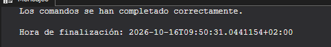{width="5.031952099737532in"
height="0.718850612423447in"}

Ejecutamos el procedimiento

EXEC silver.load_silver;

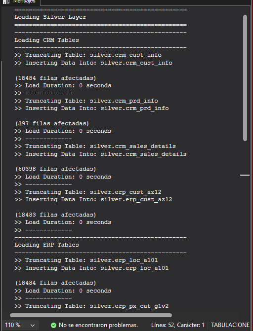{width="5.3340780839895015in"
height="6.990558836395451in"}

Validamos los resultados

/\*

===============================================================================

Quality Checks

===============================================================================

Script Purpose:

This script performs various quality checks for data consistency,
accuracy,

and standardization across the \'silver\' layer. It includes checks for:

\- Null or duplicate primary keys.

\- Unwanted spaces in string fields.

\- Data standardization and consistency.

\- Invalid date ranges and orders.

\- Data consistency between related fields.

Usage Notes:

\- Run these checks after data loading Silver Layer.

\- Investigate and resolve any discrepancies found during the checks.

===============================================================================

\*/

\-- ====================================================================

\-- Checking \'silver.crm_cust_info\'

\-- ====================================================================

\-- Check for NULLs or Duplicates in Primary Key

\-- Expectation: No Results

SELECT

cst_id,

COUNT(\*)

FROM silver.crm_cust_info

GROUP BY cst_id

HAVING COUNT(\*) \> 1 OR cst_id IS NULL;

\-- Check for Unwanted Spaces

\-- Expectation: No Results

SELECT

cst_key

FROM silver.crm_cust_info

WHERE cst_key != TRIM(cst_key);

\-- Data Standardization & Consistency

SELECT DISTINCT

cst_marital_status

FROM silver.crm_cust_info;

\-- ====================================================================

\-- Checking \'silver.crm_prd_info\'

\-- ====================================================================

\-- Check for NULLs or Duplicates in Primary Key

\-- Expectation: No Results

SELECT

prd_id,

COUNT(\*)

FROM silver.crm_prd_info

GROUP BY prd_id

HAVING COUNT(\*) \> 1 OR prd_id IS NULL;

\-- Check for Unwanted Spaces

\-- Expectation: No Results

SELECT

prd_nm

FROM silver.crm_prd_info

WHERE prd_nm != TRIM(prd_nm);

\-- Check for NULLs or Negative Values in Cost

\-- Expectation: No Results

SELECT

prd_cost

FROM silver.crm_prd_info

WHERE prd_cost \< 0 OR prd_cost IS NULL;

\-- Data Standardization & Consistency

SELECT DISTINCT

prd_line

FROM silver.crm_prd_info;

\-- Check for Invalid Date Orders (Start Date \> End Date)

\-- Expectation: No Results

SELECT

\*

FROM silver.crm_prd_info

WHERE prd_end_dt \< prd_start_dt;

\-- ====================================================================

\-- Checking \'silver.crm_sales_details\'

\-- ====================================================================

\-- Check for Invalid Dates

\-- Expectation: No Invalid Dates

SELECT

NULLIF(sls_due_dt, 0) AS sls_due_dt

FROM bronze.crm_sales_details

WHERE sls_due_dt \<= 0

OR LEN(sls_due_dt) != 8

OR sls_due_dt \> 20500101

OR sls_due_dt \< 19000101;

\-- Check for Invalid Date Orders (Order Date \> Shipping/Due Dates)

\-- Expectation: No Results

SELECT

\*

FROM silver.crm_sales_details

WHERE sls_order_dt \> sls_ship_dt

OR sls_order_dt \> sls_due_dt;

\-- Check Data Consistency: Sales = Quantity \* Price

\-- Expectation: No Results

SELECT DISTINCT

sls_sales,

sls_quantity,

sls_price

FROM silver.crm_sales_details

WHERE sls_sales != sls_quantity \* sls_price

OR sls_sales IS NULL

OR sls_quantity IS NULL

OR sls_price IS NULL

OR sls_sales \<= 0

OR sls_quantity \<= 0

OR sls_price \<= 0

ORDER BY sls_sales, sls_quantity, sls_price;

\-- ====================================================================

\-- Checking \'silver.erp_cust_az12\'

\-- ====================================================================

\-- Identify Out-of-Range Dates

\-- Expectation: Birthdates between 1924-01-01 and Today

SELECT DISTINCT

bdate

FROM silver.erp_cust_az12

WHERE bdate \< \'1924-01-01\'

OR bdate \> GETDATE();

\-- Data Standardization & Consistency

SELECT DISTINCT

gen

FROM silver.erp_cust_az12;

\-- ====================================================================

\-- Checking \'silver.erp_loc_a101\'

\-- ====================================================================

\-- Data Standardization & Consistency

SELECT DISTINCT

cntry

FROM silver.erp_loc_a101

ORDER BY cntry;

\-- ====================================================================

\-- Checking \'silver.erp_px_cat_g1v2\'

\-- ====================================================================

\-- Check for Unwanted Spaces

\-- Expectation: No Results

SELECT

\*

FROM silver.erp_px_cat_g1v2

WHERE cat != TRIM(cat)

OR subcat != TRIM(subcat)

OR maintenance != TRIM(maintenance);

\-- Data Standardization & Consistency

SELECT DISTINCT

maintenance

FROM silver.erp_px_cat_g1v2;

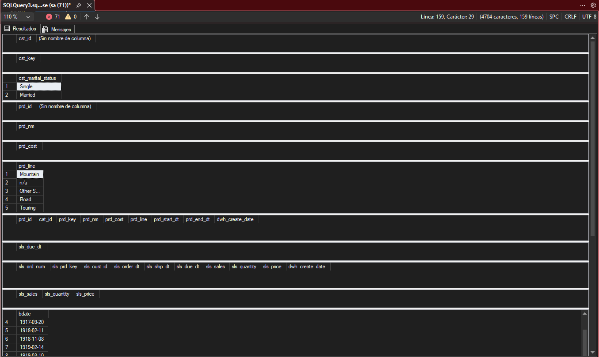{width="5.905555555555556in"
height="3.5256944444444445in"}

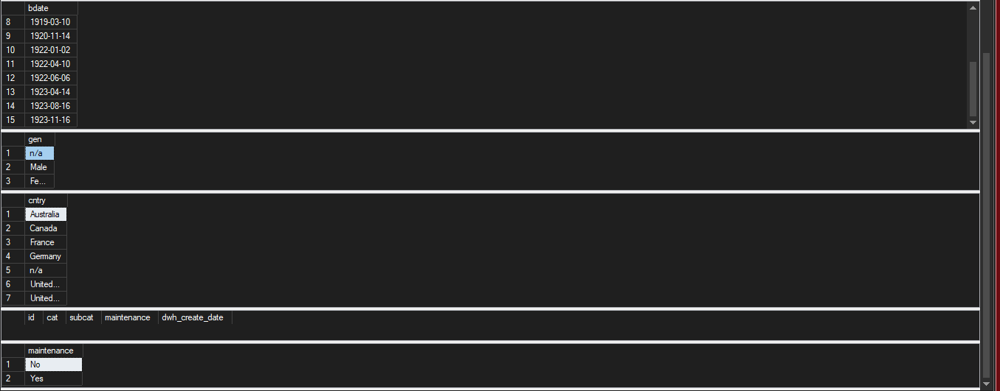{width="5.905555555555556in"
height="2.314583333333333in"}

Capa gold modelo estrella

SELECT DISTINCT

ci.cst_gndr AS genero_crm,

ca.gen AS genero_erp

FROM silver.crm_cust_info ci

LEFT JOIN silver.erp_cust_az12 ca ON ci.cst_key = ca.cid

ORDER BY 1, 2;

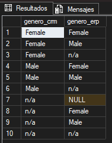{width="1.9690244969378827in"
height="2.5211854768153983in"}

Solución de los nulls

/\*

===============================================================================

DDL Script: Create Gold Views

===============================================================================

Script Purpose:

This script creates views for the Gold layer in the data warehouse.

The Gold layer represents the final dimension and fact tables (Star
Schema)

Each view performs transformations and combines data from the Silver
layer

to produce a clean, enriched, and business-ready dataset.

Usage:

\- These views can be queried directly for analytics and reporting.

===============================================================================

\*/

\--
=============================================================================

\-- Create Dimension: gold.dim_customers

\--
=============================================================================

IF OBJECT_ID(\'gold.dim_customers\', \'V\') IS NOT NULL

DROP VIEW gold.dim_customers;

GO

CREATE VIEW gold.dim_customers AS

SELECT

ROW_NUMBER() OVER (ORDER BY cst_id) AS customer_key, \-- Surrogate key

ci.cst_id AS customer_id,

ci.cst_key AS customer_number,

ci.cst_firstname AS first_name,

ci.cst_lastname AS last_name,

la.cntry AS country,

ci.cst_marital_status AS marital_status,

CASE

WHEN ci.cst_gndr != \'n/a\' THEN ci.cst_gndr \-- CRM is the primary
source for gender

ELSE COALESCE(ca.gen, \'n/a\') \-- Fallback to ERP data

END AS gender,

ca.bdate AS birthdate,

ci.cst_create_date AS create_date

FROM silver.crm_cust_info ci

LEFT JOIN silver.erp_cust_az12 ca

ON ci.cst_key = ca.cid

LEFT JOIN silver.erp_loc_a101 la

ON ci.cst_key = la.cid;

GO

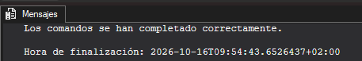{width="4.761081583552056in"
height="0.8126137357830271in"}

Capa gold de los porductos

\--
=============================================================================

\-- Create Dimension: gold.dim_products

\--
=============================================================================

IF OBJECT_ID(\'gold.dim_products\', \'V\') IS NOT NULL

DROP VIEW gold.dim_products;

GO

CREATE VIEW gold.dim_products AS

SELECT

ROW_NUMBER() OVER (ORDER BY pn.prd_start_dt, pn.prd_key) AS product_key,
\-- Surrogate key

pn.prd_id AS product_id,

pn.prd_key AS product_number,

pn.prd_nm AS product_name,

pn.cat_id AS category_id,

pc.cat AS category,

pc.subcat AS subcategory,

pc.maintenance AS maintenance,

pn.prd_cost AS cost,

pn.prd_line AS product_line,

pn.prd_start_dt AS start_date

FROM silver.crm_prd_info pn

LEFT JOIN silver.erp_px_cat_g1v2 pc

ON pn.cat_id = pc.id

WHERE pn.prd_end_dt IS NULL; \-- Filter out all historical data

GO

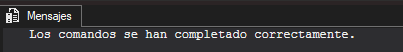{width="4.198502843394576in"
height="0.541742125984252in"}

Capa gold de los productos

\--
=============================================================================

\-- Create Fact Table: gold.fact_sales

\--
=============================================================================

IF OBJECT_ID(\'gold.fact_sales\', \'V\') IS NOT NULL

DROP VIEW gold.fact_sales;

GO

CREATE VIEW gold.fact_sales AS

SELECT

sd.sls_ord_num AS order_number,

pr.product_key AS product_key,

cu.customer_key AS customer_key,

sd.sls_order_dt AS order_date,

sd.sls_ship_dt AS shipping_date,

sd.sls_due_dt AS due_date,

sd.sls_sales AS sales_amount,

sd.sls_quantity AS quantity,

sd.sls_price AS price

FROM silver.crm_sales_details sd

LEFT JOIN gold.dim_products pr

ON sd.sls_prd_key = pr.product_number

LEFT JOIN gold.dim_customers cu

ON sd.sls_cust_id = cu.customer_id;

GO

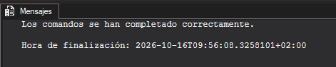{width="4.9069346019247595in"
height="0.9897211286089239in"}

Validar el modelo

/\*

===============================================================================

Quality Checks

===============================================================================

Script Purpose:

This script performs quality checks to validate the integrity,
consistency,

and accuracy of the Gold Layer. These checks ensure:

\- Uniqueness of surrogate keys in dimension tables.

\- Referential integrity between fact and dimension tables.

\- Validation of relationships in the data model for analytical
purposes.

Usage Notes:

\- Investigate and resolve any discrepancies found during the checks.

===============================================================================

\*/

\-- ====================================================================

\-- Checking \'gold.dim_customers\'

\-- ====================================================================

\-- Check for Uniqueness of Customer Key in gold.dim_customers

\-- Expectation: No results

SELECT

customer_key,

COUNT(\*) AS duplicate_count

FROM gold.dim_customers

GROUP BY customer_key

HAVING COUNT(\*) \> 1;

\-- ====================================================================

\-- Checking \'gold.product_key\'

\-- ====================================================================

\-- Check for Uniqueness of Product Key in gold.dim_products

\-- Expectation: No results

SELECT

product_key,

COUNT(\*) AS duplicate_count

FROM gold.dim_products

GROUP BY product_key

HAVING COUNT(\*) \> 1;

\-- ====================================================================

\-- Checking \'gold.fact_sales\'

\-- ====================================================================

\-- Check the data model connectivity between fact and dimensions

SELECT \*

FROM gold.fact_sales f

LEFT JOIN gold.dim_customers c

ON c.customer_key = f.customer_key

LEFT JOIN gold.dim_products p

ON p.product_key = f.product_key

WHERE p.product_key IS NULL OR c.customer_key IS NULL

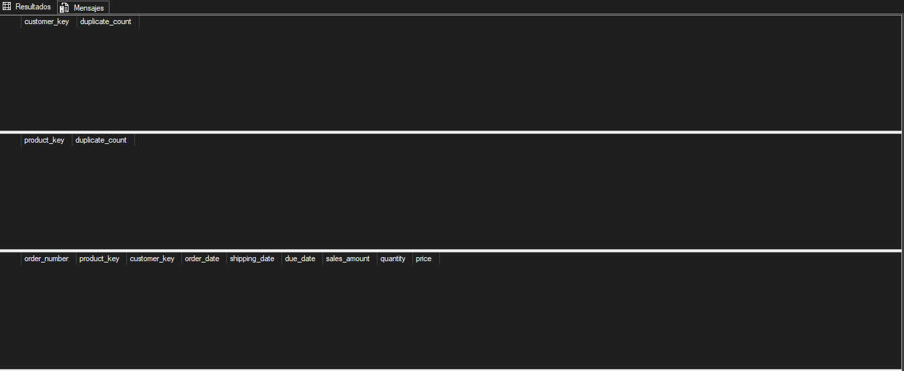{width="5.905555555555556in"
height="2.4305555555555554in"}

Comprobación de duplicados o perdida de datos

SELECT

(SELECT COUNT(\*) FROM silver.crm_sales_details) AS filas_silver, \--
60.398

(SELECT COUNT(\*) FROM gold.fact_sales) AS filas_gold; \-- 60.398

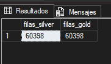{width="1.8960979877515312in"
height="1.0939031058617672in"}

Orquestar la carga

USE DataWarehouse;

GO

EXEC bronze.load_bronze; \-- 1. Fuentes → Bronze

EXEC silver.load_silver; \-- 2. Bronze → Silver

\-- 3. Gold no se carga: son vistas y reflejan Silver al instante

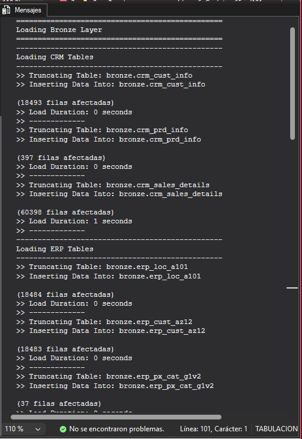{width="5.313241469816273in"
height="7.719827209098862in"}

Crear el trabajo con t-sql

/\* ============================================================

scripts/job_carga_diaria.sql

Crea el trabajo de SQL Server Agent que recarga el DWH cada día.

Requisitos: SQL Server Agent arrancado y permisos de lectura

sobre C:\\sql\\dwh_project\\datasets para NT SERVICE\\SQLSERVERAGENT
(ver 10.2).

Antes, aplica en los dos procedimientos el cambio del CATCH (ver abajo).

============================================================ \*/

USE msdb;

GO

\-- Si el trabajo ya existe, lo eliminamos para poder recrearlo

IF EXISTS (SELECT 1 FROM dbo.sysjobs WHERE name = N\'DWH - Carga
diaria\')

EXEC dbo.sp_delete_job \@job_name = N\'DWH - Carga diaria\';

GO

\-- 1. El trabajo

EXEC dbo.sp_add_job

\@job_name = N\'DWH - Carga diaria\',

\@description = N\'Recarga completa de las capas Bronze y Silver del
DataWarehouse\',

\@enabled = 1;

\-- 2. Paso 1: Bronze. Si termina bien, pasa al siguiente; si falla, el
trabajo se detiene con error

EXEC dbo.sp_add_jobstep

\@job_name = N\'DWH - Carga diaria\',

\@step_name = N\'1 - Cargar Bronze\',

\@subsystem = N\'TSQL\',

\@database_name = N\'DataWarehouse\',

\@command = N\'EXEC bronze.load_bronze;\',

\@on_success_action = 3, \-- 3 = ir al siguiente paso

\@on_fail_action = 2; \-- 2 = terminar el trabajo con error

\-- 3. Paso 2: Silver. Solo se ejecuta si Bronze terminó bien

EXEC dbo.sp_add_jobstep

\@job_name = N\'DWH - Carga diaria\',

\@step_name = N\'2 - Cargar Silver\',

\@subsystem = N\'TSQL\',

\@database_name = N\'DataWarehouse\',

\@command = N\'EXEC silver.load_silver;\',

\@on_success_action = 1, \-- 1 = terminar el trabajo con éxito

\@on_fail_action = 2;

\-- 4. Programación: todos los días a las 06:00

EXEC dbo.sp_add_schedule

\@schedule_name = N\'Diario 06:00\',

\@freq_type = 4, \-- 4 = diario

\@freq_interval = 1, \-- cada 1 día

\@active_start_time = 060000; \-- formato HHMMSS

EXEC dbo.sp_attach_schedule

\@job_name = N\'DWH - Carga diaria\',

\@schedule_name = N\'Diario 06:00\';

\-- 5. Asignar el trabajo a este servidor

EXEC dbo.sp_add_jobserver

\@job_name = N\'DWH - Carga diaria\',

\@server_name = N\'(local)\';

GO

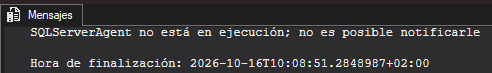{width="5.125715223097113in"
height="0.7605227471566054in"}

Exploración de la capa golg

Indicadores principales

SELECT

SUM(sales_amount) AS ventas_totales,

SUM(quantity) AS unidades_vendidas,

COUNT(DISTINCT order_number) AS pedidos,

COUNT(DISTINCT customer_key) AS clientes_con_compras

FROM gold.fact_sales;

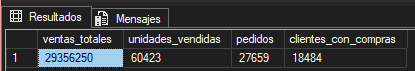{width="4.323520341207349in"
height="0.739686132983377in"}

Rendimiento por categorías

SELECT

p.category,

SUM(f.sales_amount) AS ventas,

CAST(100.0 \* SUM(f.sales_amount) / SUM(SUM(f.sales_amount)) OVER () AS
DECIMAL(5,2)) AS pct_total

FROM gold.fact_sales f

JOIN gold.dim_products p ON f.product_key = p.product_key

GROUP BY p.category

ORDER BY ventas DESC;

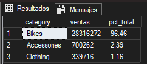{width="2.5211854768153983in"
height="1.0939031058617672in"}

Comportamiento de los clientes

SELECT

c.country,

COUNT(DISTINCT c.customer_key) AS clientes,

SUM(f.sales_amount) AS ventas

FROM gold.fact_sales f

JOIN gold.dim_customers c ON f.customer_key = c.customer_key

GROUP BY c.country

ORDER BY ventas DESC;

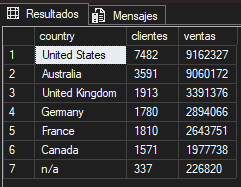{width="2.5107666229221346in"
height="1.9481889763779527in"}

Ventas por año

SELECT

YEAR(order_date) AS anio,

SUM(sales_amount) AS ventas,

COUNT(DISTINCT customer_key) AS clientes

FROM gold.fact_sales

WHERE order_date IS NOT NULL

GROUP BY YEAR(order_date)

ORDER BY anio;

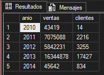{width="2.135715223097113in"
height="1.531463254593176in"}

Top 5

SELECT TOP 5

p.product_name,

p.subcategory,

SUM(f.sales_amount) AS ventas

FROM gold.fact_sales f

JOIN gold.dim_products p ON f.product_key = p.product_key

GROUP BY p.product_name, p.subcategory

ORDER BY ventas DESC;

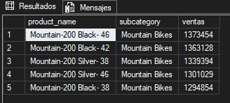{width="3.4171434820647417in"
height="1.5418821084864391in"}

Perfil cliente

SELECT

gender,

marital_status,

COUNT(\*) AS clientes

FROM gold.dim_customers

GROUP BY gender, marital_status

ORDER BY gender, marital_status;

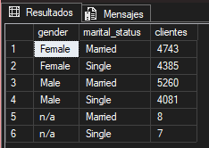{width="2.437840113735783in"
height="1.7294083552055992in"}

Pregunta de finanzas

SELECT COUNT(\*) AS lineas_incoherentes

FROM gold.fact_sales

WHERE sales_amount IS NULL

OR sales_amount \<= 0

OR sales_amount != quantity \* price;

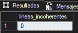{width="1.614808617672791in"
height="0.6875962379702537in"}

Ejercicio propuestos

Ejercicio 1

SELECT cst_id FROM silver.crm_cust_info

WHERE cst_firstname != TRIM(cst_firstname) OR cst_lastname !=
TRIM(cst_lastname);

SELECT DISTINCT cst_gndr FROM silver.crm_cust_info;

SELECT COUNT(\*) AS ventas_fecha_nula

FROM silver.crm_sales_details

WHERE sls_order_dt IS NULL;

SELECT cid FROM silver.erp_cust_az12 WHERE cid NOT IN (SELECT cst_key
FROM silver.crm_cust_info);

SELECT cid FROM silver.erp_loc_a101 WHERE cid NOT IN (SELECT cst_key
FROM silver.crm_cust_info);

SELECT DISTINCT cat_id FROM silver.crm_prd_info

WHERE cat_id NOT IN (SELECT id FROM silver.erp_px_cat_g1v2);

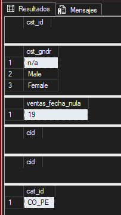{width="2.1148786089238847in"
height="3.7505238407699037in"}

SELECT product_id, product_number, product_name, category_id

FROM gold.dim_products

WHERE category IS NULL;

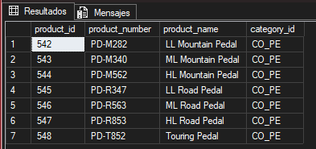{width="4.094320866141732in"
height="1.9273523622047244in"}

Ejercicio 2

IF OBJECT_ID(\'dbo.dwh_load_log\', \'U\') IS NOT NULL

DROP TABLE dbo.dwh_load_log;

GO

CREATE TABLE dbo.dwh_load_log (

log_id INT IDENTITY(1,1) PRIMARY KEY,

layer NVARCHAR(50),

table_name NVARCHAR(100),

rows_loaded INT,

start_time DATETIME,

end_time DATETIME,

status NVARCHAR(50),

error_message NVARCHAR(MAX)

);

GO

{width="4.729827209098863in"
height="0.4896511373578303in"}

Ejercicio 3

SELECT

c.country,

SUM(f.sales_amount) AS ventas_totales,

COUNT(DISTINCT f.order_number) AS total_pedidos,

SUM(f.sales_amount) / NULLIF(COUNT(DISTINCT f.order_number), 0) AS
ticket_medio

FROM gold.fact_sales f

JOIN gold.dim_customers c ON f.customer_key = c.customer_key

GROUP BY c.country

ORDER BY ticket_medio DESC;

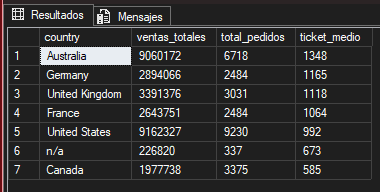{width="3.958885608048994in"
height="2.000278871391076in"}

Ejercicio 4

IF OBJECT_ID(\'gold.report_customers\', \'V\') IS NOT NULL

DROP VIEW gold.report_customers;

GO

CREATE VIEW gold.report_customers AS

WITH customer_aggregates AS (

SELECT

c.customer_key,

c.customer_id,

c.customer_number,

c.first_name,

c.last_name,

c.country,

c.marital_status,

c.gender,

DATEDIFF(YEAR, c.birthdate, GETDATE()) AS age,

MIN(f.order_date) AS first_order_date,

MAX(f.order_date) AS last_order_date,

COUNT(DISTINCT f.order_number) AS total_orders,

SUM(f.sales_amount) AS total_sales

FROM gold.dim_customers c

LEFT JOIN gold.fact_sales f ON c.customer_key = f.customer_key

GROUP BY c.customer_key, c.customer_id, c.customer_number, c.first_name,
c.last_name, c.country, c.marital_status, c.gender, c.birthdate

)

SELECT

customer_key,

customer_id,

customer_number,

first_name,

last_name,

country,

marital_status,

gender,

age,

first_order_date,

last_order_date,

total_orders,

ISNULL(total_sales, 0) AS total_sales,

DATEDIFF(MONTH, first_order_date, GETDATE()) AS customer_tenure_months,

CASE

WHEN ISNULL(total_sales, 0) \> 5000 AND DATEDIFF(MONTH,
first_order_date, GETDATE()) \> 12 THEN \'VIP\'

WHEN ISNULL(total_sales, 0) \> 5000 OR DATEDIFF(MONTH, first_order_date,
GETDATE()) \> 12 THEN \'Regular\'

ELSE \'New\'

END AS customer_segment

FROM customer_aggregates;

GO

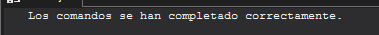{width="3.9484678477690287in"
height="0.3646347331583552in"}
