# Contenido {#contenido .TOC-Heading}

[Creación de la BBDD [3](#creación-de-la-bbdd)](#creación-de-la-bbdd)

[Ejercicio 1 [6](#ejercicio-1)](#ejercicio-1)

[Ejercicio 2 [6](#ejercicio-2)](#ejercicio-2)

[Ejercicio 3 [7](#ejercicio-3)](#ejercicio-3)

[Ejercicio 4 [7](#ejercicio-4)](#ejercicio-4)

[Ejercicio 5 [7](#ejercicio-5)](#ejercicio-5)

[Ejercicio 6 [8](#ejercicio-6)](#ejercicio-6)

[Ejercicio 7 [8](#ejercicio-7)](#ejercicio-7)

[Ejercicio 8 [9](#ejercicio-8)](#ejercicio-8)

[Ejercicio 9 [9](#ejercicio-9)](#ejercicio-9)

[Ejercicio 10 [10](#ejercicio-10)](#ejercicio-10)

[Ejercicio 11 [11](#ejercicio-11)](#ejercicio-11)

[Ejercicio 12 [12](#ejercicio-12)](#ejercicio-12)

[Ejercicio 13 [12](#ejercicio-13)](#ejercicio-13)

[Ejercicio 14 [13](#ejercicio-14)](#ejercicio-14)

[Ejercicio 15 [14](#ejercicio-15)](#ejercicio-15)

[Ejercicio 16 [14](#ejercicio-16)](#ejercicio-16)

[Ejercicio 17 [15](#ejercicio-17)](#ejercicio-17)

[Ejercicio 18 [15](#ejercicio-18)](#ejercicio-18)

[Ejercicio 19 [16](#ejercicio-19)](#ejercicio-19)

[Ejercicio 20 [17](#ejercicio-20)](#ejercicio-20)

[Ejercicio 21 [17](#ejercicio-21)](#ejercicio-21)

[Ejercicio 22 [18](#ejercicio-22)](#ejercicio-22)

[Ejercicio 23 [19](#ejercicio-23)](#ejercicio-23)

[Ejercicio 24 [19](#ejercicio-24)](#ejercicio-24)

[Ejercicio 25 [20](#ejercicio-25)](#ejercicio-25)

[Ejercicio 26 [20](#ejercicio-26)](#ejercicio-26)

[Ejercicio 27 [21](#ejercicio-27)](#ejercicio-27)

[Ejercicio 28 [21](#ejercicio-28)](#ejercicio-28)

[Ejercicio 29 [22](#ejercicio-29)](#ejercicio-29)

[Ejercicio 30 [22](#ejercicio-30)](#ejercicio-30)

[Ejercicio 31 [23](#ejercicio-31)](#ejercicio-31)

[Ejercicio 32 [23](#ejercicio-32)](#ejercicio-32)

[Ejercicio 33 [24](#ejercicio-33)](#ejercicio-33)

[Ejercicio 34 [24](#ejercicio-34)](#ejercicio-34)

[Ejercicio 35 [26](#ejercicio-35)](#ejercicio-35)

[Ejercicio 36 [27](#ejercicio-36)](#ejercicio-36)

[Ejercicio 37 [27](#ejercicio-37)](#ejercicio-37)

[Ejercicio 38 [28](#ejercicio-38)](#ejercicio-38)

[Ejercicio 39 [28](#ejercicio-39)](#ejercicio-39)

# Creación de la BBDD

Verificar instancia de ssms

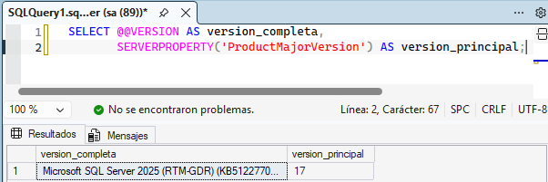{width="5.905555555555556in"
height="1.9715277777777778in"}

Crear la bbdd

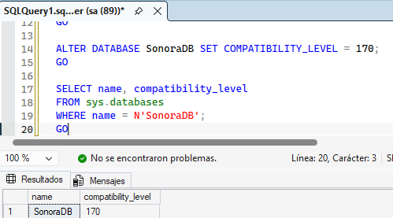{width="5.198641732283464in"
height="2.8858191163604547in"}

Crear las tablas y las claves

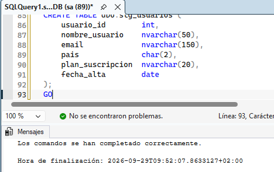{width="4.875680227471566in"
height="3.073345363079615in"}

Comprobación

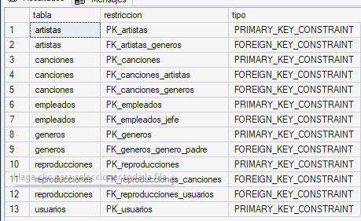{width="4.781917104111986in"
height="2.9274923447069114in"}

Añadir datos

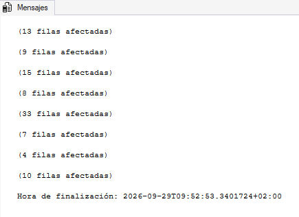{width="4.531882108486439in"
height="3.2921259842519683in"}

Verificar la carga

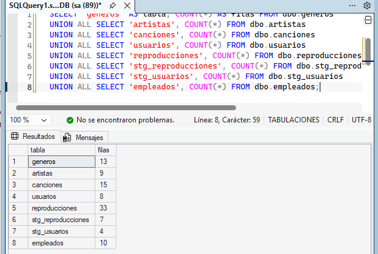{width="5.905555555555556in"
height="3.9652777777777777in"}

# Ejercicio 1

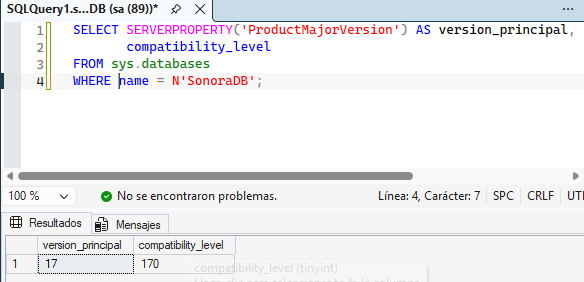{width="5.905555555555556in"
height="2.8513888888888888in"}

# Ejercicio 2

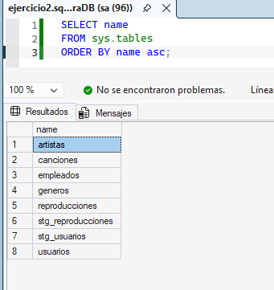{width="3.55257874015748in"
height="3.760941601049869in"}

# Ejercicio 3

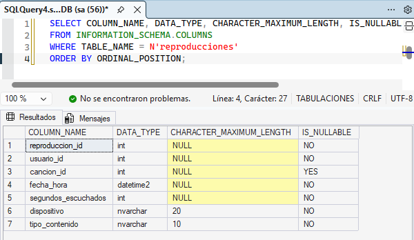{width="5.905555555555556in"
height="3.425in"}

# Ejercicio 4

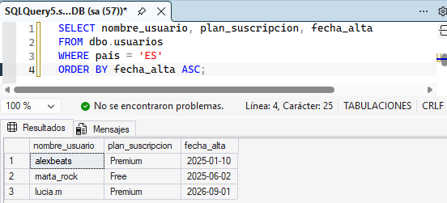{width="5.75080271216098in"
height="2.614948600174978in"}

# Ejercicio 5

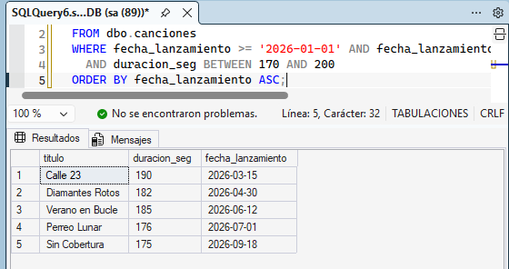{width="5.834146981627296in"
height="3.0837642169728783in"}

# Ejercicio 6

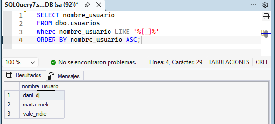{width="5.886237970253719in"
height="2.6566207349081363in"}

El usar like sin los corchetes devuelve todos los resultados porque para
sql el guion indica que se busca cualquier carácter por lo que devuelve
los 8

# Ejercicio 7

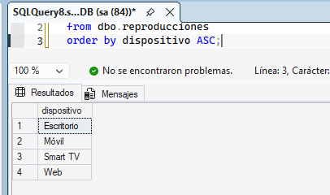{width="4.229757217847769in"
height="2.50034886264217in"}

# Ejercicio 8

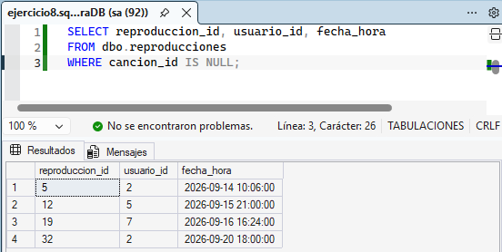{width="5.75080271216098in"
height="2.8962379702537184in"}

El uso de la condición canción_id = NULL no da resultado porque la
comparación de un null con el uso de un = el resultado que devuelve es
de tipo desconocido por eso es necesario usar is null

# Ejercicio 9

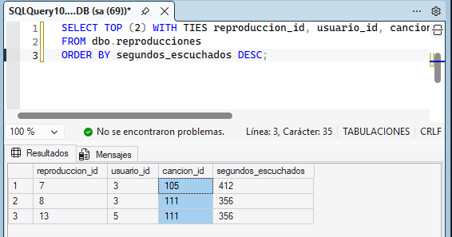{width="5.896655730533683in"
height="3.0941819772528434in"}

# Ejercicio 10

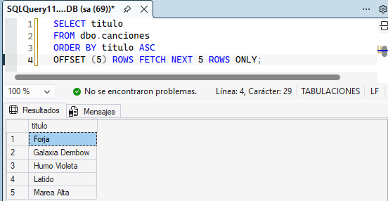{width="5.75080271216098in"
height="2.979582239720035in"}

# Ejercicio 11

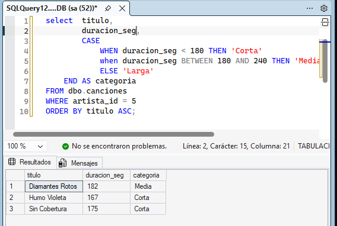{width="5.905555555555556in"
height="3.9715277777777778in"}

# Ejercicio 12

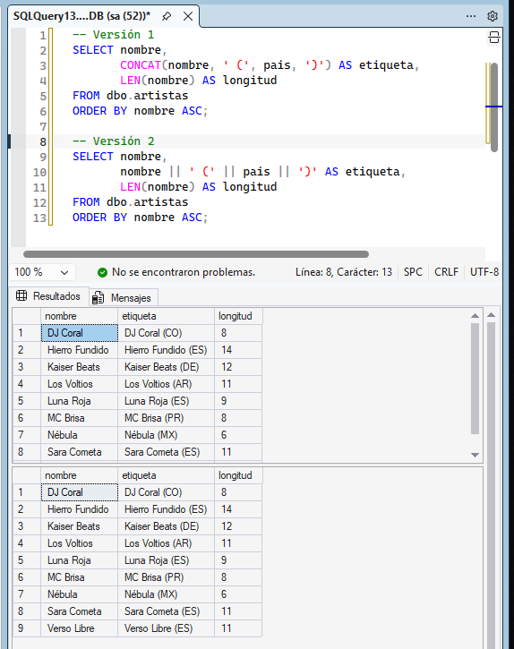{width="5.905555555555556in"
height="7.459027777777778in"}

# Ejercicio 13

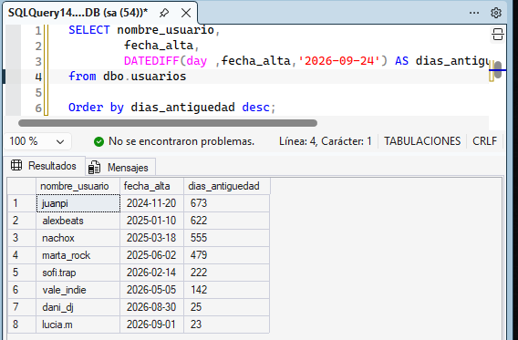{width="5.905555555555556in"
height="3.8777777777777778in"}

# Ejercicio 14

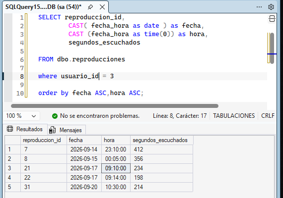{width="5.905555555555556in"
height="4.14375in"}

# Ejercicio 15

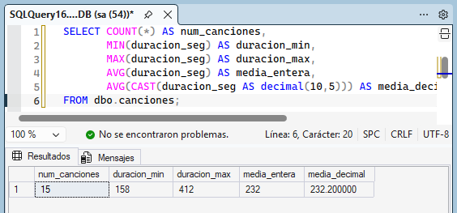{width="5.875820209973753in"
height="2.7399660979877516in"}

La media entera elimina los decimales porque sql hace una división de
enteros dando como resultado un int

# Ejercicio 16

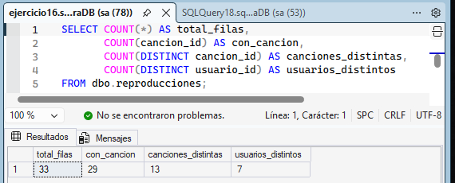{width="5.905555555555556in"
height="2.3826388888888888in"}

# Ejercicio 17

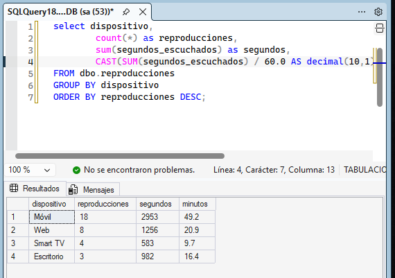{width="5.905555555555556in"
height="4.154166666666667in"}

# Ejercicio 18

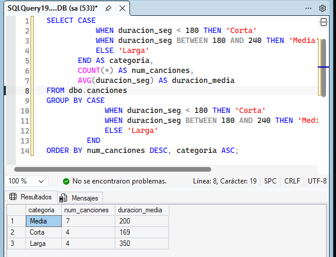{width="5.905555555555556in"
height="4.519444444444445in"}

# Ejercicio 19

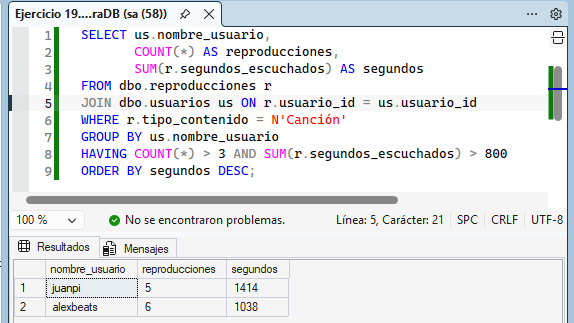{width="5.905555555555556in"
height="3.3229166666666665in"}

# Ejercicio 20

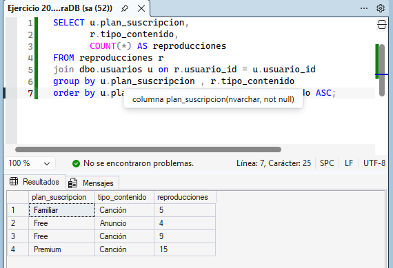{width="5.905555555555556in"
height="4.029861111111111in"}

# Ejercicio 21

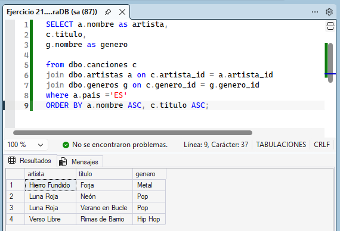{width="5.905555555555556in"
height="4.019444444444445in"}

# Ejercicio 22

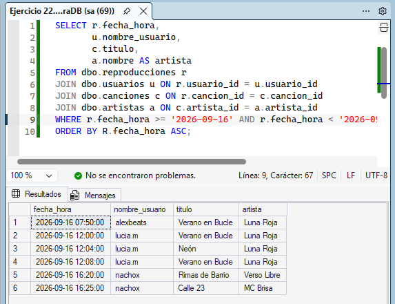{width="5.905555555555556in"
height="4.534027777777778in"}

# Ejercicio 23

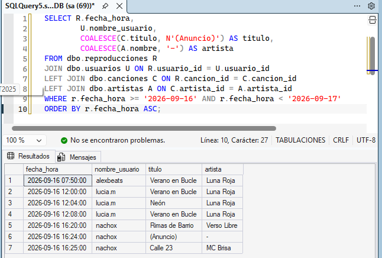{width="5.905555555555556in"
height="3.9854166666666666in"}

# Ejercicio 24

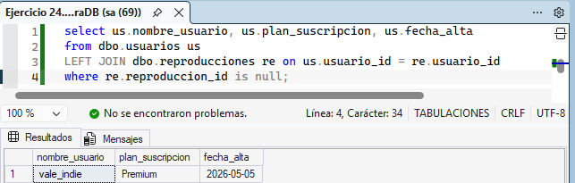{width="5.905555555555556in"
height="1.882638888888889in"}

# Ejercicio 25

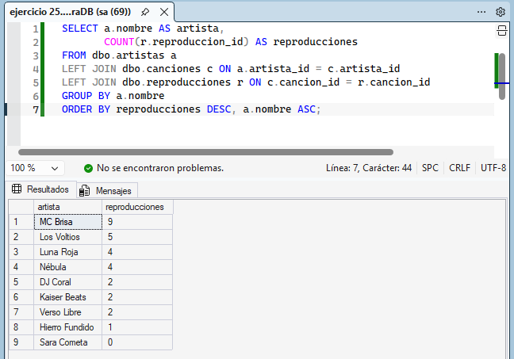{width="5.905555555555556in"
height="4.127777777777778in"}

# Ejercicio 26

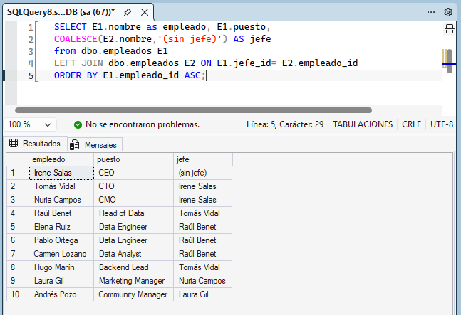{width="5.905555555555556in"
height="4.043055555555555in"}

# Ejercicio 27 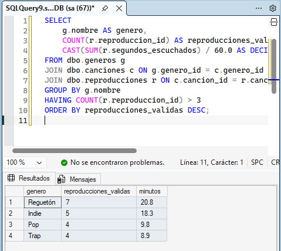{width="4.990279965004374in" height="4.458955599300087in"}

# Ejercicio 28

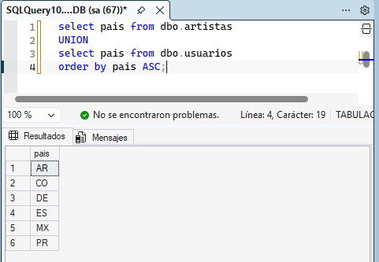{width="5.0111154855643045in"
height="3.4692344706911635in"}

# Ejercicio 29

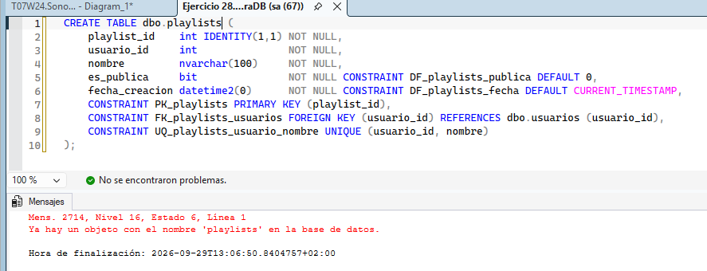{width="5.905555555555556in"
height="2.2631944444444443in"}

# Ejercicio 30

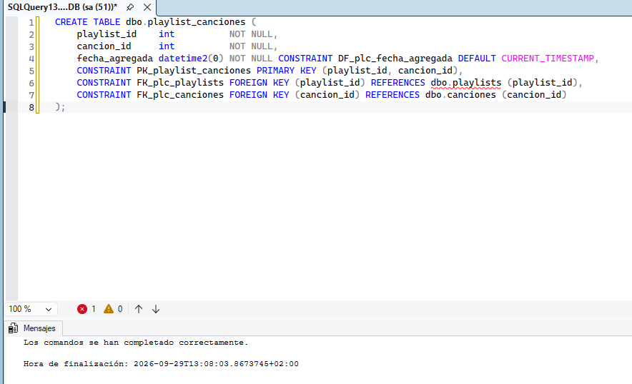{width="5.905555555555556in"
height="3.5944444444444446in"}

# Ejercicio 31

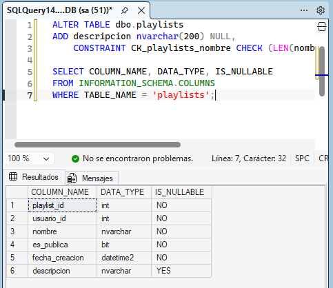{width="5.031952099737532in"
height="4.354774715660542in"}

# Ejercicio 32

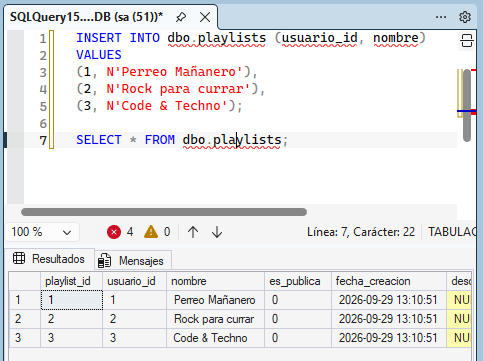{width="5.031952099737532in"
height="3.760941601049869in"}

# Ejercicio 33

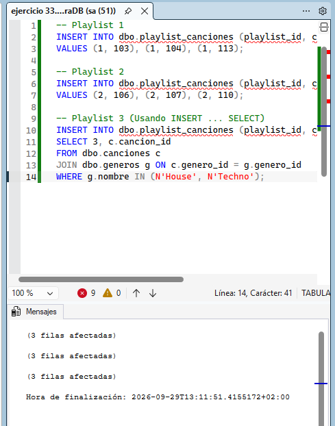{width="5.094460848643919in"
height="6.480071084864392in"}

# Ejercicio 34

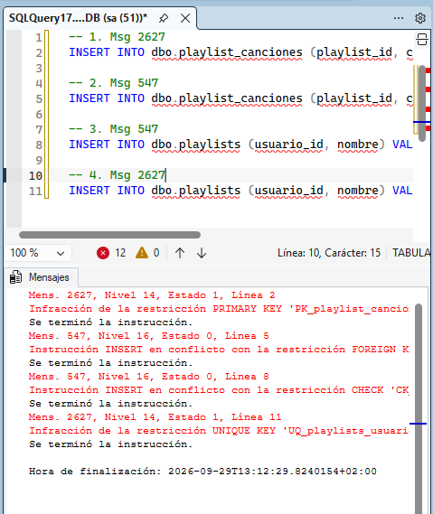{width="4.990279965004374in"
height="5.927910104986877in"}

# Ejercicio 35

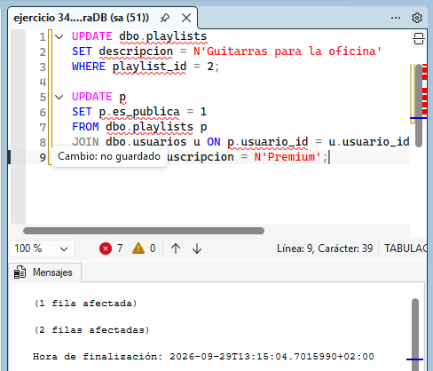{width="5.084043088363955in"
height="4.354774715660542in"}

# Ejercicio 36

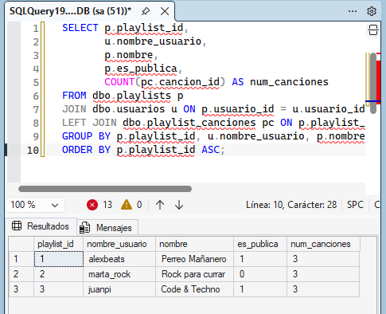{width="5.052788713910761in"
height="4.1047397200349955in"}

# Ejercicio 37

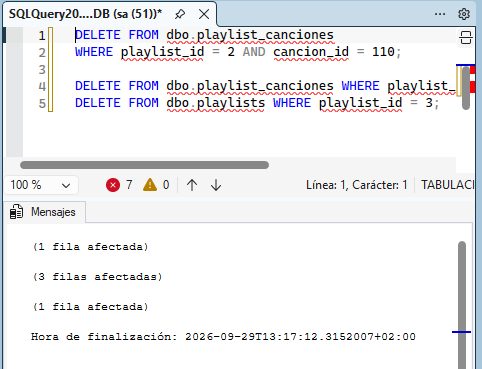{width="5.021534339457568in"
height="3.8442869641294837in"}

# Ejercicio 38

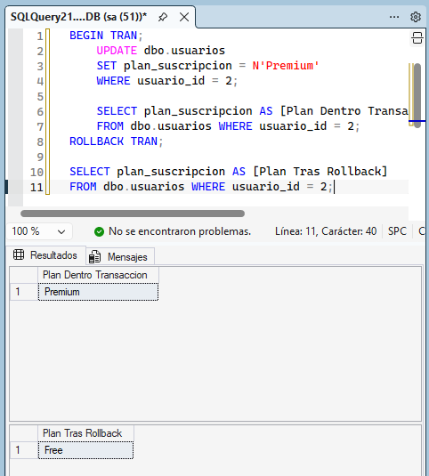{width="5.021534339457568in"
height="5.573694225721785in"}

# Ejercicio 39

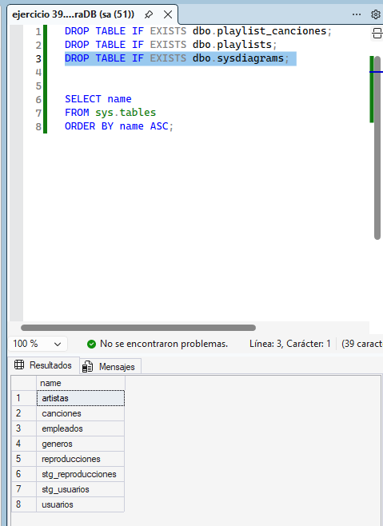{width="4.990279965004374in"
height="6.855123578302712in"}
