# Contenido {#contenido .TOC-Heading}

[Consultas ejemplo [3](#consultas-ejemplo)](#consultas-ejemplo)

[Ejemplo 1. Subconsulta escalar en WHERE
[3](#ejemplo-1.-subconsulta-escalar-en-where)](#ejemplo-1.-subconsulta-escalar-en-where)

[Ejemplo 2. Subconsulta escalar en SELECT
[4](#ejemplo-2.-subconsulta-escalar-en-select)](#ejemplo-2.-subconsulta-escalar-en-select)

[Ejemplo 3. Subconsulta de lista con IN (y subconsultas anidadas)
[5](#ejemplo-3.-subconsulta-de-lista-con-in-y-subconsultas-anidadas)](#ejemplo-3.-subconsulta-de-lista-con-in-y-subconsultas-anidadas)

[Ejemplo 4. Tabla derivada en FROM
[6](#ejemplo-4.-tabla-derivada-en-from)](#ejemplo-4.-tabla-derivada-en-from)

[Ejemplo 5. Subconsulta correlacionada
[7](#ejemplo-5.-subconsulta-correlacionada)](#ejemplo-5.-subconsulta-correlacionada)

[Ejemplo 6. EXISTS [8](#ejemplo-6.-exists)](#ejemplo-6.-exists)

[Ejemplo 7. La trampa de NOT IN con valores NULL
[9](#ejemplo-7.-la-trampa-de-not-in-con-valores-null)](#ejemplo-7.-la-trampa-de-not-in-con-valores-null)

[Ejemplo 8. NOT EXISTS como anti-join para la carga incremental
[10](#ejemplo-8.-not-exists-como-anti-join-para-la-carga-incremental)](#ejemplo-8.-not-exists-como-anti-join-para-la-carga-incremental)

[Ejemplo 9. CTE simple
[11](#ejemplo-9.-cte-simple)](#ejemplo-9.-cte-simple)

[Ejemplo 10. CTE encadenadas como pipeline
[12](#ejemplo-10.-cte-encadenadas-como-pipeline)](#ejemplo-10.-cte-encadenadas-como-pipeline)

[Ejemplo 11. CTE recursiva: árbol de géneros
[14](#ejemplo-11.-cte-recursiva-árbol-de-géneros)](#ejemplo-11.-cte-recursiva-árbol-de-géneros)

[Ejemplo 12. CTE recursiva combinada con agregación
[15](#ejemplo-12.-cte-recursiva-combinada-con-agregación)](#ejemplo-12.-cte-recursiva-combinada-con-agregación)

[Ejemplo 13. CTE recursiva para generar fechas y MAXRECURSION
[16](#ejemplo-13.-cte-recursiva-para-generar-fechas-y-maxrecursion)](#ejemplo-13.-cte-recursiva-para-generar-fechas-y-maxrecursion)

[Ejemplo 14. CTE frente a subconsulta: reutilizar un resultado
[17](#ejemplo-14.-cte-frente-a-subconsulta-reutilizar-un-resultado)](#ejemplo-14.-cte-frente-a-subconsulta-reutilizar-un-resultado)

[Ejercicios [18](#ejercicios)](#ejercicios)

[Ejercicio 1 [18](#ejercicio-1)](#ejercicio-1)

[EJERCICIO 2 [19](#ejercicio-2)](#ejercicio-2)

[Ejercicio 3 [20](#ejercicio-3)](#ejercicio-3)

[Ejercicio 4 [21](#ejercicio-4)](#ejercicio-4)

[Ejercicio 5 [22](#ejercicio-5)](#ejercicio-5)

[Ejercicio 6 [24](#ejercicio-6)](#ejercicio-6)

[Ejercicio 7 [25](#ejercicio-7)](#ejercicio-7)

[Ejercicio 8 [26](#ejercicio-8)](#ejercicio-8)

[Ejercicio 9 [27](#ejercicio-9)](#ejercicio-9)

[Ejercicio 10 [28](#ejercicio-10)](#ejercicio-10)

[Ejercicio 11 [29](#ejercicio-11)](#ejercicio-11)

[Ejercicio 12 [30](#ejercicio-12)](#ejercicio-12)

[Vistas [31](#vistas)](#vistas)

[Ejercicio 1 [31](#ejercicio-1-1)](#ejercicio-1-1)

[Vista 2 [32](#vista-2)](#vista-2)

[Vista 3 [33](#vista-3)](#vista-3)

[Vista 4 [34](#vista-4)](#vista-4)

[Vista 5 [35](#vista-5)](#vista-5)

[Vista 6 [37](#vista-6)](#vista-6)

[Vista 7 [39](#vista-7)](#vista-7)

[Vista 8 [42](#vista-8)](#vista-8)

[Vista 9 [43](#vista-9)](#vista-9)

[Vista 10 [44](#vista-10)](#vista-10)

[Vista 11 [46](#vista-11)](#vista-11)

[Parte 3 [48](#parte-3)](#parte-3)

[Requerimiento [48](#_Toc242171829)](#_Toc242171829)

[Requerimiento 2 [50](#requerimiento-2)](#requerimiento-2)

[Requerimiento 3 [51](#requerimiento-3)](#requerimiento-3)

[Requisito 4 [52](#requisito-4)](#requisito-4)

[Requerimiento 5 [53](#requerimiento-5)](#requerimiento-5)

[Requerimiento 6 [55](#requerimiento-6)](#requerimiento-6)

[Requerimiento 7 [57](#requerimiento-7)](#requerimiento-7)

# 

# Consultas ejemplo

## Ejemplo 1. Subconsulta escalar en WHERE

Primero resolvemos la parte interna

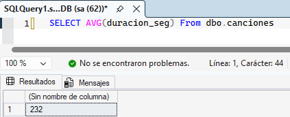{width="4.406864610673666in"
height="1.791917104111986in"}

Usamos eso en la consulta principal

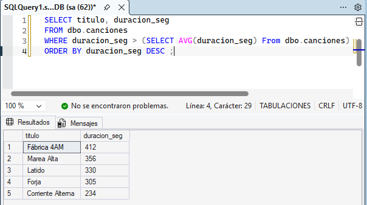{width="5.905555555555556in"
height="3.2944444444444443in"}

## Ejemplo 2. Subconsulta escalar en SELECT

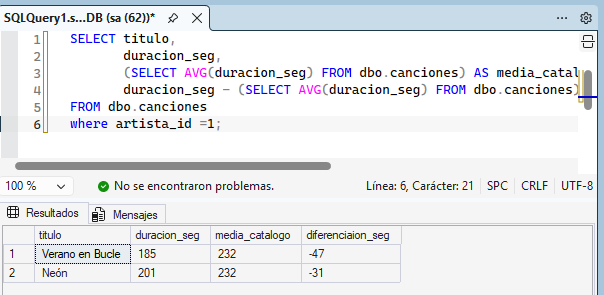{width="5.905555555555556in"
height="2.884027777777778in"}

**Pregunta de negocio:** para las canciones de Luna Roja (artista 1),
¿Cuánto se desvía su duración de la media del catálogo?

La canción verano en bucle tiene una duración inferior en 47 segundos
sobre la media general y la canción Neón tiene una duración 31 segundos
menor que la media que está estimada en 232

Para obtener los decimales de la duración he multiplicado la
duración_seg \* 1.0 para cambiar el tipo de dato de int a decimal

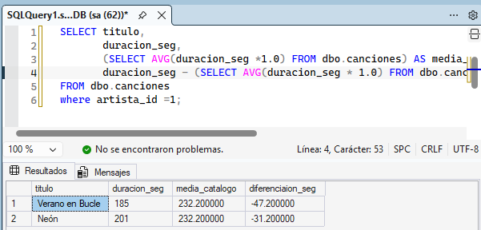{width="5.905555555555556in"
height="2.829861111111111in"}

## Ejemplo 3. Subconsulta de lista con IN (y subconsultas anidadas)

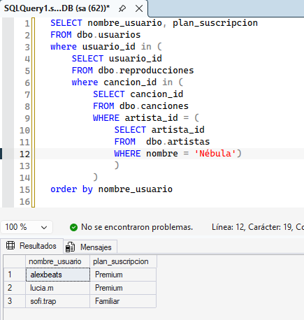{width="4.531882108486439in"
height="4.771499343832021in"}

**Pregunta de negocio:** Marketing quiere enviar una notificación a los
usuarios que han escuchado alguna canción de **Nébula**.

Los usuarios que han escuchado la canción nébula son los listados en la
tabla superior

## Ejemplo 4. Tabla derivada en FROM

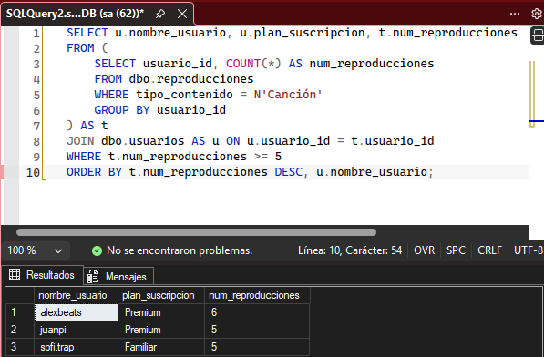{width="5.905555555555556in"
height="3.877083333333333in"}

## Ejemplo 5. Subconsulta correlacionada

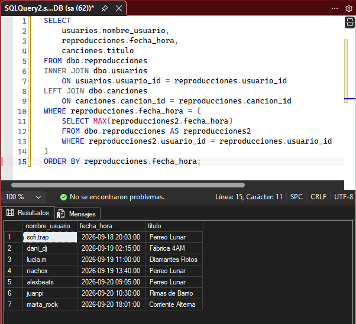{width="5.905555555555556in"
height="5.375694444444444in"}

## Ejemplo 6. EXISTS

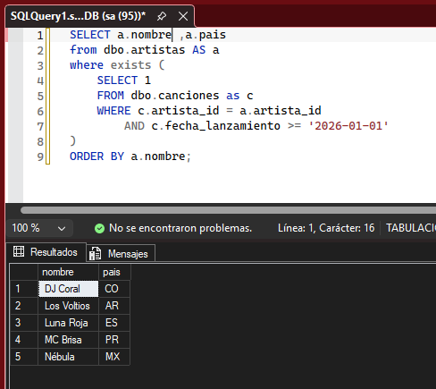{width="5.084043088363955in"
height="4.531882108486439in"}

## Ejemplo 7. La trampa de NOT IN con valores NULL

Primer intento usando not in

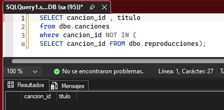{width="4.583973097112861in"
height="2.2503138670166227in"}

La consulta no devuelve valores porque el usar not in los valores null
producen que la consulta de fallo y no devuelva nada

Consulta correcta

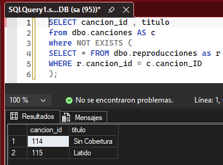{width="3.8130325896762907in"
height="2.8337292213473315in"}

## Ejemplo 8. NOT EXISTS como anti-join para la carga incremental

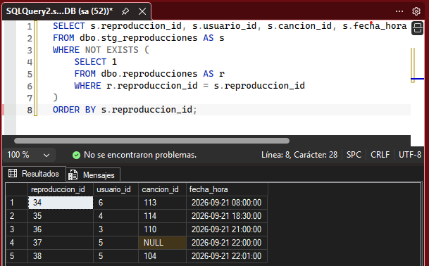{width="5.905555555555556in"
height="3.665277777777778in"}

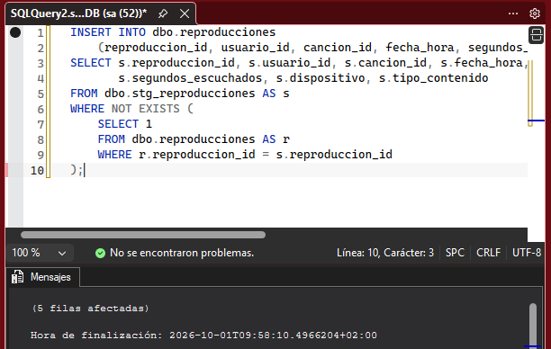{width="5.905555555555556in"
height="3.74375in"}

##  Ejemplo 9. CTE simple

Uso de una cte

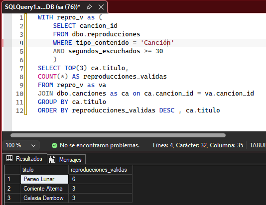{width="5.563276465441819in"
height="4.292265966754155in"}

Uso de una subconsulta

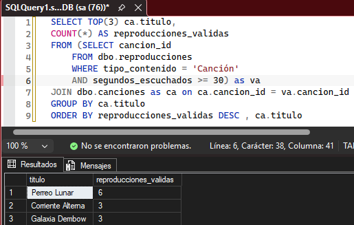{width="5.365332458442695in"
height="3.406725721784777in"}

## Ejemplo 10. CTE encadenadas como pipeline

Cte encadenada

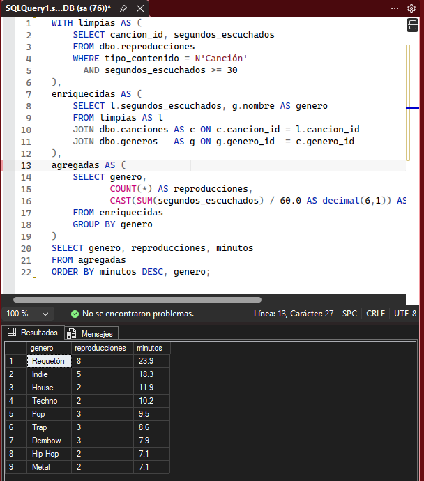{width="5.905555555555556in"
height="6.702083333333333in"}

Subconsulta

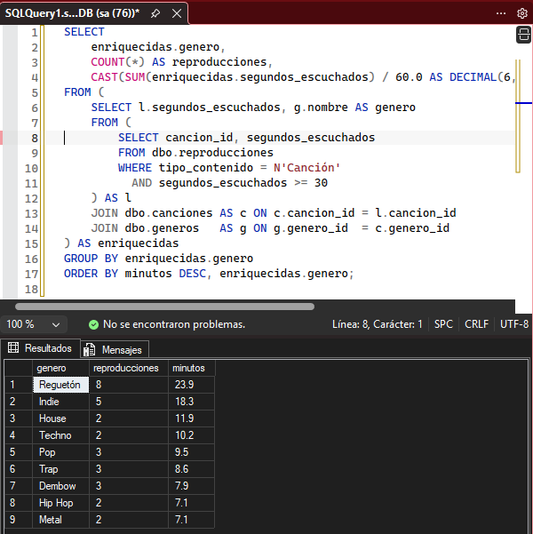{width="5.905555555555556in"
height="5.915277777777778in"}

## Ejemplo 11. CTE recursiva: árbol de géneros

cte

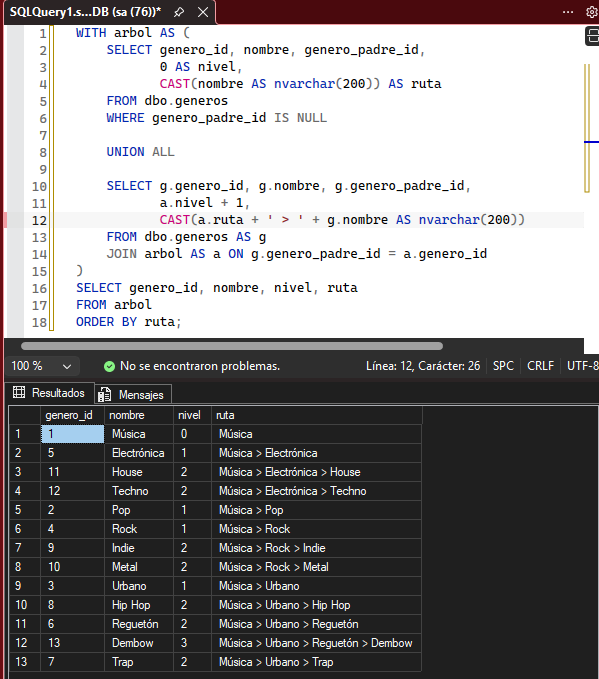{width="5.905555555555556in"
height="6.694444444444445in"}

## Ejemplo 12. CTE recursiva combinada con agregación

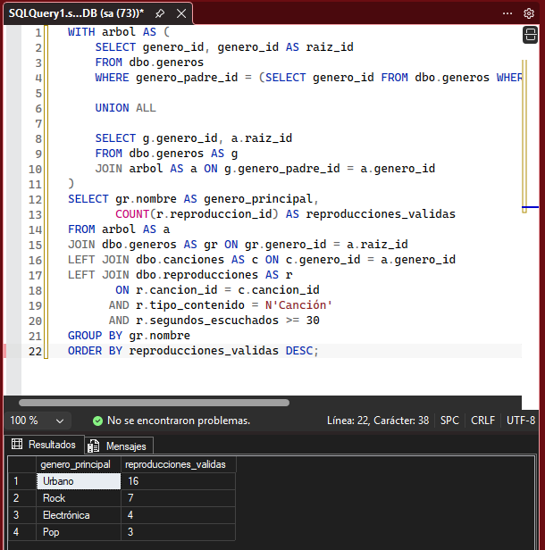{width="5.905555555555556in"
height="5.963888888888889in"}

##  Ejemplo 13. CTE recursiva para generar fechas y MAXRECURSION

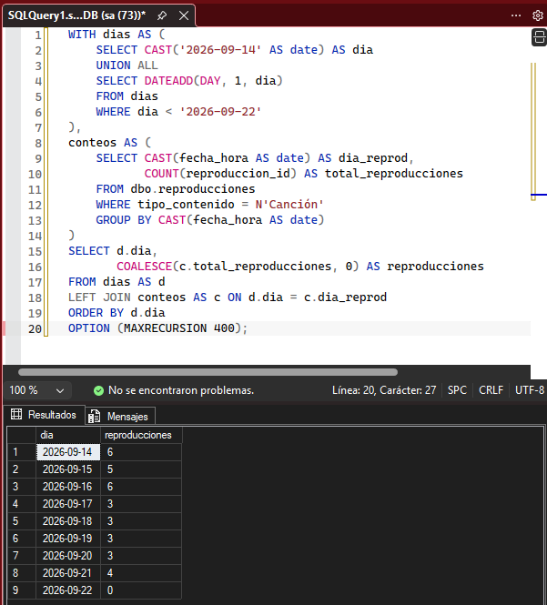{width="5.905555555555556in"
height="6.534027777777778in"}

## Ejemplo 14. CTE frente a subconsulta: reutilizar un resultado

PARTE 1

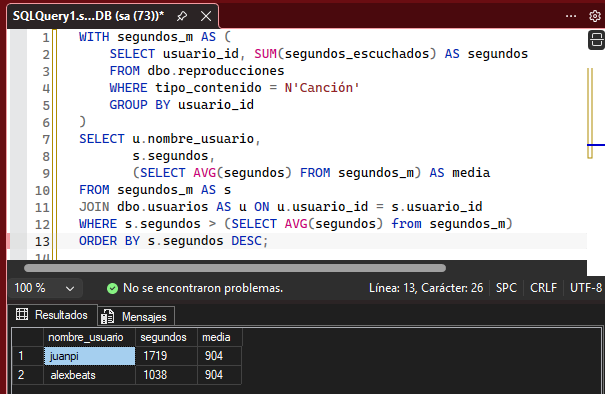{width="5.905555555555556in"
height="3.845833333333333in"}

PARTE 2

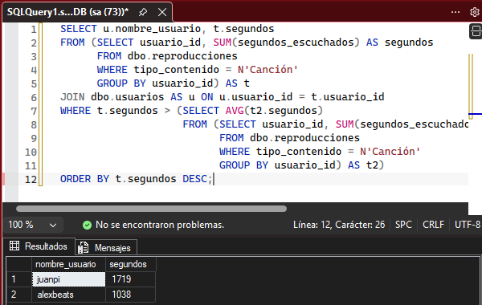{width="5.905555555555556in"
height="3.7395833333333335in"}

# Ejercicios

## Ejercicio 1

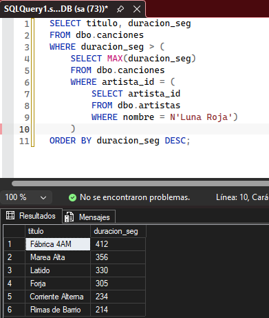{width="4.073485345581802in"
height="4.8027537182852145in"}

## EJERCICIO 2

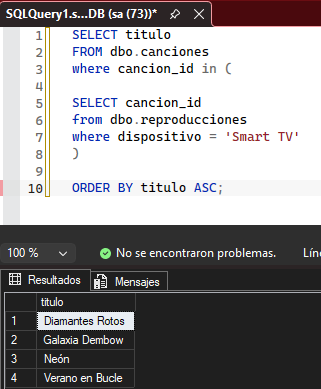{width="3.34421697287839in"
height="4.052648731408574in"}

## Ejercicio 3

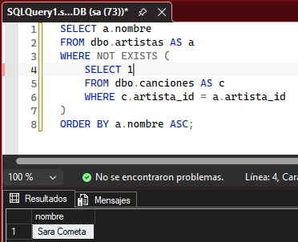{width="3.875541338582677in"
height="3.1462718722659666in"}

## Ejercicio 4

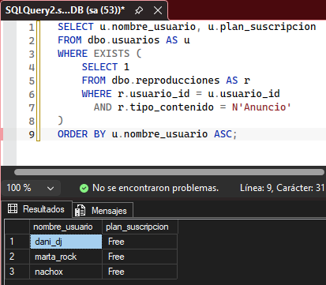{width="4.302683727034121in"
height="3.760941601049869in"}

## Ejercicio 5

Usando having 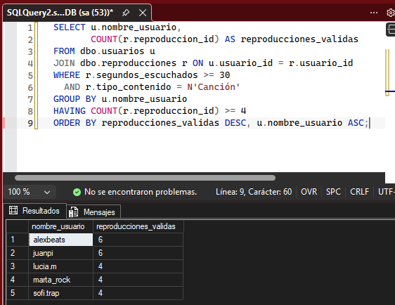{width="5.5in"
height="4.247330489938758in"}

Usando subconsulta

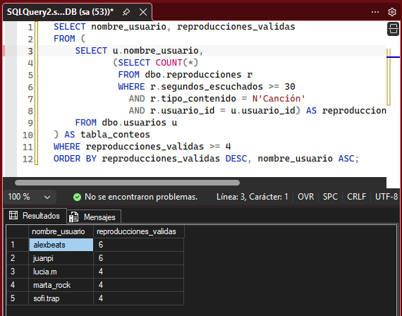{width="5.116279527559055in"
height="4.020707567804025in"}

Usando cte

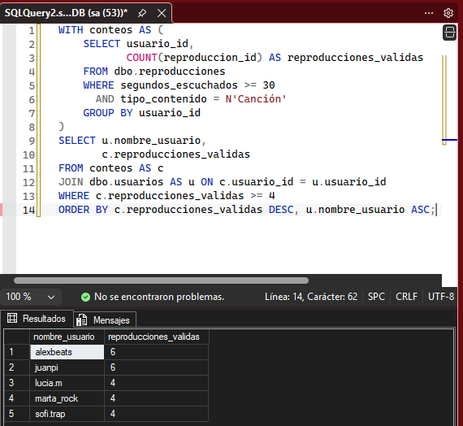{width="5.905555555555556in"
height="5.429166666666666in"}

## Ejercicio 6

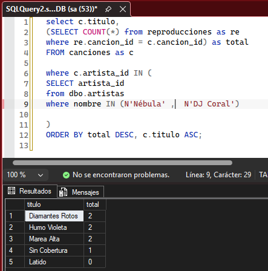{width="4.615227471566055in"
height="4.667318460192476in"}

## Ejercicio 7

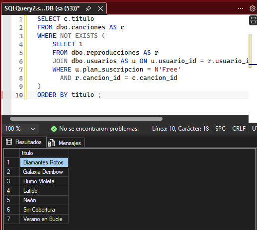{width="5.386167979002624in"
height="4.823590332458442in"}

El fallo se produce porque la cláusula not in al haber nulos los datos
de tipo unkown produce que falle la consulta

## Ejercicio 8

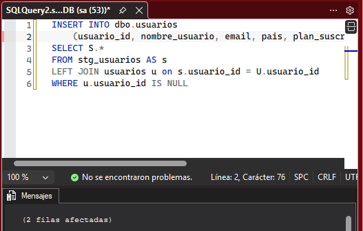{width="5.490349956255468in"
height="3.4900699912510937in"}

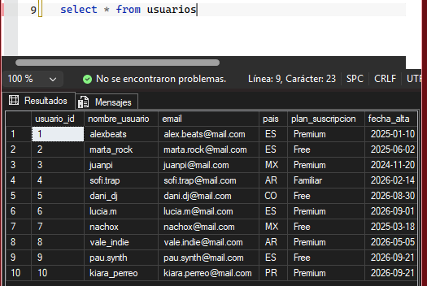{width="5.46951334208224in"
height="3.667178477690289in"}

## Ejercicio 9

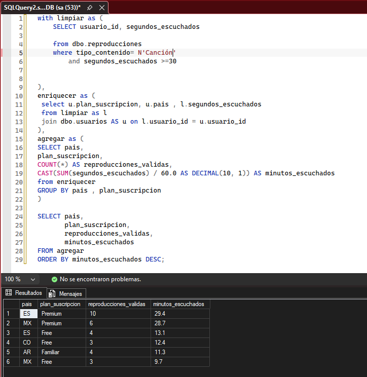{width="5.905555555555556in"
height="6.06875in"}

## Ejercicio 10

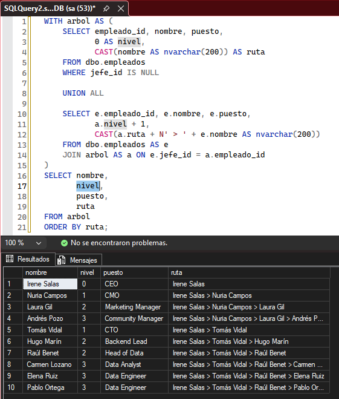{width="5.84456583552056in"
height="6.865541338582677in"}

## Ejercicio 11

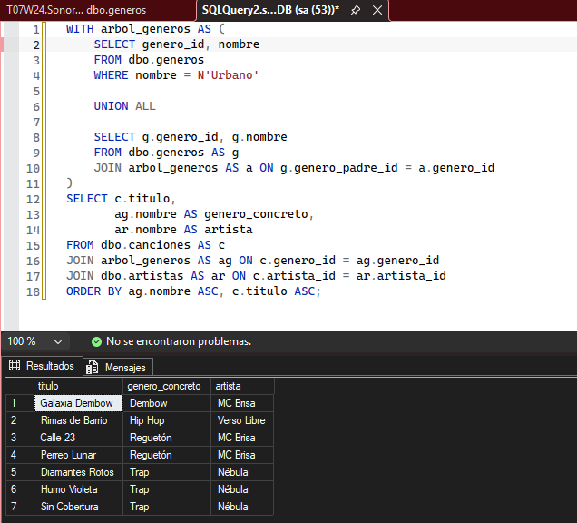{width="5.905555555555556in"
height="5.348611111111111in"}

## Ejercicio 12

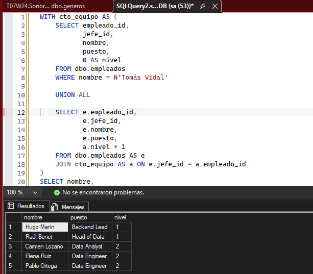{width="5.905555555555556in"
height="5.173611111111111in"}

# Vistas

## Ejercicio 1 

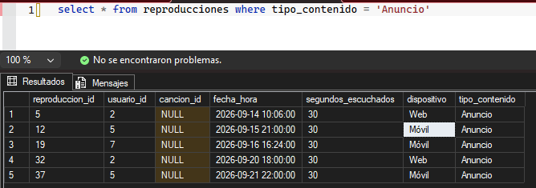{width="5.905555555555556in"
height="2.0770833333333334in"}

Mi bbdd tiene solo estos valores tres de Movil y dos de web

Vista

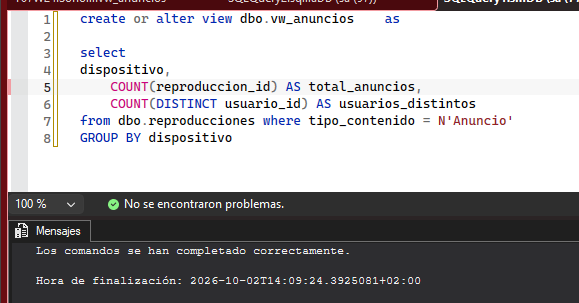{width="5.905555555555556in"
height="3.0902777777777777in"}

Resultado de la vista

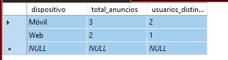{width="3.9484678477690287in"
height="1.0418121172353456in"}

## Vista 2

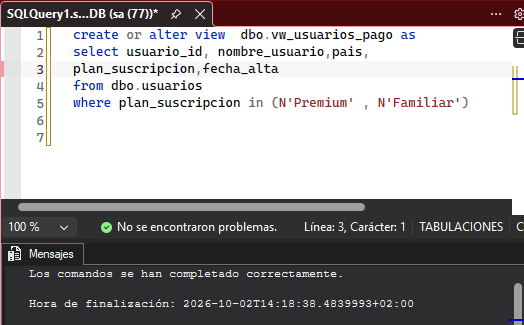{width="5.459095581802274in"
height="3.3858891076115487in"}

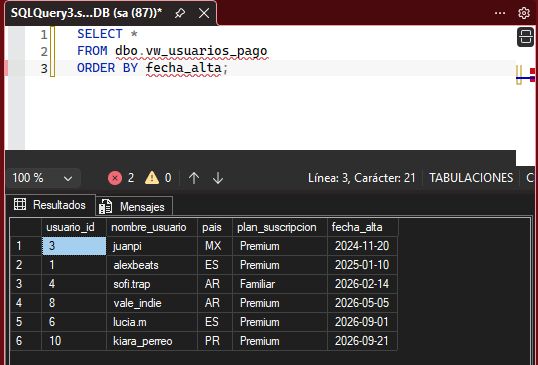{width="5.604948600174978in"
height="3.802613735783027in"}

## Vista 3

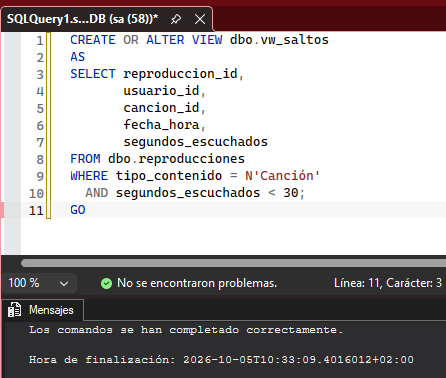{width="4.646481846019247in"
height="3.938050087489064in"}

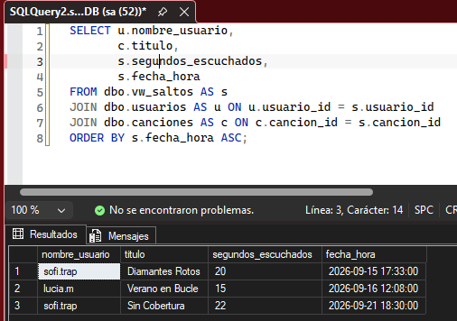{width="5.2715693350831145in"
height="3.708850612423447in"}

## Vista 4

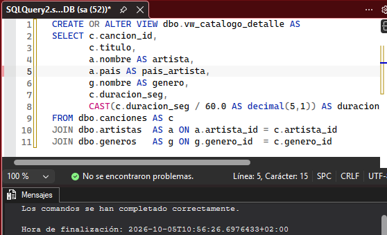{width="5.813311461067366in"
height="3.542160979877515in"}

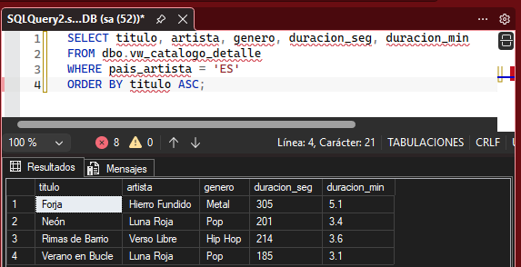{width="5.905555555555556in"
height="3.029861111111111in"}

Sara cometa no aparece porque no tiene ninguna canción registrada y al
hacer el join desaparece

## Vista 5

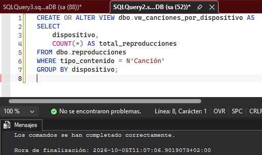{width="5.344495844269466in"
height="3.17752624671916in"}

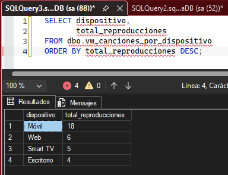{width="4.0005588363954505in"
height="3.06292760279965in"}

Los resultados obtenidos han cambiado algo sobre los esperados

  --------------------------------------
  **dispositivo**   **reproducciones**
  ----------------- --------------------
  Móvil             21

  Web               7

  Smart TV          5

  Escritorio        4
  --------------------------------------

Los problemas presentes en la consulta order by no esta permitido en las
vistas sinos que hay que hacerlo al momento de mostrar la vista y la
ausencia del alias en la columna calculada count

## Vista 6

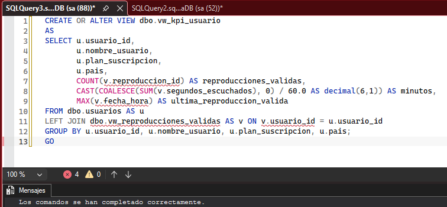{width="5.905555555555556in"
height="2.734027777777778in"}

Parte a

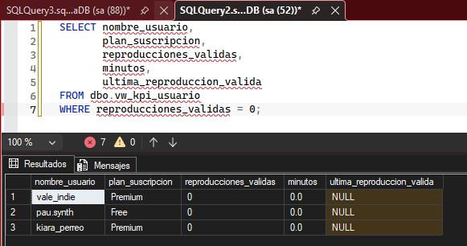{width="5.905555555555556in"
height="3.109722222222222in"}

Parte b

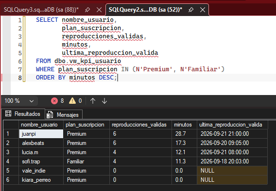{width="5.905555555555556in"
height="4.095833333333333in"}

## Vista 7

{width="5.552858705161855in"
height="7.782335958005249in"}

{width="5.905555555555556in"
height="3.44375in"}

Parte a

{width="3.43798009623797in"
height="3.448397856517935in"}

Parte b

{width="3.125436351706037in"
height="3.135854111986002in"}

## Vista 8

{width="5.905555555555556in"
height="3.2895833333333333in"}

## Vista 9

{width="5.905555555555556in"
height="2.7083333333333335in"}

{width="4.563136482939632in"
height="4.125575240594926in"}

## Vista 10

Parte a

{width="5.156969597550306in"
height="5.4382589676290465in"}

Parte b

{width="5.905555555555556in"
height="1.6284722222222223in"}

Parte c

{width="5.905555555555556in"
height="2.620833333333333in"}

## Vista 11

Parte a

{width="5.417422353455818in"
height="4.729827209098863in"}

Parte b

{width="5.905555555555556in"
height="3.4in"}

Parte c

{width="5.905555555555556in"
height="3.807638888888889in"}

# Parte 3

[]{#_Toc242171829 .anchor}Requerimiento 1

{width="5.905555555555556in"
height="7.36875in"}

Resultado de la vista

{width="5.905555555555556in"
height="3.252083333333333in"}

## Requerimiento 2

{width="5.905555555555556in"
height="4.915277777777778in"}

{width="4.594390857392826in"
height="2.5524398512685913in"}

## Requerimiento 3

{width="5.3340780839895015in"
height="6.417562335958006in"}

## Requisito 4 

{width="5.905555555555556in"
height="4.201388888888889in"}

## Requerimiento 5

{width="5.905555555555556in"
height="4.909722222222222in"}

\- a) Que se puede cambiar el plan de nachox a \`Premium\`.

\- b) Que no se puede cambiar el país de juanpi a \`ES\`.

\- c) Que un intento de modificar a marta_rock (España) a través de la
vista no afecta a ninguna fila.

{width="5.396586832895888in"
height="4.792335958005249in"}

##  Requerimiento 6

{width="5.636202974628172in"
height="7.032230971128609in"}

Cambio del tamaño del campo

Si se intentara realizar el cambio del tamaño del campo se produciría un
error porque la vista bloquea ese cambio al estar protegida para poder
realizar el cambio seria necesario eliminar la vista realizar el cambio
de tamaño y volver a hacer la vista de nuevo

## Requerimiento 7

Parte a vista vw_bi que leen de la tabal dbo,reproducciones

{width="5.905555555555556in"
height="2.6152777777777776in"}

Parte b vistas que leen de dbo.vw_bi_hechos_reproducion

{width="5.905555555555556in"
height="1.7729166666666667in"}
