# Clase 14

# Ejercicios 

## Ejercicio1

consulta

DROP TABLE IF EXISTS dbo.artistas_copia;

SELECT \*

INTO dbo.artistas_copia

FROM dbo.artistas;

Salida

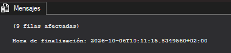{width="4.031812117235345in"
height="0.9376312335958005in"}

## Ejercicio 2

Consulta

DROP TABLE IF EXISTS dbo.usuarios_latam;

SELECT usuario_id, nombre_usuario, pais, plan_suscripcion

INTO dbo.usuarios_latam

FROM dbo.usuarios

WHERE pais IN (\'MX\', \'AR\', \'CO\', \'PR\');

Resultado

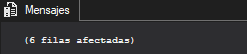{width="2.5732753718285215in"
height="0.5625787401574803in"}

Consulta ordenada del resultado

SELECT TOP (1000) \[usuario_id\]

,\[nombre_usuario\]

,\[pais\]

,\[plan_suscripcion\]

FROM \[SonoraDB\].\[dbo\].\[usuarios_latam\]

ORDER BY pais, nombre_usuario

Resultado

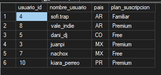{width="3.448397856517935in"
height="1.6043908573928258in"}

## Ejercicio 3

Consulta para crear la tabla

DROP TABLE IF EXISTS dbo.stg_usuarios_2309

select \*

into dbo.stg_usuarios_2309

from dbo.usuarios

where 1=0;

salida

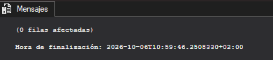{width="4.073485345581802in"
height="0.9063768591426071in"}

comprobación que no hay filas

SELECT \*

FROM dbo.stg_usuarios_2309;

Salida

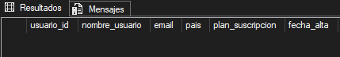{width="4.469373359580053in"
height="0.7605227471566054in"}

Comprobación de la estructura

SELECT \*

FROM INFORMATION_SCHEMA.COLUMNS

WHERE TABLE_NAME = \'stg_usuarios_2309\'

AND TABLE_SCHEMA = \'dbo\';

Resultado

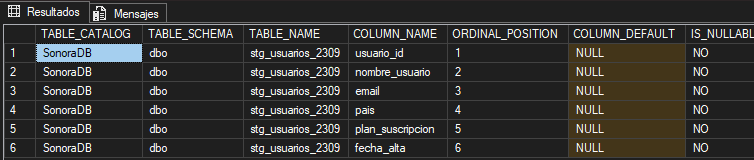{width="5.905555555555556in"
height="1.2527777777777778in"}

Se podría insertar dos veces una fila con usuario_id=1 si se podría ya
que en una cta no se compian las claves primarias ni las restricciones
que tuviera la tabla de origen y una fila con email en null la respuesta
a esta pregunta es que depende ya que todo depende de si la tabla de
origen permitía nulos o no ya que eso si se hereda

## Ejercicio 4

Creación de la tabla

DROP TABLE IF EXISTS dbo.anuncios_emitidos

select reproduccion_id,usuario_id , fecha_hora , dispositivo

into dbo.anuncios_emitidos

from dbo.reproducciones

where tipo_contenido = N\'Anuncio\';

resultado

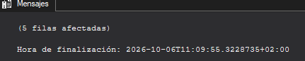{width="4.490209973753281in"
height="0.8959580052493439in"}ç

Muestra ordenada

select \*

from dbo.anuncios_emitidos

order by reproduccion_id

salida

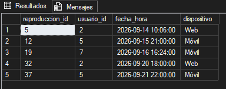{width="4.0005588363954505in"
height="1.5731364829396326in"}

##  Ejercicio 5

Consulta corregida

SELECT

u.pais AS pais_usuario,

a.pais AS pais_artista,

COUNT(\*) AS total_reproducciones

INTO dbo.cruce_paises

FROM dbo.reproducciones AS r

JOIN dbo.usuarios AS u ON u.usuario_id = r.usuario_id

JOIN dbo.canciones AS c ON c.cancion_id = r.cancion_id

JOIN dbo.artistas AS a ON a.artista_id = c.artista_id

WHERE r.tipo_contenido = N\'Canción\'

AND r.segundos_escuchados \>= 30

GROUP BY u.pais, a.pais;

Resultado

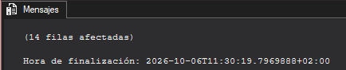{width="4.521464348206474in"
height="0.9167946194225722in"}

Los problemas presentes son que las tablas no tenían alias por lo que
había un problema de duplicados y el segundo problema presente es que
las columnas calculadas en una cta exigen tener un alias obligatorio

## Ejercicio 6

Creación de la tabla

drop table if exists dbo.canciones_ficha

select c.cancion_id, c.titulo,

cast(c.duracion_seg / 60.0 as decimal(4,1))as duracion_min,

cast( case when c.duracion_seg \>= 300 then \'Larga\'

when c.duracion_seg between 180 and 299 then \'Media\'

else \'Corta\'

END AS varchar(10)) AS categoria

into dbo.canciones_ficha

from dbo.canciones as c

salida

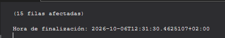{width="4.583973097112861in"
height="0.7813593613298337in"}

Comprobación de los tipos creados

SELECT \*

FROM INFORMATION_SCHEMA.COLUMNS

WHERE TABLE_NAME = \'canciones_ficha\'

AND TABLE_SCHEMA = \'dbo\';

resultado

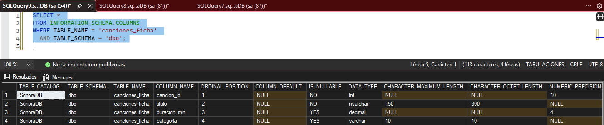{width="5.905555555555556in"
height="1.2291666666666667in"}

Cuenta de las canciones de cada categoría

select categoria, count(categoria) as numerocanciones

from dbo.canciones_ficha

group by categoria

order by categoria asc

resultado

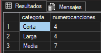{width="2.0836242344706912in"
height="1.0939031058617672in"}

##  Ejercicio 7 

Creación de la tabla

DROP TABLE IF EXISTS dbo.seguimiento_lanzamientos;

SELECT cancion_id,

titulo,

fecha_lanzamiento,

CAST(N\'Sin revisar\' AS nvarchar(30)) AS estado,

CAST(NULL AS nvarchar(100)) AS revisado_por,

CAST(NULL AS date) AS fecha_revision

INTO dbo.seguimiento_lanzamientos

FROM dbo.canciones

WHERE fecha_lanzamiento \>= \'2026-08-01\';

GO

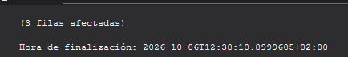{width="4.521464348206474in"
height="0.739686132983377in"}

Primera revisión

UPDATE dbo.seguimiento_lanzamientos

SET estado = N\'Revisado: apta para portada\',

revisado_por = N\'Carmen Lozano\',

fecha_revision = \'2026-09-23\'

WHERE titulo = N\'Galaxia Dembow\';

GO

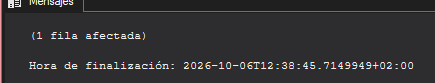{width="4.531882108486439in"
height="0.8647036307961505in"}

Tabla ordenada por fecha de lanzamiento

SELECT cancion_id,

titulo,

fecha_lanzamiento,

estado,

revisado_por,

fecha_revision

FROM dbo.seguimiento_lanzamientos

ORDER BY fecha_lanzamiento ASC;

Resultado

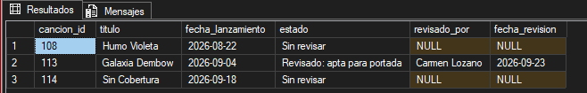{width="5.905555555555556in"
height="0.9423611111111111in"}

## Ejercicio 8

Consulta

DROP TABLE IF EXISTS dbo.catalogo_completo;

SELECT c.cancion_id,

c.titulo,

a.nombre AS artista,

a.pais AS pais_artista,

g.nombre AS genero,

gp.nombre AS genero_padre

INTO dbo.catalogo_completo

FROM dbo.canciones AS c

JOIN dbo.artistas AS a ON a.artista_id = c.artista_id

JOIN dbo.generos AS g ON g.genero_id = c.genero_id

JOIN dbo.generos AS gp ON gp.genero_id = g.genero_padre_id;

GO

Resultado

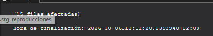{width="4.583973097112861in"
height="0.7917771216097987in"}

Contado de las canciones por subgénero

SELECT genero_padre,

COUNT(\*) AS canciones

FROM dbo.catalogo_completo

GROUP BY genero_padre

ORDER BY canciones DESC, genero_padre ASC;+

Salida

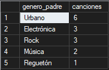{width="1.8960979877515312in"
height="1.2293383639545057in"}

## Ejercicio 9

Creación de la tabla

DROP TABLE IF EXISTS dbo.actividad_usuarios;

SELECT

usu.usuario_id,

usu.nombre_usuario,

usu.plan_suscripcion,

COUNT(CASE WHEN rep.tipo_contenido = \'Canción\' AND
rep.segundos_escuchados \>= 30 THEN 1 END) AS validas,

COUNT(CASE WHEN rep.tipo_contenido = \'Canción\' AND
rep.segundos_escuchados \< 30 THEN 1 END) AS saltos,

COUNT(CASE WHEN rep.tipo_contenido = \'Anuncio\' THEN 1 END ) AS
Anuncios

INTO dbo.actividad_usuarios

FROM dbo.usuarios AS usu

LEFT JOIN dbo.reproducciones AS rep ON rep.usuario_id = usu.usuario_id

GROUP BY

usu.usuario_id,

usu.nombre_usuario,

usu.plan_suscripcion;

resultado

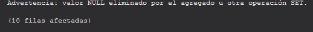{width="5.396586832895888in"
height="0.5625787401574803in"}

Mostrado

SELECT \[usuario_id\]

,\[nombre_usuario\]

,\[plan_suscripcion\]

,\[validas\]

,\[saltos\]

,\[Anuncios\]

FROM \[SonoraDB\].\[dbo\].\[actividad_usuarios\]

order by usuario_id

resultado

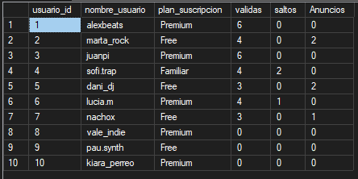{width="4.625645231846019in"
height="2.3128226159230096in"}

## Ejercicio 10

Cte recursiva

DROP TABLE IF EXISTS dbo.organigrama_plano;

WITH arbol AS (

\-- Caso base el CEO quien no tiene jefe

SELECT empleado_id, nombre, puesto, jefe_id, 0 AS nivel,

CAST(nombre AS nvarchar(500)) AS ruta

FROM dbo.empleados

WHERE jefe_id IS NULL

UNION ALL

\-- Caso recursivo

SELECT e.empleado_id, e.nombre, e.puesto, e.jefe_id, a.nivel + 1,

CAST(a.ruta + N\' \> \' + e.nombre AS nvarchar(500))

FROM dbo.empleados AS e

JOIN arbol AS a ON e.jefe_id = a.empleado_id

)

SELECT empleado_id, nombre, puesto, nivel, ruta

INTO dbo.organigrama_plano

FROM arbol;

Resultado

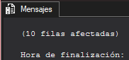{width="1.8960979877515312in"
height="0.8855402449693788in"}

Cuenta los empleados

SELECT nivel,

COUNT(\*) AS empleados

FROM dbo.organigrama_plano

GROUP BY nivel

ORDER BY nivel ASC;

Resultado

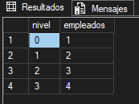{width="1.802334864391951in"
height="1.3439370078740158in"}

Lista con like

SELECT nombre, puesto, nivel

FROM dbo.organigrama_plano

WHERE ruta LIKE N\'%Raúl Benet%\'

ORDER BY nivel ASC, nombre ASC;

Resultado

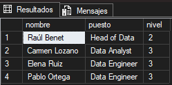{width="2.59411198600175in"
height="1.2918471128608924in"}

## Ejercicio 11

Creación de la tabla

DROP TABLE IF EXISTS dbo.personas_por_pais;

SELECT pais,

CAST(N\'Usuario\' AS nvarchar(10)) AS tipo,

nombre_usuario AS nombre

INTO dbo.personas_por_pais

FROM dbo.usuarios

UNION ALL

SELECT pais,

CAST(N\'Artista\' AS nvarchar(10)) AS tipo,

nombre

FROM dbo.artistas;

Resultado

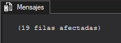{width="2.0836242344706912in"
height="0.7501049868766404in"}

Mostar usarios y clientes por pais

SELECT pais,

SUM(CASE WHEN tipo = N\'Usuario\' THEN 1 ELSE 0 END) AS usuarios,

SUM(CASE WHEN tipo = N\'Artista\' THEN 1 ELSE 0 END) AS artistas

FROM dbo.personas_por_pais

GROUP BY pais

ORDER BY usuarios DESC, pais ASC;

Resultado

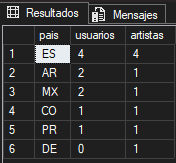{width="1.8335892388451445in"
height="1.698153980752406in"}

## Ejercicio 12

Creación de la foto

DROP TABLE IF EXISTS dbo.foto_usuarios_plan;

SELECT plan_suscripcion,

COUNT(\*) AS usuarios

INTO dbo.foto_usuarios_plan

FROM dbo.usuarios

GROUP BY plan_suscripcion;

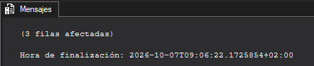{width="4.604809711286089in"
height="0.9688856080489939in"}

Mostar planes

BEGIN TRAN;

UPDATE dbo.usuarios

SET plan_suscripcion = N\'Premium\'

WHERE nombre_usuario = N\'nachox\';

SELECT COALESCE(f.plan_suscripcion, a.plan_suscripcion) AS
plan_suscripcion,

f.usuarios AS usuarios_foto,

a.usuarios AS usuarios_ahora

FROM dbo.foto_usuarios_plan AS f

FULL JOIN (

SELECT plan_suscripcion, COUNT(\*) AS usuarios

FROM dbo.usuarios

GROUP BY plan_suscripcion

) AS a ON a.plan_suscripcion = f.plan_suscripcion

WHERE COALESCE(f.usuarios, 0) \<\> COALESCE(a.usuarios, 0);

ROLLBACK;

Resultado

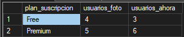{width="3.1566907261592303in"
height="0.635505249343832in"}

## Ejercicio 13

Creación tabla

DROP TABLE IF EXISTS dbo.ranking_artistas_nueva;

SELECT a.artista_id,

a.nombre AS artista,

COUNT(r.reproduccion_id) AS reproducciones_validas,

COUNT(DISTINCT r.usuario_id) AS oyentes

INTO dbo.ranking_artistas_nueva

FROM dbo.artistas AS a

JOIN dbo.canciones AS c ON c.artista_id = a.artista_id

JOIN dbo.reproducciones AS r ON r.cancion_id = c.cancion_id

WHERE r.tipo_contenido = N\'Canción\'

AND r.segundos_escuchados \>= 30

GROUP BY a.artista_id, a.nombre;

ALTER TABLE dbo.ranking_artistas_nueva

ALTER COLUMN artista_id int NOT NULL;

SELECT (SELECT COUNT(\*) FROM dbo.ranking_artistas_nueva) AS
filas_nueva,

(SELECT COUNT(\*) FROM (

SELECT artista_id

FROM dbo.ranking_artistas_nueva

GROUP BY artista_id

HAVING COUNT(\*) \> 1

) AS repetidos) AS ids_repetidos;

BEGIN TRAN;

DROP TABLE IF EXISTS dbo.ranking_artistas;

EXEC sp_rename N\'dbo.ranking_artistas_nueva\', N\'ranking_artistas\';

ALTER TABLE dbo.ranking_artistas

ADD CONSTRAINT PK_ranking_artistas PRIMARY KEY (artista_id);

COMMIT;

SELECT artista,

reproducciones_validas,

oyentes

FROM dbo.ranking_artistas

ORDER BY reproducciones_validas DESC, artista ASC;

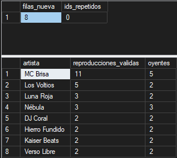{width="3.1566907261592303in"
height="2.8233103674540683in"}

# Parte 2

## Ejercicio 1

DROP TABLE IF EXISTS #lanzamientos_2026;

SELECT c.cancion_id,

c.titulo,

a.nombre AS artista,

c.fecha_lanzamiento

INTO #lanzamientos_2026

FROM dbo.canciones AS c

JOIN dbo.artistas AS a ON c.artista_id = a.artista_id

WHERE c.fecha_lanzamiento \>= \'2026-01-01\' AND c.fecha_lanzamiento \<
\'2027-01-01\';

SELECT artista,

COUNT(\*) AS lanzamientos

FROM #lanzamientos_2026

GROUP BY artista

ORDER BY lanzamientos DESC, artista ASC;

Resultado

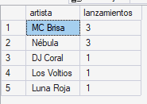{width="1.9273523622047244in"
height="1.3647736220472442in"}

## Ejercicio 2

DROP TABLE IF EXISTS #usuarios_pago;

CREATE TABLE #usuarios_pago (

usuario_id INT PRIMARY KEY,

nombre_usuario NVARCHAR(100),

pais CHAR(2),

plan_suscripcion NVARCHAR(20)

);

INSERT INTO #usuarios_pago (usuario_id, nombre_usuario, pais,
plan_suscripcion)

SELECT usuario_id, nombre_usuario, pais, plan_suscripcion

FROM dbo.usuarios

WHERE plan_suscripcion IN (N\'Premium\', N\'Familiar\');

SELECT pais,

COUNT(\*) AS usuarios_pago

FROM #usuarios_pago

GROUP BY pais

ORDER BY usuarios_pago DESC, pais ASC;

Resultado

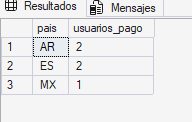{width="2.000278871391076in"
height="1.271010498687664in"}

## Ejercicio 3

DROP TABLE IF EXISTS #largas;

SELECT cancion_id, titulo, duracion_seg

INTO #largas

FROM dbo.canciones

WHERE duracion_seg \> 300;

SELECT COUNT(\*) AS canciones_largas FROM #largas;

Resultado

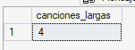{width="1.5731364829396326in"
height="0.5834142607174103in"}

## Ejercicio 4

El lote devuelve a=2 y b=2 el lote 2 falla y el lote 3 devuele e=3

## Ejercicio 5

DROP TABLE IF EXISTS #validas;

SELECT reproduccion_id,

usuario_id,

cancion_id,

segundos_escuchados,

dispositivo

INTO #validas

FROM dbo.reproducciones

WHERE tipo_contenido = N\'Canción\' AND segundos_escuchados \>= 30;

\-- a)

SELECT u.pais,

COUNT(v.reproduccion_id) AS reproducciones,

CAST(SUM(v.segundos_escuchados) / 60.0 AS decimal(10,1)) AS minutos

FROM #validas AS v

JOIN dbo.usuarios AS u ON v.usuario_id = u.usuario_id

GROUP BY u.pais

ORDER BY reproducciones DESC;

\-- b)

SELECT c.titulo

FROM dbo.canciones AS c

WHERE NOT EXISTS (

SELECT 1 FROM #validas AS v WHERE v.cancion_id = c.cancion_id

)

ORDER BY c.titulo ASC;

\-- c)

SELECT u.nombre_usuario, u.plan_suscripcion

FROM dbo.usuarios AS u

WHERE NOT EXISTS (

SELECT 1 FROM #validas AS v WHERE v.usuario_id = u.usuario_id

);

Resultado

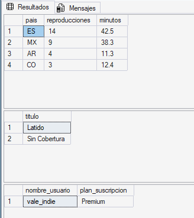{width="3.4171434820647417in"
height="3.8442869641294837in"}

## Ejercicio 6

DECLARE \@tarifas TABLE (

plan_suscripcion NVARCHAR(20),

tarifa DECIMAL(5,2)

);

INSERT INTO \@tarifas VALUES (N\'Premium\', 0.08), (N\'Familiar\',
0.08), (N\'Free\', 0.02);

SELECT u.plan_suscripcion,

CAST(SUM(v.segundos_escuchados) / 60.0 AS decimal(10,1)) AS minutos,

t.tarifa AS euros_minuto,

CAST((SUM(v.segundos_escuchados) / 60.0) \* t.tarifa AS decimal(10,2))
AS importe

FROM #validas AS v

JOIN dbo.usuarios AS u ON v.usuario_id = u.usuario_id

JOIN \@tarifas AS t ON t.plan_suscripcion = u.plan_suscripcion

GROUP BY u.plan_suscripcion, t.tarifa

ORDER BY importe DESC;

Resultado

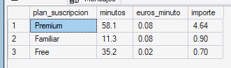{width="3.448397856517935in"
height="1.0209755030621173in"}

## Ejercicio 7

DROP TABLE IF EXISTS #catalogo;

SELECT cancion_id,

titulo,

duracion_seg,

CASE

WHEN duracion_seg \< 180 THEN \'Corta\'

WHEN duracion_seg BETWEEN 180 AND 300 THEN \'Estándar\'

ELSE \'Larga\'

END AS formato

INTO #catalogo

FROM dbo.canciones;

SELECT formato, COUNT(\*) AS canciones

FROM #catalogo

GROUP BY formato

ORDER BY canciones DESC, formato ASC;

DELETE FROM #catalogo WHERE formato = \'Corta\';

SELECT

(SELECT COUNT(\*) FROM #catalogo) AS filas_catalogo_temporal,

(SELECT COUNT(\*) FROM dbo.canciones) AS filas_canciones;

Resultado

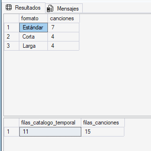{width="3.2504538495188102in"
height="3.2608716097987753in"}x

## Ejercicio 8

DROP TABLE IF EXISTS ##artistas_semana;

SELECT a.nombre AS artista,

COUNT(v.reproduccion_id) AS reproducciones,

CAST(SUM(v.segundos_escuchados) / 60.0 AS decimal(10,1)) AS minutos

INTO ##artistas_semana

FROM #validas AS v

JOIN dbo.canciones AS c ON v.cancion_id = c.cancion_id

JOIN dbo.artistas AS a ON c.artista_id = a.artista_id

GROUP BY a.nombre;

Resultado

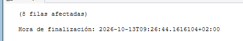{width="5.0111154855643045in"
height="0.8647036307961505in"}

Parte 2

SELECT artista, reproducciones, minutos

FROM ##artistas_semana

WHERE reproducciones \> 1

ORDER BY reproducciones DESC;

Resutado

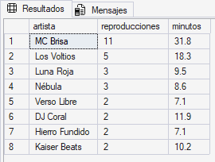{width="2.812892607174103in"
height="2.1252963692038493in"}

## Ejercicio 10

DROP TABLE IF EXISTS #arbol_generos;

WITH recursiva AS (

SELECT genero_id, nombre AS genero_principal

FROM dbo.generos

WHERE genero_padre_id IS NULL

UNION ALL

SELECT g.genero_id, r.genero_principal

FROM dbo.generos AS g

JOIN recursiva AS r ON g.genero_padre_id = r.genero_id

)

SELECT genero_id, genero_principal

INTO #arbol_generos

FROM recursiva;

\-- a)

SELECT a.genero_principal, COUNT(c.cancion_id) AS canciones

FROM #arbol_generos AS a

JOIN dbo.canciones AS c ON a.genero_id = c.genero_id

GROUP BY a.genero_principal

ORDER BY canciones DESC, a.genero_principal ASC;

\-- b)

SELECT a.genero_principal,

COUNT(r.reproduccion_id) AS reproducciones,

CAST(SUM(r.segundos_escuchados) / 60.0 AS decimal(10,1)) AS minutos

FROM #arbol_generos AS a

JOIN dbo.canciones AS c ON a.genero_id = c.cancion_id

JOIN dbo.reproducciones AS r ON r.cancion_id = c.cancion_id

WHERE r.tipo_contenido = N\'Canción\' AND r.segundos_escuchados \>= 30

GROUP BY a.genero_principal

ORDER BY reproducciones DESC;

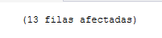{width="2.0940419947506563in"
height="0.4896511373578303in"}

Parte a

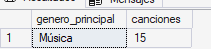{width="2.1982239720034995in"
height="0.5104877515310586in"}

Parte b

{width="4.7194083552056in"
height="1.3439370078740158in"}

## Ejercicio 11

DROP TABLE IF EXISTS #novedades;

SELECT DISTINCT cancion_id, titulo, artista_id, duracion_seg

INTO #novedades

FROM dbo.stg_canciones_2509;

SELECT cancion_id, COUNT(\*)

FROM #novedades

GROUP BY cancion_id

HAVING COUNT(\*) \> 1;

DELETE n

FROM #novedades AS n

WHERE EXISTS (

SELECT 1 FROM dbo.canciones AS c WHERE c.cancion_id = n.cancion_id

);

SELECT \* FROM #novedades ORDER BY cancion_id;

## Ejercicio 12

DROP TABLE IF EXISTS #novedades_rechazadas;

CREATE TABLE #novedades_rechazadas (

cancion_id INT,

titulo NVARCHAR(200),

motivo NVARCHAR(100)

);

INSERT INTO #novedades_rechazadas (cancion_id, titulo, motivo)

SELECT cancion_id, titulo, \'Artista inexistente\'

FROM #novedades AS n

WHERE NOT EXISTS (SELECT 1 FROM dbo.artistas AS a WHERE a.artista_id =
n.artista_id);

DELETE FROM #novedades

WHERE cancion_id IN (SELECT cancion_id FROM #novedades_rechazadas WHERE
motivo = \'Artista inexistente\');

INSERT INTO #novedades_rechazadas (cancion_id, titulo, motivo)

SELECT cancion_id, titulo, \'Duración no válida\'

FROM #novedades

WHERE duracion_seg \<= 0 OR duracion_seg IS NULL;

DELETE FROM #novedades

WHERE cancion_id IN (SELECT cancion_id FROM #novedades_rechazadas WHERE
motivo = \'Duración no válida\');

SELECT cancion_id, titulo, motivo

FROM #novedades_rechazadas;

BEGIN TRAN;

INSERT INTO dbo.canciones (cancion_id, titulo, artista_id, duracion_seg)

SELECT cancion_id, titulo, artista_id, duracion_seg

FROM #novedades;

SELECT COUNT(\*) AS filas_catalogo_dentro_tran FROM dbo.canciones;

ROLLBACK;

SELECT COUNT(\*) AS filas_catalogo_fuera_tran FROM dbo.canciones;

Resultado

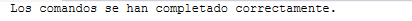{width="4.292265966754155in"
height="0.21878062117235345in"}

# Clase 15

# Parte 1

## Ejercicio 1 

CREATE OR ALTER PROCEDURE dbo.usp_usuarios_por_plan

AS

BEGIN

SET NOCOUNT ON;

SELECT plan_suscripcion, COUNT(\*) AS usuarios

FROM dbo.usuarios

GROUP BY plan_suscripcion

ORDER BY usuarios DESC;

END;

GO

EXEC dbo.usp_usuarios_por_plan;

Salida

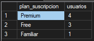{width="1.9794433508311462in"
height="0.8751224846894138in"}

## Ejercicio 2 

CREATE OR ALTER PROCEDURE dbo.usp_canciones_de_artista

\@nombre nvarchar(100)

AS

BEGIN

SET NOCOUNT ON;

SELECT c.titulo, c.duracion_seg, c.fecha_lanzamiento

FROM dbo.canciones AS c

JOIN dbo.artistas AS a ON c.artista_id = a.artista_id

WHERE a.nombre = \@nombre

ORDER BY c.fecha_lanzamiento ASC;

END;

GO

EXEC dbo.usp_canciones_de_artista \@nombre = N\'MC Brisa\';

EXEC dbo.usp_canciones_de_artista \@nombre = N\'Los Planetas\';

Salida

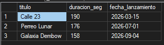{width="3.34421697287839in"
height="0.9272123797025372in"}

## Ejercicio 3 

Resultados

- A da error porque faltan parámetros

- B funciona

- C da error por posición al pasarse del rango

- D da error por la fecha

- E no da error

## Ejercicio 4

CREATE OR ALTER PROCEDURE dbo.usp_altas_desde

\@desde date,

\@pais char(2) = NULL

AS

BEGIN

SET NOCOUNT ON;

SELECT nombre_usuario, pais, plan_suscripcion, fecha_alta

FROM dbo.usuarios

WHERE fecha_alta \>= \@desde

AND (@pais IS NULL OR pais = \@pais)

ORDER BY fecha_alta ASC, nombre_usuario ASC;

END;

GO

EXEC dbo.usp_altas_desde \@desde = \'2026-01-01\';

EXEC dbo.usp_altas_desde \@desde = \'2026-01-01\', \@pais = \'ES\';

Resultado

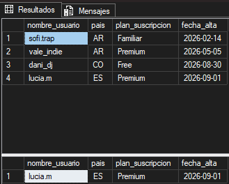{width="3.427561242344707in"
height="2.7503838582677167in"}

## Ejercicio 5

CREATE OR ALTER PROCEDURE dbo.usp_actividad_usuario

\@nombre_usuario nvarchar(50),

\@reproducciones int OUTPUT,

\@minutos decimal(8,1) OUTPUT

AS

BEGIN

SET NOCOUNT ON;

SELECT \@reproducciones = COUNT(r.reproduccion_id),

\@minutos = CAST(COALESCE(SUM(r.segundos_escuchados), 0) / 60.0 AS
decimal(8,1))

FROM dbo.usuarios AS u

LEFT JOIN dbo.reproducciones AS r

ON r.usuario_id = u.usuario_id

AND r.tipo_contenido = N\'Canción\'

AND r.segundos_escuchados \>= 30

WHERE u.nombre_usuario = \@nombre_usuario;

END;

GO

Resultado

{width="4.177666229221347in"
height="0.2604527559055118in"}

## Ejercicio 7

CREATE OR ALTER PROCEDURE dbo.usp_cifras_periodo

\@desde date,

\@hasta date,

\@reproducciones int OUTPUT,

\@minutos decimal(8,1) OUTPUT

AS

BEGIN

SET NOCOUNT ON;

SELECT \@reproducciones = COUNT(\*),

\@minutos = CAST(COALESCE(SUM(segundos_escuchados), 0) / 60.0 AS
decimal(8,1))

FROM dbo.reproducciones

WHERE tipo_contenido = N\'Canción\'

AND segundos_escuchados \>= 30

AND fecha_hora \>= \@desde

AND fecha_hora \< \@hasta;

END;

GO

EXEC dbo.usp_cifras_por_dia \@desde = \'2026-09-20\', \@hasta =
\'2026-09-25\';

Resultado

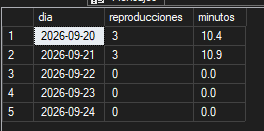{width="2.7503838582677167in"
height="1.3647736220472442in"}

# Ejercicio 8 

El select devuelve las filas del paso 1 paso 4 6 y 7 si hubiera un throw
el error mostraría la pantalla en rojo y se cortaría la ejecución si el
paso 7

## Ejercicio 9

DECLARE \@nuevo_id INT;

BEGIN TRY

EXEC dbo.usp_alta_artista \@nombre = N\'Aurora Boreal\', \@pais =
\'ES\', \@genero = N\'Synthwave\', \@artista_id = \@nuevo_id OUTPUT;

END TRY

BEGIN CATCH

PRINT ERROR_MESSAGE();

END CATCH;

EXEC dbo.usp_alta_artista \@nombre = N\'Aurora Boreal\', \@pais =
\'ES\', \@genero = N\'House\', \@artista_id = \@nuevo_id OUTPUT;

SELECT artista_id, nombre, pais, genero_id FROM dbo.artistas WHERE
artista_id = \@nuevo_id;

BEGIN TRY

EXEC dbo.usp_alta_artista \@nombre = N\'Aurora Boreal\', \@pais =
\'ES\', \@genero = N\'House\', \@artista_id = \@nuevo_id OUTPUT;

END TRY

BEGIN CATCH

PRINT ERROR_MESSAGE();

END CATCH;

Resultado

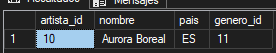{width="2.87540135608049in"
height="0.552159886264217in"}

## Ejercicio 10

Parte a

EXEC dbo.usp_baja_usuario \@nombre_usuario = N\'pau.synth\', \@motivo =
N\'Se ha cansado\';

GO

SELECT

(SELECT COUNT(\*) FROM dbo.reproducciones) AS reproducciones,

(SELECT COUNT(\*) FROM dbo.usuarios) AS usuarios,

(SELECT COUNT(\*) FROM dbo.bajas_usuarios) AS bajas;

Resultados

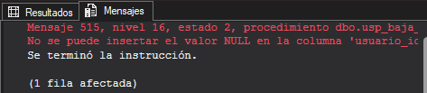{width="4.927771216097987in"
height="1.0730664916885388in"}

Parte c

plantilla

CREATE OR ALTER PROCEDURE dbo.usp_baja_usuario

\@nombre_usuario nvarchar(50),

\@motivo nvarchar(30)

AS

BEGIN

SET NOCOUNT ON;

SET XACT_ABORT ON;

DECLARE \@usuario_id int;

BEGIN TRY

SET \@usuario_id = (SELECT usuario_id FROM dbo.usuarios WHERE
nombre_usuario = \@nombre_usuario);

\-- Validación añadida

IF \@usuario_id IS NULL

THROW 50020, N\'El usuario no existe.\', 1;

BEGIN TRAN;

DELETE FROM dbo.reproducciones

WHERE usuario_id = \@usuario_id;

INSERT INTO dbo.bajas_usuarios (usuario_id, nombre_usuario, motivo)

VALUES (@usuario_id, \@nombre_usuario, \@motivo);

DELETE FROM dbo.usuarios

WHERE usuario_id = \@usuario_id;

COMMIT;

END TRY

BEGIN CATCH

IF @@TRANCOUNT \> 0 ROLLBACK;

THROW;

END CATCH;

END;

GO

Resultado

BEGIN TRY

EXEC dbo.usp_baja_usuario \@nombre_usuario = N\'pau.synth\', \@motivo =
N\'Se ha cansado\';

END TRY

BEGIN CATCH

PRINT ERROR_MESSAGE();

END CATCH;

GO

SELECT

(SELECT COUNT(\*) FROM dbo.reproducciones) AS reproducciones,

(SELECT COUNT(\*) FROM dbo.usuarios) AS usuarios,

(SELECT COUNT(\*) FROM dbo.bajas_usuarios) AS bajas;

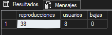{width="2.3961679790026245in"
height="0.7605227471566054in"}

Tramitar la baja

EXEC dbo.usp_baja_usuario \@nombre_usuario = N\'pau.synth\', \@motivo =
N\'Solicitud del usuario\';

GO

SELECT

(SELECT COUNT(\*) FROM dbo.reproducciones) AS reproducciones,

(SELECT COUNT(\*) FROM dbo.usuarios) AS usuarios,

(SELECT COUNT(\*) FROM dbo.bajas_usuarios) AS bajas;

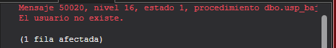{width="5.073624234470691in"
height="0.729268372703412in"}

## Ejercicio 11

Re escritura

CREATE OR ALTER PROCEDURE dbo.usp_refrescar_resumen_diario

\@desde date,

\@hasta date

AS

BEGIN

SET NOCOUNT ON;

SET XACT_ABORT ON;

DECLARE \@log_id int, \@insertadas int = 0;

INSERT INTO dbo.log_cargas (proceso, inicio, estado)

VALUES (N\'usp_refrescar_resumen_diario\', SYSDATETIME(), N\'En
curso\');

SET \@log_id = SCOPE_IDENTITY();

BEGIN TRY

IF \@desde IS NULL OR \@hasta IS NULL OR \@desde \>= \@hasta

THROW 50001, N\'Periodo no válido: \@desde debe ser anterior a
\@hasta.\', 1;

BEGIN TRAN;

DELETE FROM dbo.resumen_diario

WHERE dia \>= \@desde AND dia \< \@hasta;

INSERT INTO dbo.resumen_diario (dia, reproducciones, oyentes, minutos)

SELECT CAST(r.fecha_hora AS date),

COUNT(\*),

COUNT(DISTINCT r.usuario_id),

CAST(SUM(r.segundos_escuchados) / 60.0 AS decimal(8,1))

FROM dbo.reproducciones AS r

WHERE r.tipo_contenido = N\'Canción\'

AND r.segundos_escuchados \>= 30

AND r.fecha_hora \>= \@desde

AND r.fecha_hora \< \@hasta

GROUP BY CAST(r.fecha_hora AS date);

SET \@insertadas = @@ROWCOUNT;

COMMIT;

UPDATE dbo.log_cargas

SET fin = SYSDATETIME(),

filas_insertadas = \@insertadas,

estado = N\'OK\'

WHERE log_id = \@log_id;

END TRY

BEGIN CATCH

IF @@TRANCOUNT \> 0 ROLLBACK;

UPDATE dbo.log_cargas

SET fin = SYSDATETIME(),

estado = N\'Error\',

mensaje_error = ERROR_MESSAGE()

WHERE log_id = \@log_id;

THROW;

END CATCH;

END;

GO

Resultado

{width="4.083903105861768in"
height="0.35421587926509185in"}

EXEC dbo.usp_refrescar_resumen_diario \@desde = \'2026-09-16\', \@hasta
= \'2026-09-23\';

BEGIN TRY

EXEC dbo.usp_refrescar_resumen_diario \@desde = \'2026-09-23\', \@hasta
= \'2026-09-16\';

END TRY

BEGIN CATCH

PRINT ERROR_MESSAGE();

END CATCH;

GO

SELECT TOP (2) proceso, filas_insertadas, estado, mensaje_error

FROM dbo.log_cargas

ORDER BY log_id DESC;

Resultado

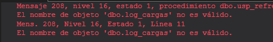{width="4.781917104111986in"
height="0.7501049868766404in"}

## Ejercicio 12

- A no es indepotente en caso de ser ejecutafo dos veces duplica los
  datos para solucionar ese error se debería usar un delete antes del
  insert

- B no es indepotente si se ejecuta 2 veces suma 10 en vez de 5 para dar
  solucion habría que poner el valor final sin aumentos

- C si es indepotente si cambiamos un valor no cambia nada

- D es indepotente si se borra un registro no se borra nada

- E no es indepotente añade una línea nueva por cada ejecución

## Ejercicio 13

DROP TABLE IF EXISTS dbo.rechazos_altas;

CREATE TABLE dbo.rechazos_altas (

log_id int NOT NULL,

usuario_id int NULL,

nombre_usuario nvarchar(50) NULL,

motivo nvarchar(60) NOT NULL

);

GO

CREATE OR ALTER PROCEDURE dbo.usp_cargar_usuarios

AS

BEGIN

SET NOCOUNT ON;

SET XACT_ABORT ON;

DECLARE \@log_id int, \@leidas int, \@insertadas int, \@rechazadas int;

INSERT INTO dbo.log_cargas (proceso, inicio, estado)

VALUES (N\'usp_cargar_usuarios\', SYSDATETIME(), N\'En curso\');

SET \@log_id = SCOPE_IDENTITY();

BEGIN TRY

SET \@leidas = (SELECT COUNT(\*) FROM dbo.stg_usuarios_2309);

SELECT DISTINCT

s.usuario_id,

s.nombre_usuario,

s.email,

s.pais,

CASE WHEN s.plan_suscripcion = N\'Family\' THEN N\'Familiar\'

ELSE s.plan_suscripcion END AS plan_suscripcion,

s.fecha_alta,

CASE

WHEN s.email IS NULL THEN N\'Email vacío\'

WHEN (CASE WHEN s.plan_suscripcion = N\'Family\' THEN N\'Familiar\'

ELSE s.plan_suscripcion END) NOT IN (N\'Free\', N\'Premium\',
N\'Familiar\')

THEN N\'Plan no reconocido\'

END AS motivo

INTO #lote_altas

FROM dbo.stg_usuarios_2309 AS s

WHERE NOT EXISTS (SELECT 1 FROM dbo.usuarios AS u WHERE u.usuario_id =
s.usuario_id);

BEGIN TRAN;

INSERT INTO dbo.rechazos_altas (log_id, usuario_id, nombre_usuario,
motivo)

SELECT \@log_id, l.usuario_id, l.nombre_usuario, l.motivo

FROM #lote_altas AS l

WHERE l.motivo IS NOT NULL;

SET \@rechazadas = @@ROWCOUNT;

INSERT INTO dbo.usuarios (usuario_id, nombre_usuario, email, pais,
plan_suscripcion, fecha_alta)

SELECT l.usuario_id, l.nombre_usuario, l.email, l.pais,
l.plan_suscripcion, l.fecha_alta

FROM #lote_altas AS l

WHERE l.motivo IS NULL

AND NOT EXISTS (SELECT 1 FROM dbo.usuarios AS u WHERE u.usuario_id =
l.usuario_id);

SET \@insertadas = @@ROWCOUNT;

COMMIT;

UPDATE dbo.log_cargas

SET fin = SYSDATETIME(),

filas_leidas = \@leidas,

filas_insertadas = \@insertadas,

filas_rechazadas = \@rechazadas,

estado = N\'OK\'

WHERE log_id = \@log_id;

END TRY

BEGIN CATCH

IF @@TRANCOUNT \> 0 ROLLBACK;

UPDATE dbo.log_cargas

SET fin = SYSDATETIME(),

filas_leidas = \@leidas,

estado = N\'Error\',

mensaje_error = ERROR_MESSAGE()

WHERE log_id = \@log_id;

THROW;

END CATCH;

END;

GO
